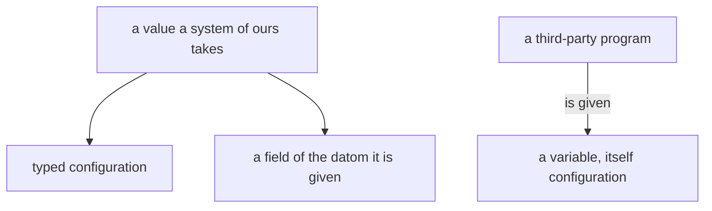

## Every layer carries its own context

A value at any layer carries the context it makes sense in, and each
layer carries only its own facts.

## Every value is configuration

A system of ours takes every value as typed configuration or as a field of the datom it is given. A variable is set only for a third-party program, and the value set is itself configuration.

```datom
; the place name picks the sockets
flow-nexus main 'Send.{ … }'
```


