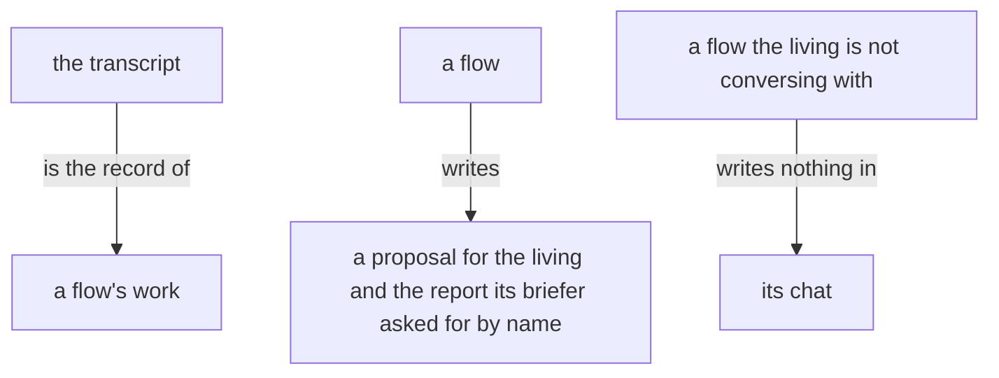

# Energy

A text is measured by the energy it costs, not by its length. What
reaches a dearer reader carries everything that reader would otherwise
spend itself to get; what reaches a cheaper reader may leave to it what
it gets cheaply. A message that saves the sender's words and makes a
dearer reader fetch has cost more, not less. A message carries the sender's
reading of what happened. A text longer than a dozen lines, a draft, a
log, a listing, an error, stays with its writer in a file, and the
message carries the path and one line saying what the file is. The
reader opens it, or sees from the line that it need not.

A text for the living is as small as its point: a comment on a proposal is a sentence or two, and the chat gives him one line.

The transcript is the record of a flow's work. A flow writes a proposal for the living and the report its briefer asked for by name.

A flow the living is not conversing with writes nothing in its chat.
