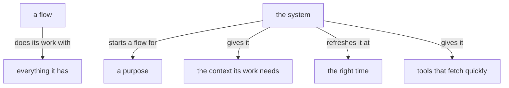

# Energy

Energy is saved by what the system chooses to do: a flow is started for a purpose, with the context its work needs, refreshed at the right time, and given tools that bring it what it needs quickly.

What a flow does, it does with everything it has.

A text is measured by the energy it costs, not by its length. What reaches a dearer reader carries everything that reader would otherwise spend itself to get; what reaches a cheaper reader may leave to it what it gets cheaply. A message that saves the sender's words and makes a dearer reader fetch has cost more, not less. A message carries the sender's reading of what happened. A flow's own text longer than a dozen lines, a draft, a log, a listing, an error, stays with its writer in a file, and the message carries the path and one line saying what the file is. The living's words travel in the message, whole, at any length. The reader opens it, or sees from the line that it need not.
