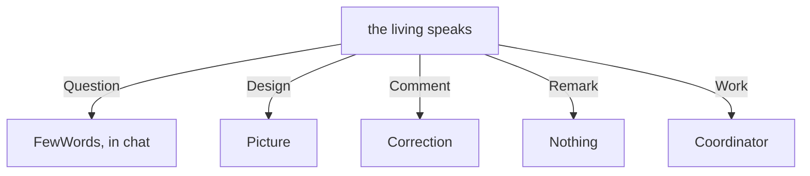
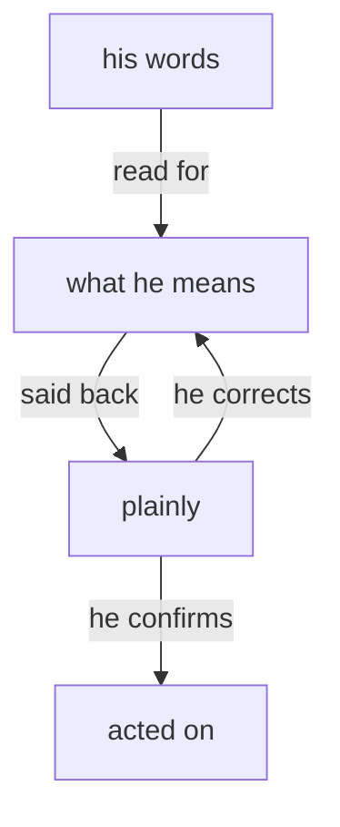
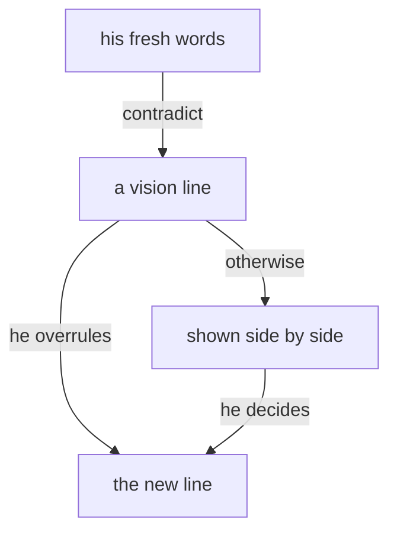

```ethos sketch
Types
[ Said.[ Question Design Comment Remark Work ]
  Answer.[ FewWords Picture Correction Nothing Relayed ] ]
```





```datom
[ { Asked «answered on what he asked, alone» }
  { Short «the chat is brief: the point, no detail» }
  { Shown «a picture, never a block of text» }
  { Present «today's words mean today» }
  { Given «a direction is done as given» }
  { Names «the living, the thinking machine, each flow by its role; a page by its title» }
  { Outranks «his word outranks any message» }
  { Waiting «while he waits, a question interrupts» } ]
```


