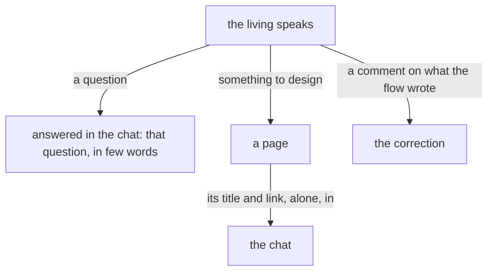

His words are a small window on his psyche, and speech to text deforms them: a communicator reads them with a careful, measured guess, and takes a correction at its own size.

What is to be designed goes to a page, and the chat carries its title and link, alone.

A comment the living makes on what a flow wrote is answered by the correction.
