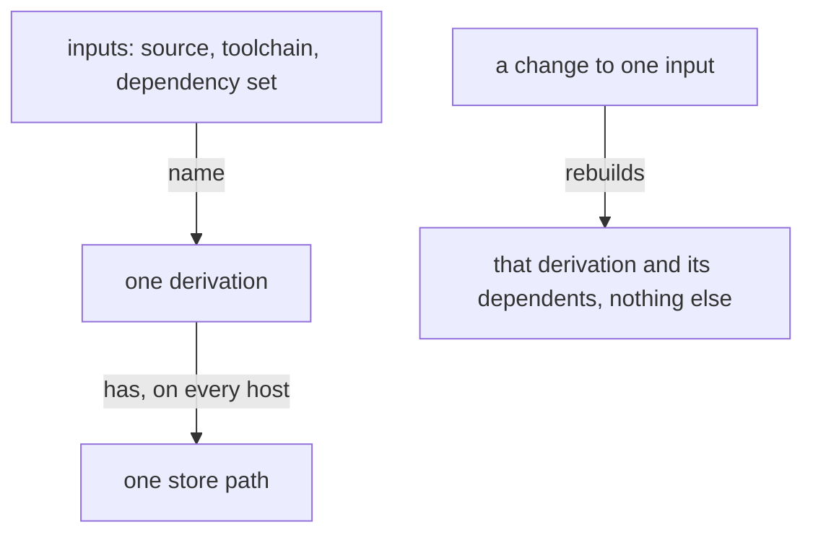

## Nothing is built twice

Nothing is built twice. A compiled thing is a derivation named by its inputs, and the same inputs give the same store path on every host; a second compilation of the same inputs is a fault in the build's design, and is removed at its cause.

What changes is what rebuilds: a crate's source changes, and the crate and its dependents rebuild; a test changes, and the test build alone rebuilds; a dependency changes, and it changes once, for every repository at once. Everything else is reused from the store.

One place holds the facts every build shares, the toolchain, the package set and the version and feature set of every third-party crate; a repository holds only what is its own.

