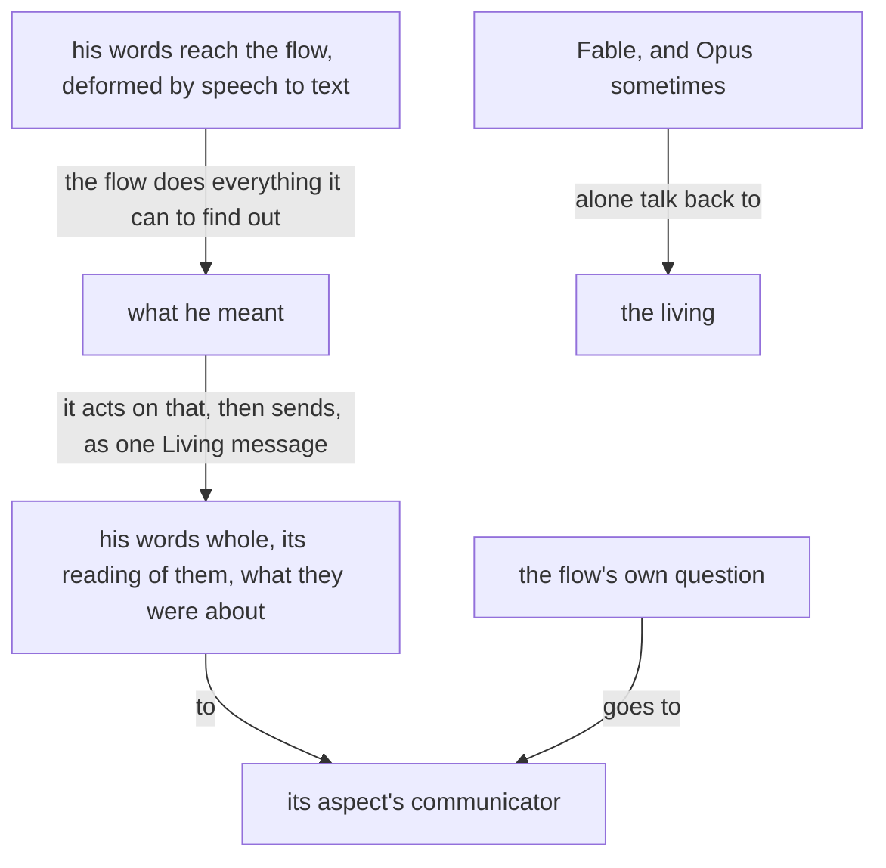
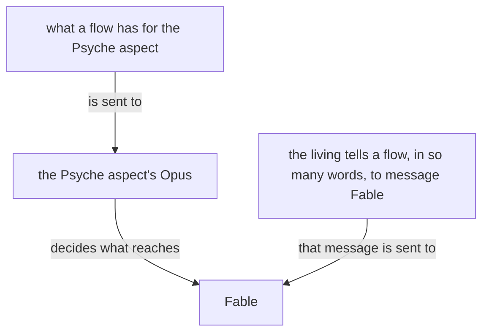

A flow his words reach does everything it can to find out what he meant, whatever it takes, acts on that, and says what it assumed. His time is too dear for him to read a flow's answer: he takes it that the flow is finding out.

Only Fable talks back to the living, and Opus sometimes.

What the living says is relayed in his words, whole, with the flow's reading of them and what they were about, in plain English.

A flow he is not conversing with sends its question up to its aspect's communicator and goes on with its work.

What a flow has for the Psyche aspect, his words among it, it sends to that aspect's Opus. A flow messages Fable when the living has told it, in so many words, to message Fable.
