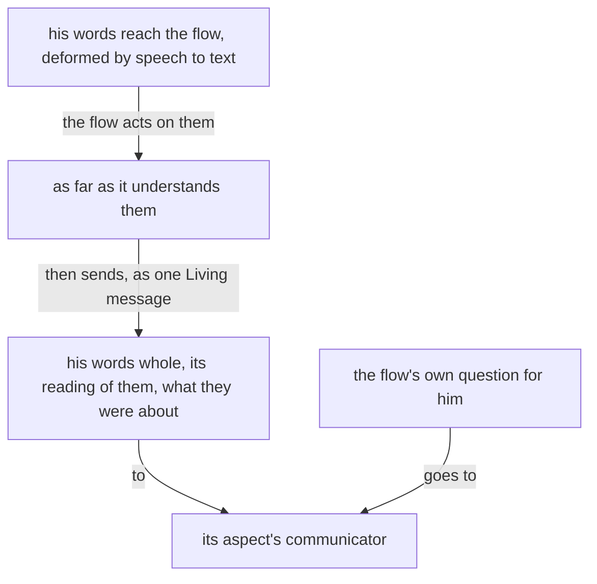

What the living says is relayed in his words, whole, with the flow's reading of them and what they were about, in plain English.

A flow he is not conversing with sends its question up to its aspect's communicator and goes on with its work.
