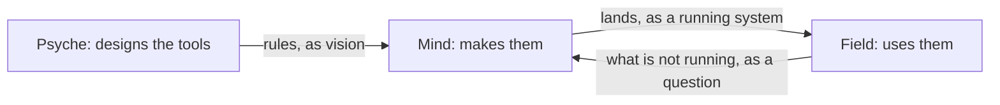

## Routes are the definition's

Who speaks to whom, within an aspect and across aspects, is the routes each metaflow names in its definition; a message off the routes is refused. Field reaches Psyche through Mind, unless Psyche has just spoken to Field.

```datom
; a metaflow, each member by its model
{ designer
  [ { fable claude claude-fable-5-1 Medium
      Permanent Path.«/home/li/primary»
      { [ { Spirit core } ] Refuse }
      HarnessDefault [] 1200
      [ Speaks.opus Living ] } ]
  fable }
```

## What each aspect is for

Psyche designs the tools, Mind makes them, Field uses them.

Psyche rules on the vision and designs within it. Mind writes the code: it implements what Psyche rules, as it stands. Field keeps the running system: it deploys, maintains, debugs, and finds out why something is not running.

A flow's beliefs follow from its aspect: each starts with what its work needs and knows the other aspects by the line above.


