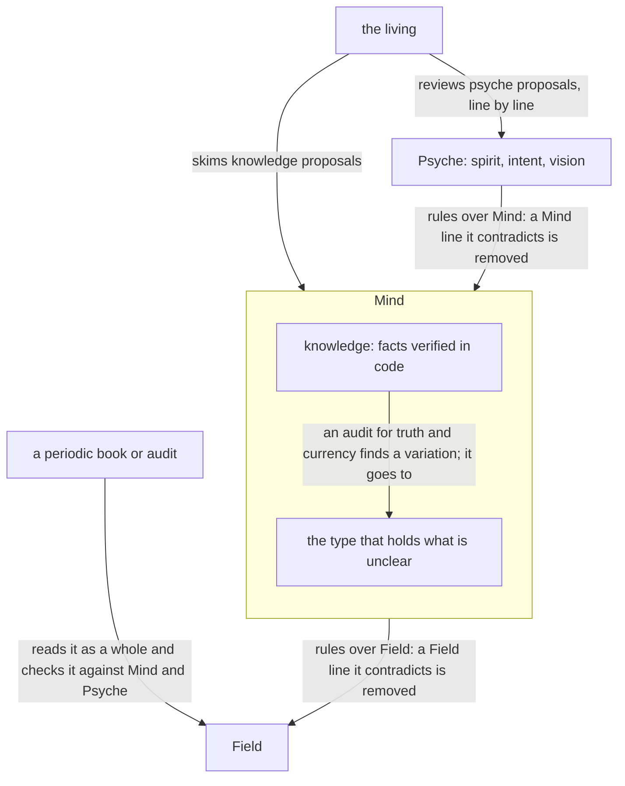
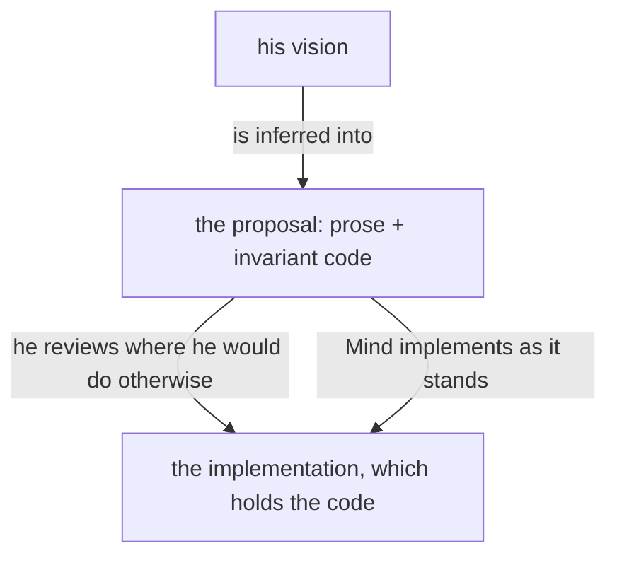
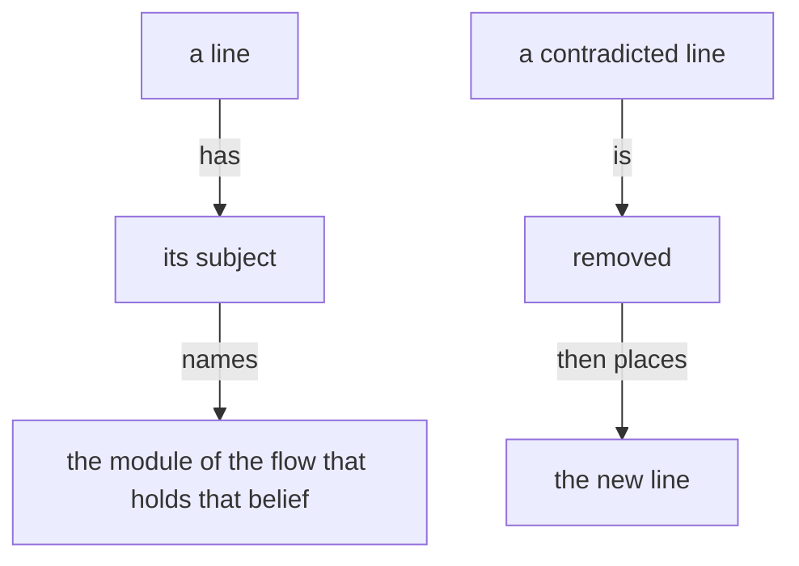

## Belief modules and their review



Knowledge modules are audited from time to time for truth and currency against practice.

A subject the living reviews or asks about has a module, on its topic or a broader one, with room to hold it.

A vision module may be substantial: it holds the code that is important to the vision, the invariant parts, which the living reviews as he reviews prose.

The code important to a vision lives in that topic's vision module.



A module declares its placement: the system prompt, or loaded on demand. A skill is the harness's interface for an on-demand module.

Spirit and intent are placed in the system prompt.

The vocabulary is context, belief modules and context building.

A context repository holds one folder per module type, each named for its type. A file is named by its subject alone, and its folder gives its type.

## Change through the living or a mechanism

A belief module changes only on the living's approval of the line, or through a mechanism. In the long term, a change may land without his review through an extensive automated machine review held to standards.

## Context lines are richly annotated

Context lines are richly annotated, because lines of very different categories share one module and are otherwise given the same weight. Separating modules into kinds such as vision and intent is the first, crude form of that annotation.

## A belief module states what holds now

A belief module states what holds now.

## A belief module names nothing particular to his own machines

A belief module carries the mechanism, and nothing that is true of his own machines alone: no cluster name, host name, login, path or address of his. An example that needs a name uses one that is plainly an example, and says so. What is particular to his machines lives in the host's own declaration, which the module points to.

```nix
# a belief module's example: a name that
# is plainly an example
{ cluster = "example"; host = "laptop"; }
```

## A description is part of the content

A module's description is part of its content: what the description says, the body does not say again.

## Editing belief

A belief goes in the module of its subject.

Removal comes before addition.


