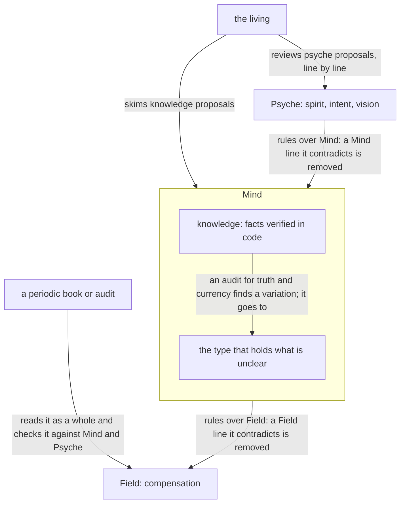
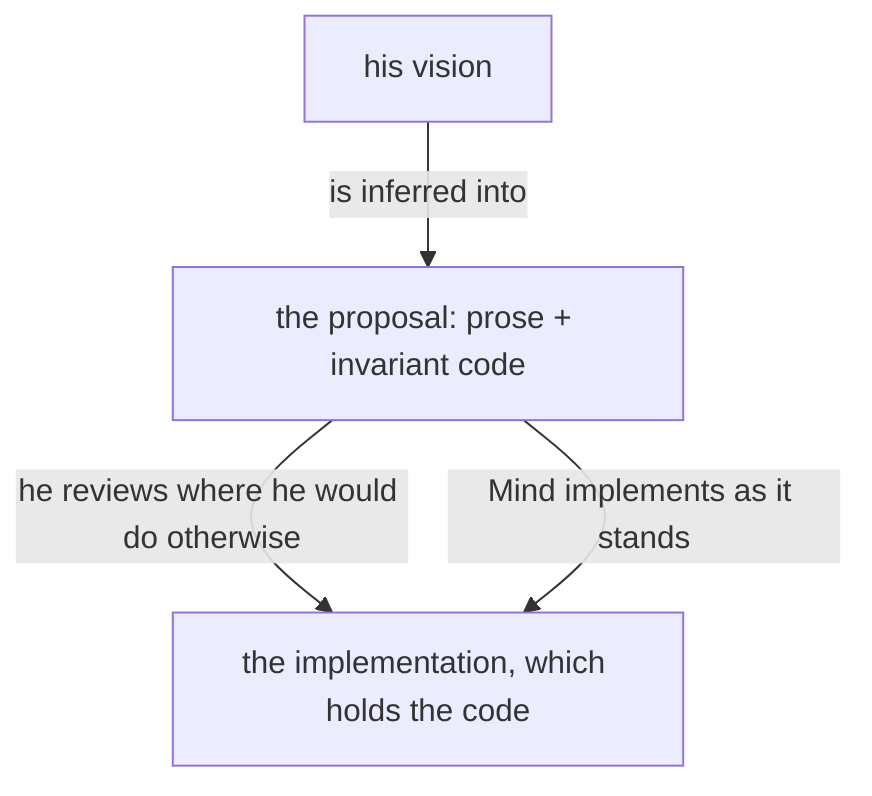
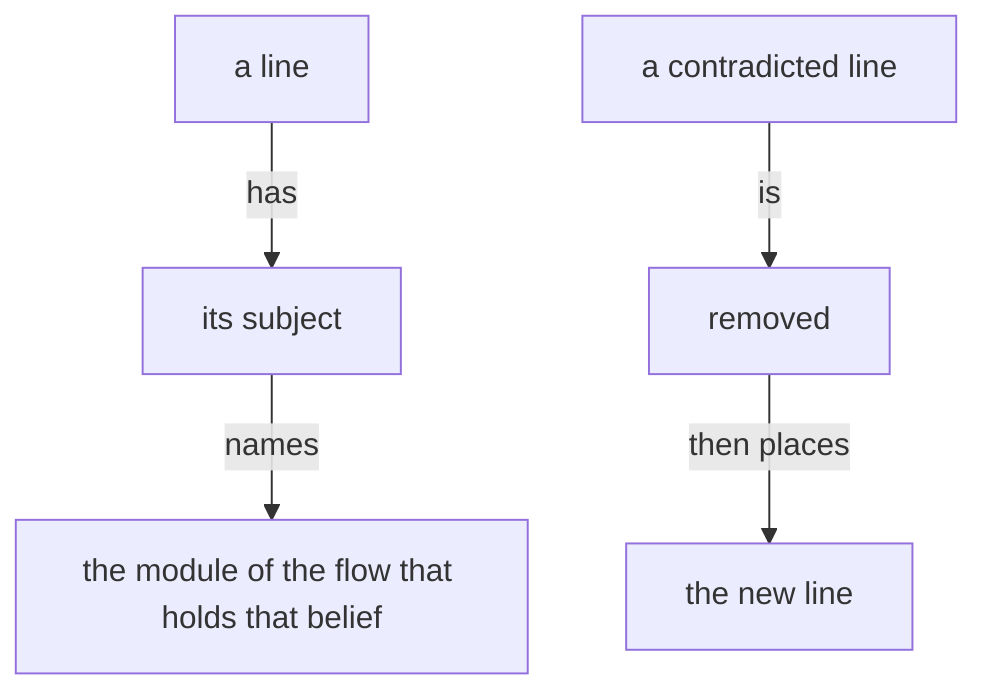

## Belief modules and their review

Knowledge modules are audited from time to time for truth and currency against practice.

A subject the living reviews or asks about has a module, on its topic or a broader one, with room to hold it.

A vision module may be substantial: it holds the code that is important to the vision, the invariant parts, which the living reviews as he reviews prose.

The code important to a vision lives in that topic's vision module. The invariant code of Flow, which the Psyche core Primary sees going into the Flow Nexus, lives in vision:flow; a Chronos invariant lives in vision:chronos.

A module declares its placement: the system prompt, or loaded on demand. A skill is the harness's interface for an on-demand module.

In the long term, intent is placed directly in the system prompt.

The vocabulary is context, belief modules and context building.
A skill is the legacy name, one harness name for things that differ, becoming obsolete as harness infrastructure improves.

A context repository holds one folder per module type; no folder is called skills. A file is named by its subject alone, and its folder gives its type.

A module is named by its type and its subject. A directory structure gives each type its own directory; a single-string name without whitespace puts the type first, then a colon, then the subject, as vision:book.

A context repository holds one section of role modules per layer, Primary, Secondary, Tertiary and Quaternary, and may hold sections for specialized topics.

## No change except through the living or a mechanism

No belief module changes except through the living or a mechanism. In the long term, a change may land without his review through an extensive automated machine review held to standards.

## Context lines are richly annotated

Context lines are richly annotated, because lines of very different categories share one module and are otherwise given the same weight. Separating modules into kinds such as vision and intent is the first, crude form of that annotation.

## A belief module is not a history book

A belief module is not a history book; content can be good and still not belong in one.

## Editing belief

A belief goes in the module of its subject.

A line that a module contradicts is edited by removing the contradicted line first, never by adding a contradicting line elsewhere.

Removal comes before addition.

