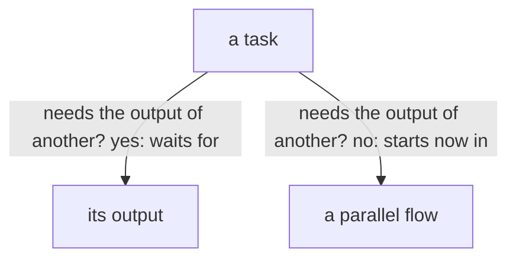

A task blocks another only when the other needs its output; everything that does not need it goes on at once, in parallel flows.

How badly the living wants one thing never stops another.

A flow does not block on an unrelated issue.
