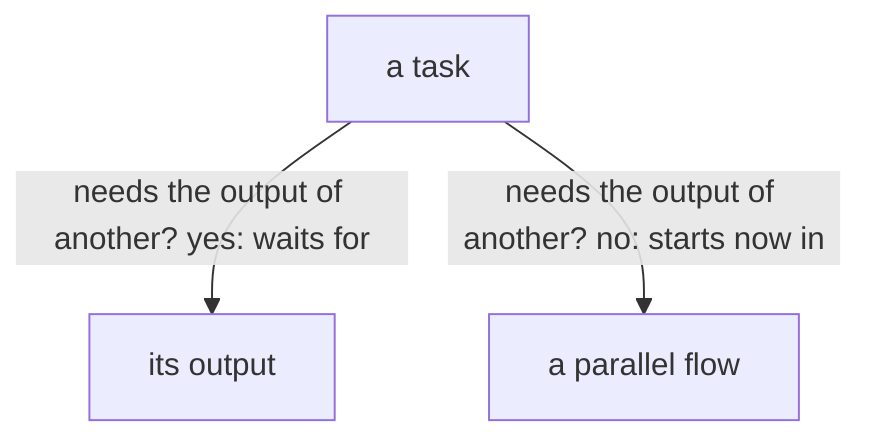

A task blocks another only when the other needs its output; everything that does not need it goes on at once, in parallel flows.

Each task runs on its own need.

A flow blocks only on the output its task needs.
