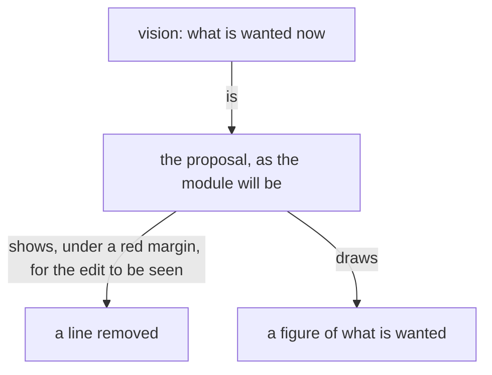
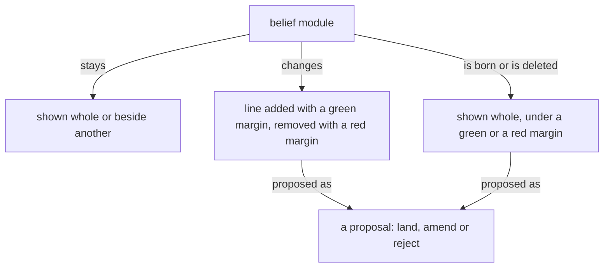

## Books

A book carries belief modules, as they stand and as they are proposed to change; its sources live in its reference file.

A figure shows how a thing moves, one question per figure, readable in seconds. Its grammar: a box is a thing or a collection; an arrow is a one-way relation carrying a verb, so that box, verb, box reads as a sentence; nearness and enclosure are kinship; top to bottom is order; colour carries a role or is absent. A figure is boxes joined by verbed arrows. A diagram in a book's source is a Mermaid flowchart in that grammar, drawn so a phone shows it. A sizable book carries several figures.

Prose is shown as rendered text.

## What a book shows

A book is belief modules in the forms below, each under its repo › path; its headings, naming the module and the kind of change, are the only words it has of its own.

A module shown whole, as it stands, situates the landing.

A module shown beside another, both as they stand, serves comparison: psyche with knowledge.

Colour is the sign of a change and lies in the margin alone: text keeps the page's colour, and code its language's colours, highlighted.

A line added shows a green margin.

A line removed shows a red margin.

A line replaced shows its removal and its addition together, and only the changed words are marked.

A new module shows whole under a green margin, under the path it will have.

A module deleted shows whole under a red margin, with a Destroy or Archive mark.

A line moved between modules is one proposal headed by both paths: the line under a red margin in the module it leaves, the same line under a green margin in the module it enters.

A dependency changed shows in the module's front matter: the dependency removed under a red margin, the dependency added under a green margin.

A figure proposed for a module shows under that module's path with a green margin, as an added line does; a fence it replaces, in the module, shows as its lines under a red margin. A figure is drawn only of what is wanted; a removed sentence is its red text and is never drawn.

Code in a book is shown as code, labelled with its language and highlighted in that language's colours.

## Pictures

A figure shows one thing, where the idea has a shape, and its colours and marks mean the same in every book.

Every flowchart, in a book or in a belief module, is Mermaid, in the figure grammar; a book shows the SVG drawn from it.
