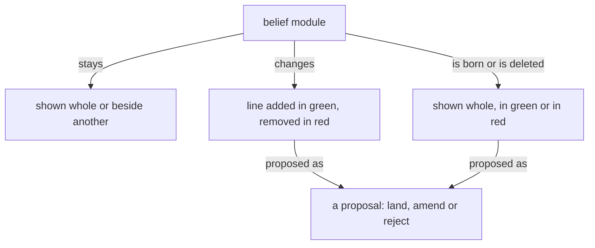

## Books

A book carries belief modules, as they stand and as they are proposed to change; its sources live in its reference file.

A figure shows how a thing moves, one question per figure, readable in seconds. Its grammar: a box is a thing or a collection; an arrow is a one-way relation carrying a verb, so that box, verb, box reads as a sentence; nearness and enclosure are kinship; top to bottom is order; colour carries a role or is absent. A figure is boxes joined by verbed arrows. A diagram in a book's source is a Mermaid flowchart in that grammar, drawn so a phone shows it; every sketch carries its arrows before it is sent. The published book shows the figure drawn from the Mermaid source by a Tertiary or Quaternary subflow given the grammar with the sketch; the figure keeps every box, label and arrow, and says only what the source says; a figure that lost an arrow is returned. A sizable book carries several figures.

Prose is shown as rendered text. A code block holds code alone, and it may scroll sideways.

## What a book shows

A book is belief modules in the forms below, each under its repo › path; its headings, naming the module and the kind of change, are the only words it has of its own.

A module shown whole, as it stands, situates the landing.

A module shown beside another, both as they stand, serves comparison: psyche with knowledge.

A line added shows in green.

A line removed shows in red.

A line replaced shows its removal and its addition together, and only the changed words are marked.

A new module shows whole in green, under the path it will have.

A module deleted shows whole in red, with a Destroy or Archive mark.

A line moved between modules is one proposal headed by both paths: the line in red under the module it leaves, the same line in green under the module it enters.

A dependency changed shows in the module's front matter: the dependency removed in red, the dependency added in green.

A figure shows as proposed for the module it will live in.

A figure proposed for a module shows under that module's path in green, as an added line does; a figure it replaces shows beside it in red.

Code in a book is shown as code, labelled with its language, plain. Ethos and datom in a book are written in the vertical form.

## Pictures

A figure shows one thing, where the idea has a shape, and its colours and marks mean the same in every book.

Every flowchart, in a book or in a belief module, is Mermaid, in the figure grammar; a book shows the SVG drawn from it.
