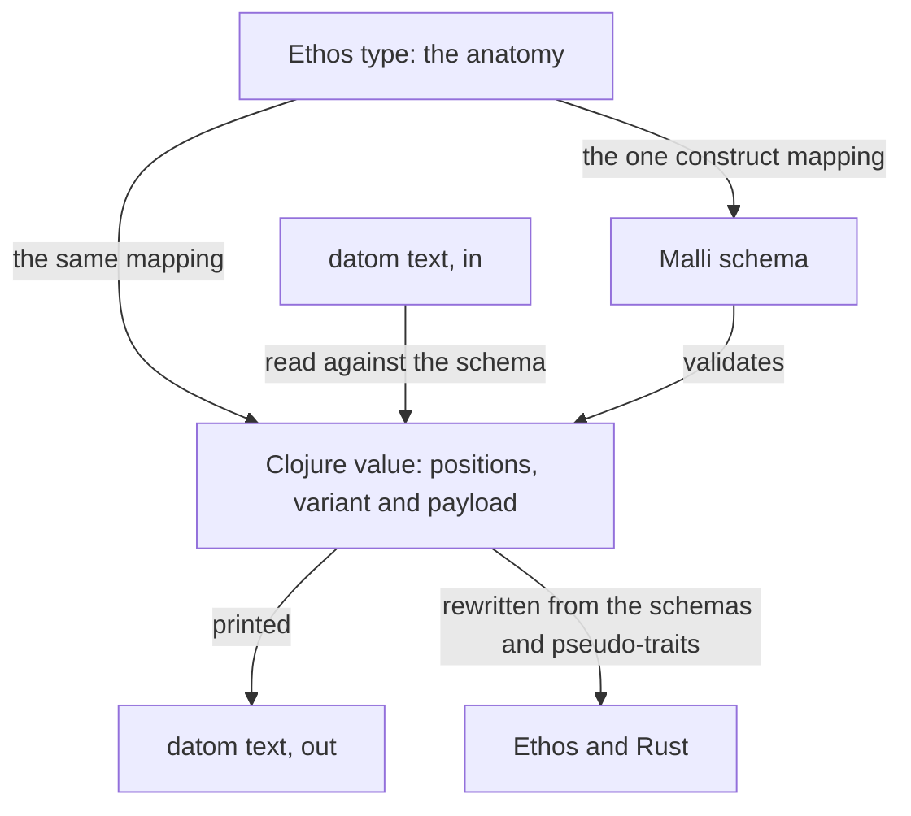

## Clojure

Short-term prototypes and scripts are written in Clojure; Rust is the main language. A Clojure tool is a standalone CLI, named with the -clj suffix, built and deployed by Nix: it takes one datom and prints one datom, as a Nexus CLI does. Its build reuses compiled Nix artifacts, recompiles little, and writes its own logic in Clojure as far as it can.

The Ethos anatomy comes first, and the Clojure code takes its types from it. The Clojure translation preserves the anatomy declared in Ethos: named types, struct positions, variant identity and payload, and nested containers. One shared construct mapping defines their Malli schemas and Clojure data representations, including how Datom values become those Clojure values. Each representation keeps enough information to recover the same typed value. A prototype is rewritten in Ethos and Rust from its Malli schemas and pseudo-traits.

