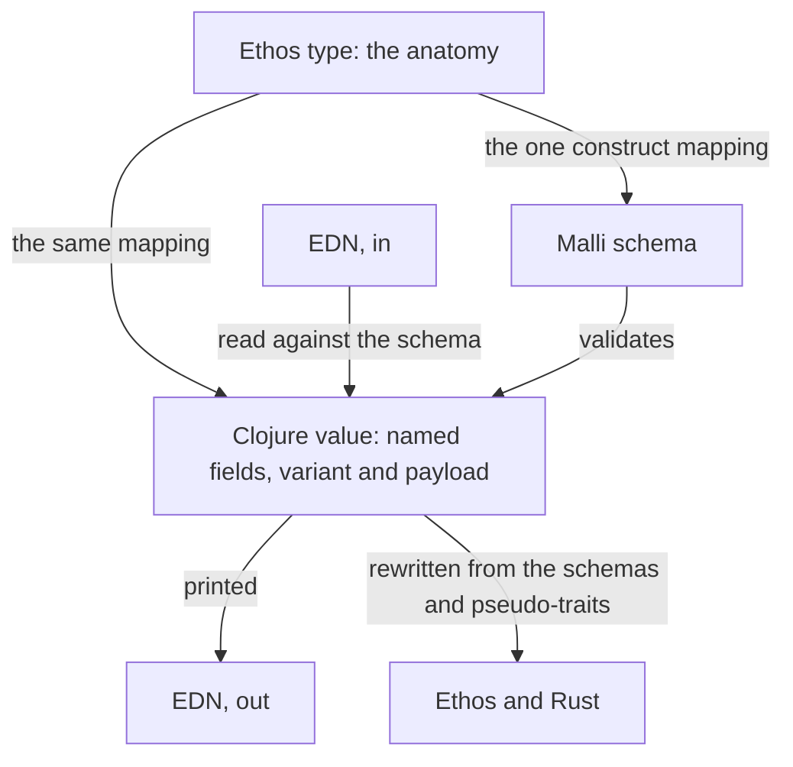

## Clojure

Short-term prototypes and scripts are written in Clojure; Rust is the main language. Clojure is a fast way to iterate on an idea: EDN, its data notation, gives a tool an interface made of data, as Datom does, in an older and weaker form.

A Clojure tool is a standalone CLI, named with the -clj suffix, built and deployed by Nix: it takes one EDN value, inline or in a file, and prints one EDN value. Its build reuses compiled Nix artifacts, recompiles little, and writes its own logic in Clojure as far as it can.

## EDN names its fields

Datom is read in Rust, by the type at each position; a Clojure tool reads EDN. EDN names its fields: a Datom struct is written in EDN as a map, each key the name of a field, and a vector stays a vector.

The Ethos:

```ethos
Types
[ Person.{ Name.String
           Born.Integer
           Vector<Role> }
  Role.[ Author Reviewer ] ]
```

The datom, by position:

```datom
{ Ada 1990 [ Author Reviewer ] }
```

The EDN, by name:

```clojure
{:name "Ada" :born 1990 :role-vector [:author :reviewer]}
```

## The anatomy comes first

The Ethos anatomy comes first, and the Clojure code takes its types from it. The Clojure translation preserves the anatomy declared in Ethos: named types, struct fields, variant identity and payload, and nested containers. One shared construct mapping defines their Malli schemas and their EDN representations. Each representation keeps enough information to recover the same typed value. A prototype is rewritten in Ethos and Rust from its Malli schemas and pseudo-traits.


