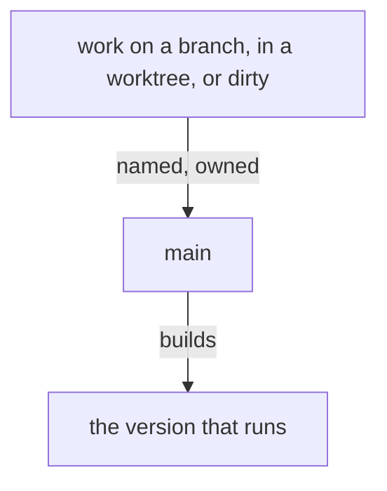

## A commit names its files

A flow commits the files it edited.

## What runs is on main

A version that runs is built from main. A branch, a worktree or a dirty tree of ours carries a line naming what it holds and which flow owns it, and is folded into main or removed when that is done.

