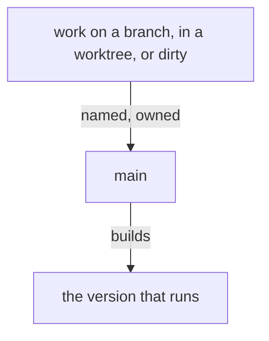

## A commit names its files

The commit call is explicit with file paths. A flow commits the files
it edited, and usually works only in its own flow directory.

## One shared workspace, for now

For now Primary is one workspace shared by every flow, so a change there is made in its one checkout. This short-term vision ends when flows get workspaces of their own.

## What runs is on main

A version that runs is built from main. A branch, a worktree or a dirty tree of ours carries a line naming what it holds and which flow owns it, and is folded into main or removed when that is done.

