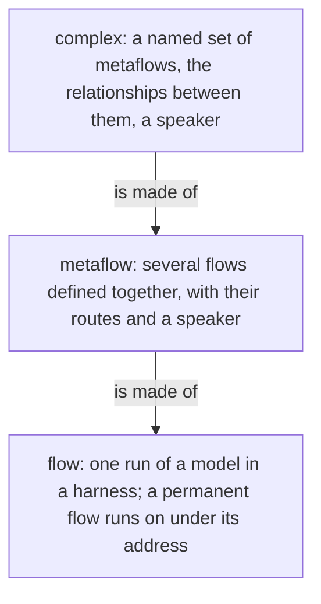
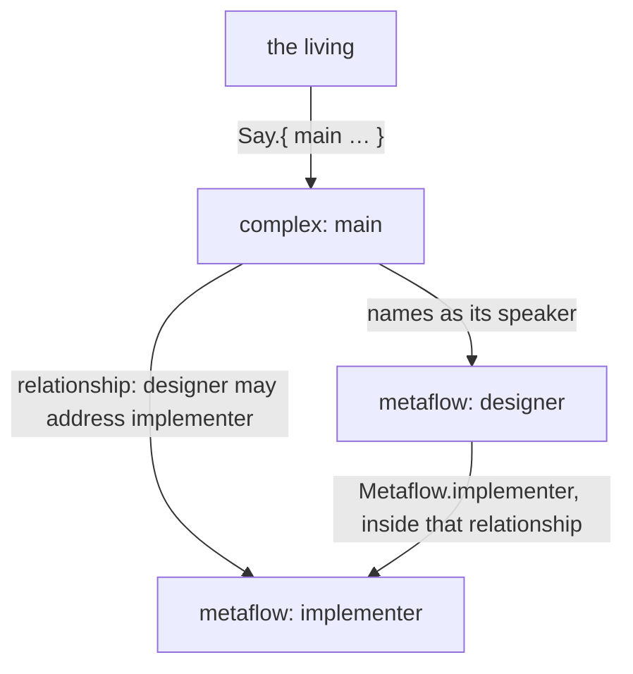
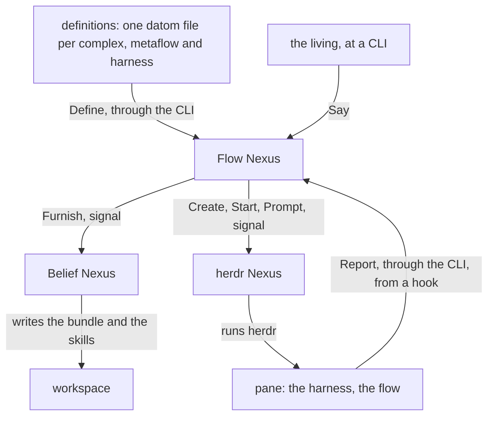

# The complex

A complex is the being a person names, my accountant, my coder: a named set of metaflows and the relationships between them, defined by its purpose and its beliefs, the layer above the metaflow, what people today call an agent. It is a definition, as a metaflow is: it names its metaflows, the relationships between them, its speaker and its instances, and it has no directory, process or socket of its own. A complex runs as its metaflows on a host; it may have instances, each the complex run on a host, for redundancy. A Flow Nexus runs many complexes. Three Nexuses run them, from the definitions given them, and the flows run from those.

## The layers

Each layer is defined in terms of the one below it. A flow is one run of a model in a harness. A permanent flow continues through a succession of runs, one entity under one address. A metaflow is several flows defined together: each flow's model, harness, workspace, beliefs and tools, and which flow speaks to which. A complex is several metaflows defined together, with the relationships between them and a speaker.



## One self

The metaflows of a complex are one self because they speak to one another: the complex defines the relationships between its metaflows, each one that this metaflow may address that one, and a member's route to another metaflow holds only inside them; a message to a metaflow reaches its speaker. The living talks to the complex: Say addresses it by name and reaches its speaker, the metaflow that receives what comes to the complex. What one metaflow says, does or leaves undone, the whole answers for.

A flow knows its complex by name: the name is set at launch, in the Identity composed into its first prompt or its system prompt beside its Address and FlowId, so a flow names the being it is part of.

```datom
; the Identity composed into a flow's prompt: complex, address, flow id
{ main { designer fable } 15c0ce }
```



## One owner

A complex runs for one owner: the login whose Nexuses run it. The definitions are his sources; the flows run with his credentials and files; it is not a sandbox.

## Where a complex lives

A complex is a definition the Flow Nexus holds in its Memory, given by Define and read back by Describe, the names by Definitions, as a metaflow and a harness are; it names its metaflows by name, and a Flow Nexus holds many. A change to one definition touches no other.

A complex names features for every flow of its metaflows, as a member names them for itself: each a feature of that member's harness, with its effect, a flag or a variable, composed into the launch beside the member's own. So what every flow of a being is to run with, a harness reminder turned off among it, is said once, in the complex. A complex feature a member's harness lacks refuses the launch, with the harness named.

```ethos
Library
[ flow:[ MetaflowName FeatureName ] ]
[ ComplexName.String                ; the being's name: main
  Host.String                        ; a host the complex runs on; tentative
  Relationship.{ From.MetaflowName    ; this metaflow
                 To.MetaflowName }    ;   may address that one
  Complex.{ ComplexName
             Metaflows.Vector<MetaflowName>      ; its metaflows, by name
             Relationships.Vector<Relationship> ; the relationships between them
             Features.Vector<FeatureName>       ; of each member's harness, composed into every launch of its metaflows
             Instances.Vector<Host>             ; each instance runs the complex on that host, for redundancy; tentative
             Speaker.MetaflowName } ] ; receives what comes to the complex; tentative
[]
[]
```

```ethos
Memory
[ flow:[ Metaflow Harness Complex ] ]
[ Definition.[ Metaflow Harness Complex ] ] ; each held alone; a Complex names its metaflows, a Member its harness
```

```datom
; definitions/main.datom: one complex, headed as Define takes it
Complex.{
   main
   [ designer implementer ]
   [ { designer implementer } ]
   [ LongWaitReminder ]              ; a feature of the harness, for every flow of the complex
   [ criome ]                        ; one instance, on the host criome
   designer }                        ; the speaker
Say.{ main Order.«Read the book» }   ; the living, to its speaker
```



## The Nexuses that run it

The Flow Nexus, the Belief Nexus and the herdr Nexus run a complex. Each is started in its place, a Nexus startup fact of vision:nexus:1: the three that run one complex share one place name, and a CLI reaches them by it. Two place names are two sets of Nexuses, so the stable set keeps running while the next is tried; the complexes are whatever the Flow Nexus at that place holds.

```sh
# the CLI: one datom; the place is its configuration's
flow-nexus 'Launch.{ designer fable «Read the book» }'
herdr-nexus 'Prompt.{ { main wQ:pT } «hello» }'
```

## The Nexuses are built and started by Nix

The repository metaflow holds the Nix that builds the three Nexuses, their translators and CLIs, and a shell that starts each of them with its place under the owner's login.

```sh
nix develop github:LiGoldragon/metaflow -- metaflow start next
```

## Everything in a complex is a definition

The Nexuses hold vocabulary; the owner writes definitions in datom. A definition is one file, one datom; the definition files are the owner's sources, kept wherever he keeps them and given by Define and replaced the same way; the running set is the Flow Nexus's Memory in its State directory. A change to one definition touches no other. The Rust knows no role, model name or topic.

A new place is told its complexes by replaying the definition files, one Define per file, harnesses before the metaflows that name them and metaflows before the complexes that name them; nothing is migrated from the place before it, and the set of files is the whole of what a place needs to know.

```sh
# the owner's definitions, replayed into a fresh place, from the capsule whose configuration names it
for f in definitions/*.datom; do flow-nexus "Define.$(cat "$f")"; done
```

```datom
; definitions/designer.datom: one metaflow, headed as Define takes it
Metaflow.{
   designer
   [ { fable claude claude-fable-5-1 Medium
       Permanent
       Path.«/home/li/primary»
       { [ { Spirit core 0 } { Vision nexus 1 } ] Refuse }
       Restricted.{ [ Bash Edit ] [ Artifact ] }
       [ ClaudeMd ]
       1200
       [ Speaks.opus Living ] }
     { opus claude claude-opus-4 Medium Ephemeral
       Temporary
       { [ { Spirit core 0 } { Role worker } ] Notice }
       HarnessDefault
       []
       4000
       [ Speaks.fable Metaflow.implementer ] } ]
   fable }                           ; the speaker
```
