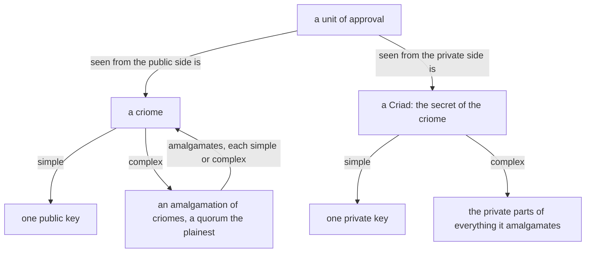

## A unit of approval, seen from two sides

A criome is a unit of approval seen from the public point of view: what an approval is checked against. A Criad is the same unit seen from the private point of view: the secret of a criome, what makes the approval.

A simple criome is one public key, and its Criad is the private key.

A complex criome is an amalgamation of criomes, each of them simple or itself complex. A quorum is an amalgamation of simple criomes; a complex criome may amalgamate quorums, and amalgamations of those in turn, to any depth. Its Criad is a complex Criad: the private parts of everything it amalgamates.

Most criomes spoken of are complex, and the word criome alone implies it.

