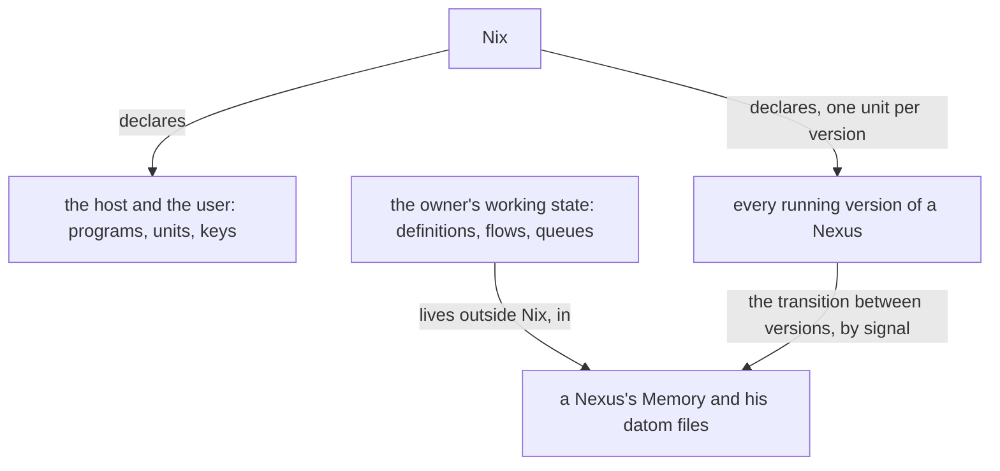

## CriomOS

CriomOS is a declarative operating system: every host is built from its declaration.

A problem in CriomOS is fixed in CriomOS by a proper fix and a proper deploy.
Every hotfix in place is removed and replaced by that fix.

CriomOS is made more modular; an anatomy of it shows what should be taken out.

## Nix code

Every store path in Nix code is the output of evaluating a package, a flake input or an option.

## What Nix declares

Nix sets up the host and the user: programs, units, keys. Cluster data is the data that sets the hosts and the users up. Nix kills and restarts what it changes, so it holds no running state: the owner's working state, the metaflow definitions, the flows and their queues, lives in a Nexus's Memory and in his datom files, outside Nix. Every running version of a Nexus is declared, one unit per version, and every stateful transition between versions is made outside Nix, by signal.

## Hardware

CriomOS has a hardware type, so that it supports several kinds of hardware, the Librem 5 Linux smartphone among them; a module may be gated on it.
A fix that only some hardware needs is a value in the cluster data, marked by the chip or part that makes it necessary.
A library reads the cluster's list of its hardware and answers, by processor, model and variant, which fixes a computer needs.

## Services

A new service lives in CriomOS.
A service is updated by bringing it up at its latest version.

