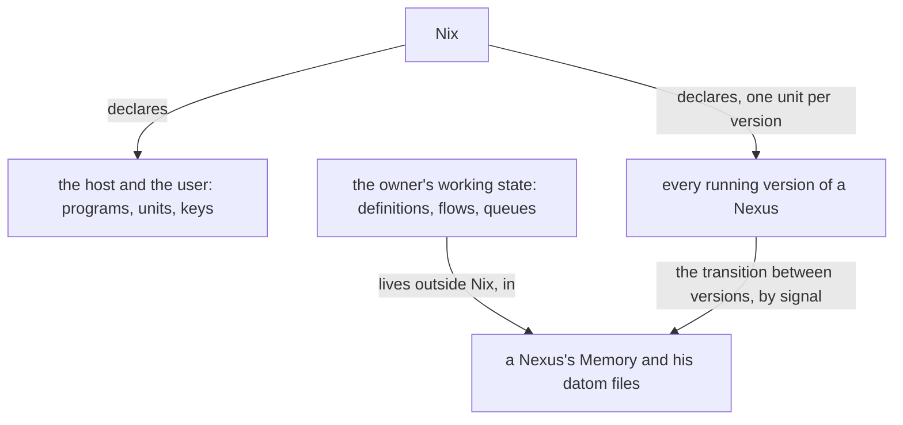
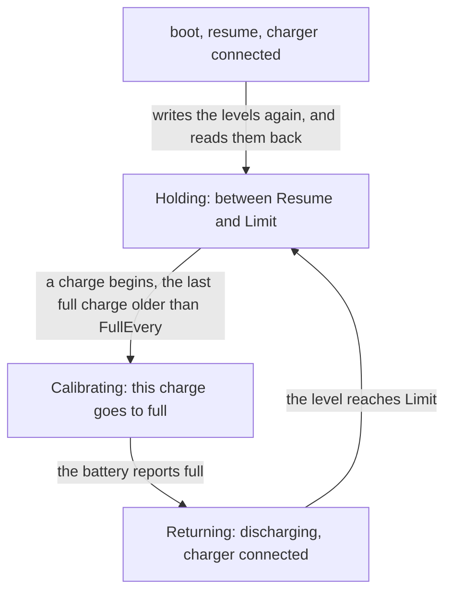

## CriomOS

CriomOS is a declarative operating system: every host is built from its declaration.

A problem in CriomOS is fixed in CriomOS by a proper fix and a proper deploy.
Every hotfix in place is removed and replaced by that fix.

CriomOS is made more modular; an anatomy of it shows what should be taken out. What CriomOS and CriomOS-home share lives in criomos-core, which supersedes CriomOS-lib and exports the namespaces both use.

## Nix code

Every store path in Nix code is the output of evaluating a package, a flake input or an option.

## What Nix declares

Nix sets up the host and the user: programs, units, keys. Cluster data is the data that sets the hosts and the users up. Nix kills and restarts what it changes, so it holds no running state: the owner's working state, the metaflow definitions, the flows and their queues, lives in a Nexus's Memory and in his datom files, outside Nix. Every running version of a Nexus is declared, one unit per version, and every stateful transition between versions is made outside Nix, by signal.



## Hardware

CriomOS has a hardware type, so that it supports several kinds of hardware, the Librem 5 Linux smartphone among them; a module may be gated on it.
A fix that only some hardware needs is a value in the cluster data, marked by the chip or part that makes it necessary.
A library reads the cluster's list of its hardware and answers, by processor, model and variant, which fixes a computer needs.
The cluster data holds a model table: from a computer's model it derives its facts, its processor architecture, display and form factor among them; a computer of unknown model is given its architecture and form factor by hand; Field verifies the hardware after boot. A form factor is a variant named for what the computer is, handheld, laptop, paper-size tablet or large tablet, in high or low pixel density. The hardware record has sections, audio, visual and interface among them.

### Battery care

Battery care is a capability of a laptop node, declared in the cluster data with its values. The battery is held between two levels while the charger is connected. When a charge begins and the last full charge is older than the configured days, that charge goes to full, which resets the gauge; when the battery reports full, the node discharges it back to the limit with the charger still connected, and holds it there again. Where the hardware cannot discharge while connected, the node returns to holding and the level falls when the charger is next away.

The firmware may forget the levels; they are written again, and read back, at every boot, every resume from any sleep and every connection of the charger. When the service stops, and again when it starts, it returns the battery to charging as the firmware does by itself, so a discharge left unfinished ends at the next start.

```ethos
Library
[]                                   ; imports
[ Percent.Integer                    ; types
  Days.Integer
  BatteryCare.{ Resume.Percent       ; the capability: charging resumes below this level
                Limit.Percent        ;   and stops at this one
                FullEvery.Days }     ;   a charge goes to full when the last full charge is older
  Phase.[ Holding                    ; held between Resume and Limit
          Calibrating                ; this charge goes to full
          Returning ] ]              ; full reached: discharging to Limit, charger connected
[]                                   ; traits
[]                                   ; associations
```

```datom
; a laptop node in the cluster data; the names are an example
{ laptop Laptop [ BatteryCare.{ 75 80 30 } ] }
```



## Services

A new service lives in CriomOS.
A service is updated by bringing it up at its latest version.

The remote builder serves its store as the cluster's binary cache, a capability of that node declared in the cluster data; every other host substitutes from it first, and compiles nothing the builder holds.

```datom
; the builder node in the cluster data; the names are an example
{ builder OnPremise [ GitServer RemoteBuilder NixCache ] }
```

## Between events the operating system is silent

CriomOS has no polling of any kind: no timer, no periodic job, no loop that looks. A service acts when something it listens to tells it: a path unit, a socket, a hook, a word from the kernel or from a Nexus. A writer who needs an event he cannot reach brings the need to Psyche, who finds the event; between events the operating system is silent.
