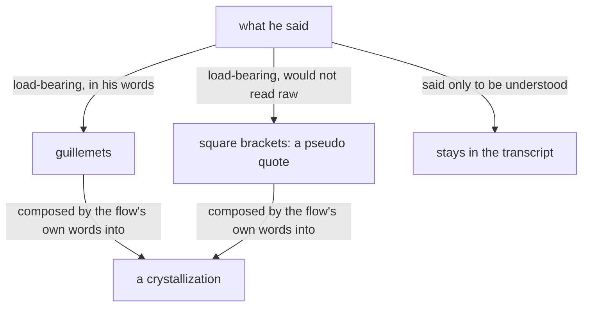
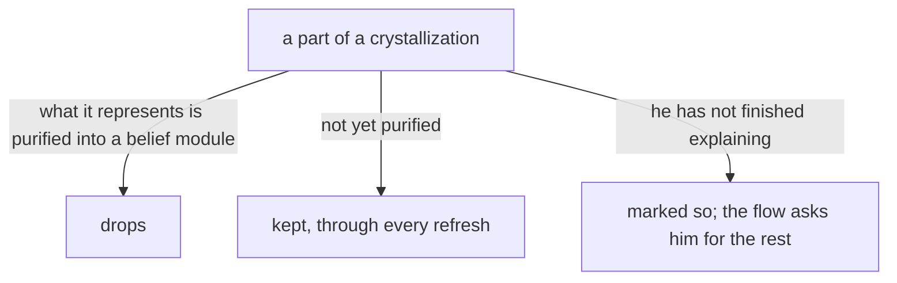
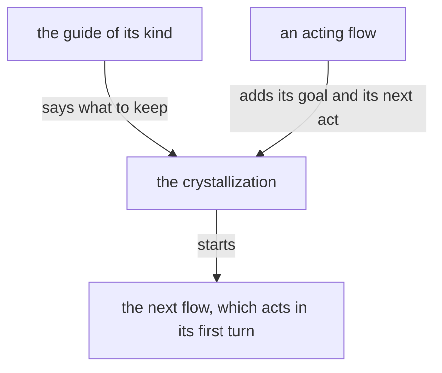

## A proposal names each statement's destination

A crystallization proposal says, for every statement, the topic it goes
to; a statement under the wrong topic is corrected by a crystallization
edit of its own.

## A statement carries what the living said

A crystallized statement carries what the living said and nothing
beyond it. A small ruling makes a small statement.

## Designing model behavior is vision

Designing model behavior is vision, and a correction of an agent's
conduct is vision.

## Statements are positive

A crystallized statement says what is and what is wanted, in positive
terms only.

## Crystallized vision is up to date

Crystallized vision is up to date: it states what is wanted of the subject now.

## Crystallization

A crystallization is purified by a proposal: purification re-articulates what the living said into self-standing statements and merges each with what is already crystallized, so the whole stays cohesive and the new reads as if always written with the original context.

A crystallized statement stands on its own words.

Every term in a
crystallized statement is defined. Define the term first.
A statement about code carries the code: a crystallized statement on a syntax, a type, a kind, or a wire form shows example code, because machines think in code and the next machine to read it must understand.

Vision code is written in the stacks the system is built in: Ethos and Datom first, then Rust and Nix; where a design depends on how any of them is used, the statement carries that code.

A crystallized statement lands as lines in a vision- or intent- skill's authored source.

## A crystallization

A crystallization is what a flow keeps of what it holds that is purified into no belief module, and only what is load-bearing. What he said only to be understood is left out.

His words stand in guillemets, and the flow's own words around them compose the sentence so that it reads. Where his raw words would not read, the flow gives a pseudo quote, his meaning in tidied words, in square brackets, alone. Square brackets inside guillemets mark a pseudo quote inside a quote.

```text
He wants the form kept to «that which is load-bearing», because [raw speech is convoluted].
He would be «careful» with [an Opus that infers [as little as possible]].
```



A crystallization is kept in parts, one per subject. A part stays until what it represents is purified into a belief module; then it drops. What he has not finished explaining is marked so in its part, and the flow that holds it asks him for the rest.



Each kind of flow crystallizes by its own guide, a module for its kind. Fable concentrates on the living: what he said and wants. An implementer keeps a high-level view of the code it is dealing with: why it is touching it, what it tried, what did not work, and what it did. An acting flow's crystallization states its goal and its next act, so that the flow that follows sees the path ahead, rereads little of what its predecessor read, and acts in its first turn.


