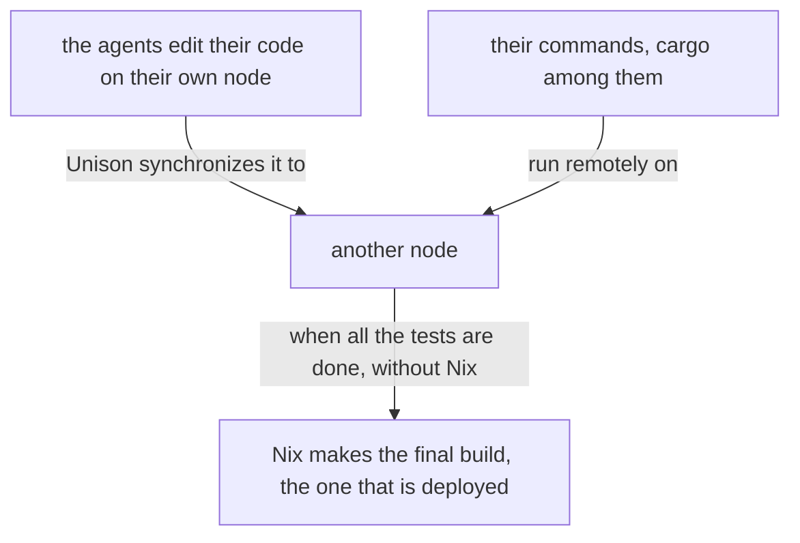

## A proof of concept deploys on the flow's own host

A proof of concept is worked on and deployed on the host the flow is
running on.

## Nix makes the final build

The agents run their commands remotely, cargo among them, on the node their code is synchronized to, without Nix, which is a lot faster. Nix is used only for the final build, when the work is ready to be deployed and all the tests have been done.

## Outside declarative deployment, call by store path

A thing tested outside declarative deployment is called by its full store path.

