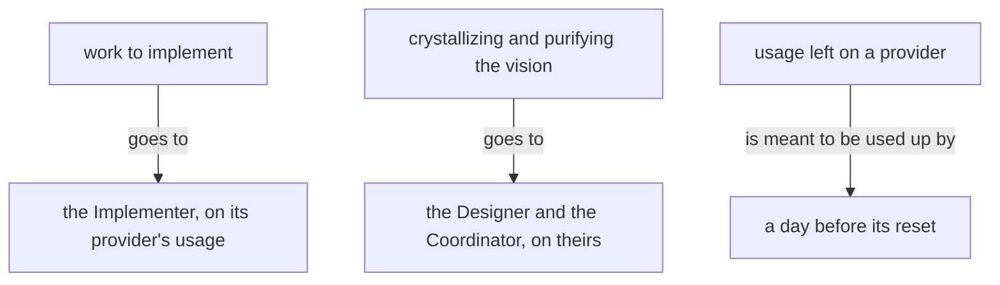
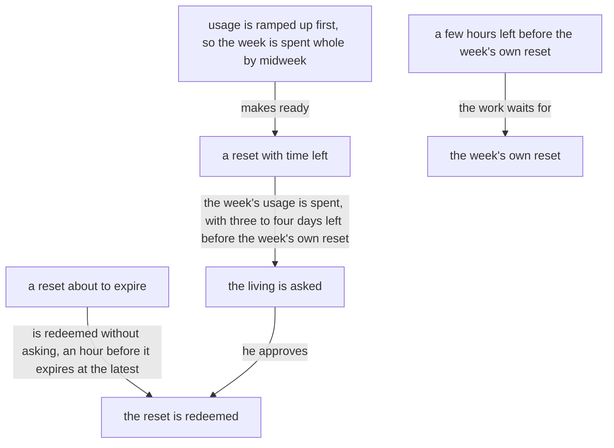

The system is understood energetically. The living's attention is a thousand times dearer than any flow's; within the system the Designer's input and output are the dearest, far above the Coordinator's, and the Coordinator's above the Gatherer's and the Publisher's.

## Usage is meant to be spent

A provider's usage is meant to be spent, used up a day before its reset: the nearer the reset, the more abundant what is left.



Every model launches the cheapest model that does the job, its own
rarely.

A launch new to the system is tried on a cheap flow before the Designer spends on it.

## A usage reset

A usage reset gives a provider's week again, whole. A reset left unused until it expires is lost.



The hour is configuration; the figure below is tentative.

```datom
RedeemBeforeExpiry.{ Minutes.60 }
```
