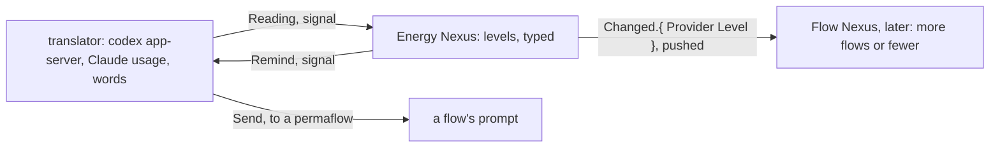

# The Energy Nexus

The Energy Nexus knows how much usage the machine has left, on every provider, and says so: it answers a reading, pushes each change, and sends a reminder when a level is crossed. It is the worked example of a translator: the Nexus holds only typed readings; every word of every provider's API lives in the translator.



## Library

```ethos
Library
[]
[ Provider.[ Claude Codex ]
  Percent.Integer                      ; 0 to 100
  Instant.Integer                      ; Unix seconds
  Minutes.Integer
  Window.{ Name.[ Session Week ]       ; one rate limit
           Used.Percent
           Resets.Instant
           Duration.Minutes }
  ResetId.String
  ResetStatus.[ Available Redeeming Redeemed ]
  Reset.{ ResetId ResetStatus Expires.Instant }
  Reading.{ Provider
            Allowed.Boolean            ; the provider's own word
            Vector<Window>
            Vector<Reset>              ; Codex only; empty for Claude
            At.Instant }
  Level.[ Plenty Fair Low Out ]        ; Out is Allowed false
  Threshold.{ Level Left.Percent }     ; a level begins at this much left
  Address.{ Aspect.[ Psyche Mind Field ] Topic.String Layer.[ Primary Secondary ] }
  Recipient.Address
  Reminder.{ Provider Level Recipient } ]
[]
[]
```

## Signal

```ethos
Signal
[ energy:[ Provider Reading Level Reset ResetId ] ]
[ Read.Provider                        ; a reading, now
  Subscribe                            ; readings and levels as they change
  Redeem.Provider ]                    ; the soonest Codex reset, under the rule
[ Read.Reading
  Subscribed
  Changed.{ Provider Level Reading }   ; pushed on every level change
  Redeemed.Reset
  Refused.[ ProviderDown.Provider
            NoReset
            RuleRefused.String ] ]     ; why the rule refused: not out, not expiring
[]
```

## Meta

```ethos
Signal
[ energy:[ Provider Threshold Reminder Minutes ResetId ] ]
[ Configure.Set ]
[ Configured.Set
  ConfigureRefused.String ]
[ Set.[ Polling.Minutes
        Threshold.Threshold            ; one level's boundary
        Reminder.Reminder              ; who hears about a level
        RemoveReminder.Reminder
        RedeemExpiring.Minutes         ; redeem within this many minutes of a reset expiring
        RedeemUsedAtLeast.Percent ] ]  ; or when the week is this used
```

## Operation

```ethos
Operation
[ energy:[ Provider Reading Level Reminder Reset ] ]
[ Reading.Provider                     ; attempts
  Levelling.Reading                    ;   a reading into a level; Changed if it moved
  Reminding.{ Reminder Reading }
  Redeeming.Provider ]
[ Read.Reading
  Levelled.Option<Level>               ; Some when the level moved
  Reminded
  Redeemed.Reset
  Failed.[ ProviderDown NoReset RuleRefused.String ] ]
[]
```

## Emission

The translator's vocabulary. Each emission is one call; the words of the call are the translator's alone.

```ethos
Emission
[ energy:[ Reading ResetId Recipient Level Provider ] ]
[ CodexRateLimits                      ; codex app-server, account/rateLimits/read
  CodexConsumeReset.{ ResetId Idempotency.String }  ; account/rateLimitResetCredit/consume
  ClaudeUsage                          ; the Claude usage endpoint, with the login
  Send.{ Recipient Provider Level } ]  ; flow Send.{ Address Soft.Notice }, the text composed here
[ Observed.Reading
  Consumed.[ Reset NothingToReset NoCredit AlreadyRedeemed ]
  Sent
  Down ]
[]
```

```rust
impl Emittable for CodexRateLimits {                      // the one place the words live
    type Outcome = ExternalOutcome;
    fn emit(&self, t: &Translator) -> ExternalOutcome {
        t.app_server("account/rateLimits/read", json!({})) // reply → Reading, typed, by the translator
    }
}
```

## Memory

```ethos
Memory
[ energy:[ Provider Reading Level Threshold Reminder Minutes Percent ] ]
[ Latest.{ Provider Reading Level }
  History.Vector<Reading>
  Configuration.{ Polling.Minutes
                  Vector<Threshold>
                  Vector<Reminder>
                  RedeemExpiring.Minutes
                  RedeemUsedAtLeast.Percent }
  Answer.[ Succeeded Failed.String ] ]
```

## The redeem rule

A Codex reset is redeemed when the provider says usage is not allowed and work is waiting, or within RedeemExpiring minutes of its expiry with the week at least 1% used; the reset redeemed is the available one expiring soonest, never a later one while an earlier stands. The rule is the Nexus's; the call is the translator's.

## Later: the Flow Nexus listens

The Flow Nexus subscribes. On Plenty it launches more and higher; on Low it launches fewer and cheaper; on Out it lets flows sleep and wakes them on Changed. What it does at each level is its own configuration, not the Energy Nexus's.

```datom
energy-nexus main 'Read.Codex'
Read.{ Codex true [ { Week 92 1762235580 10080 } ] [ { rc_1 Available 1762450320 } ] 1762210000 }
Configure.Reminder.{ Codex Low { Psyche core Primary } }
```
