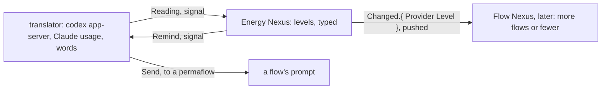

# The Energy Nexus

The Energy Nexus knows how much usage the machine has left, on every provider, and says so: it answers a reading, pushes each change, and sends a reminder when a level is crossed. It is the worked example of a translator: the Nexus holds only typed readings; every word of every provider's API lives in the translator.



## Library

```ethos
Library
[ flow:[ Address ] ]                    ; imports: the Flow Nexus's Address, vision:flow-nexus
[ Provider.[ Claude Codex ]
  Percent.Integer                      ; 0 to 100
  Instant.Integer                      ; Unix seconds
  Minutes.Integer
  Window.{ Name.[ Session Week ]       ; one rate limit
           Used.Percent
           Resets.Instant
           Duration.Minutes }
  ResetId.String
  ResetStatus.[ Available Redeeming Redeemed ]
  Reset.{ ResetId ResetStatus Expires.Instant }
  Reading.{ Provider
            Allowed.Boolean            ; the provider's own word
            Vector<Window>
            Vector<Reset>              ; Codex only; empty for Claude
            At.Instant }
  Level.[ Plenty Fair Low Out ]        ; Out is Allowed false
  Threshold.{ Level Left.Percent }     ; a level begins at this much left
  Recipient.Address                    ; a permaflow the reminder goes to
  Reminder.{ Provider Level Recipient }
  Target.[ Even                        ; spend the window evenly
           SpendBy.Instant ]           ; spend it whole by this instant
  ProviderTarget.{ Provider Target }
  Pace.{ Provider
         Target
         Expected.Percent              ; what the target says is used by now, time counted in useful hours
         Used.Percent
         Standing.[ Over Under On ]    ; used against expected
         HoursLeft.Hours               ; the hours left in the window
         UsefulLeft.Decimal            ; those hours, each counted at its usefulness
         PerUsefulHour.Decimal } ]     ; percent left per useful hour left
[]
[]
```

## Signal

```ethos
Signal
[ energy:[ Provider Reading Level Reset ResetId Pace ] ]
[ Read.Provider                        ; a reading, now
  Subscribe                            ; readings and levels as they change
  Redeem.Provider ]                    ; the soonest Codex reset, under the rule
[ Read.{ Reading Pace }                ; the reading, and its pace against the target
  Subscribed
  Changed.{ Provider Level Reading }   ; pushed on every level change
  Redeemed.Reset
  Refused.[ ProviderDown.Provider
            NoReset
            RuleRefused.String ] ]     ; why the rule refused: not out, not expiring
[]
```

## Meta

```ethos
Signal
[ energy:[ Provider Threshold Reminder Minutes Percent ResetId ProviderTarget Span Override Baseline ] ]
[ Configure.Set ]
[ Configured.Set
  ConfigureRefused.String ]
[ Set.[ Polling.Minutes
        Threshold.Threshold            ; one level's boundary
        Reminder.Reminder              ; who hears about a level
        RemoveReminder.Reminder
        RedeemExpiring.Minutes         ; redeem within this many minutes of a reset expiring
        RedeemUsedAtLeast.Percent      ; or when the week is this used
        Target.ProviderTarget          ; one provider's pace target
        Span                           ; one span of the schedule, added
        RemoveSpan.Span
        Override                       ; one stretch of time, set over the schedule
        RemoveOverride.Override
        Baseline ] ]                   ; the usefulness of every other hour
```

## Operation

```ethos
Operation
[ energy:[ Provider Reading Level Reminder Reset ] ]
[ Reading.Provider                     ; attempts
  Levelling.Reading                    ;   a reading into a level; Changed if it moved
  Reminding.{ Reminder Reading }
  Redeeming.Provider ]
[ Read.Reading
  Levelled.Option<Level>               ; Some when the level moved
  Reminded
  Redeemed.Reset
  Failed.[ ProviderDown NoReset RuleRefused.String ] ]
[]
```

## Emission

The translator's vocabulary. Each emission is one call; the words of the call are the translator's alone.

```ethos
Emission
[ energy:[ Reading ResetId Recipient Level Provider ] ]
[ CodexRateLimits                      ; codex app-server, account/rateLimits/read
  CodexConsumeReset.{ ResetId Idempotency.String }  ; account/rateLimitResetCredit/consume
  ClaudeUsage                          ; the Claude usage endpoint, with the login
  Send.{ Recipient Provider Level } ]  ; flow Send.{ Address Soft.Notice }, the text composed here
[ Observed.Reading
  Consumed.[ Reset NothingToReset NoCredit AlreadyRedeemed ]
  Sent
  Down ]
[]
```

```rust
impl Emittable for CodexRateLimits {                      // the one place the words live
    type Outcome = ExternalOutcome;
    fn emit(&self, t: &Translator) -> ExternalOutcome {
        t.app_server("account/rateLimits/read", json!({})) // reply → Reading, typed, by the translator
    }
}
```

## Memory

```ethos
Memory
[ energy:[ Provider Reading Level Threshold Reminder Minutes Percent ProviderTarget Span Override Baseline ] ]
[ Latest.{ Provider Reading Level }
  History.Vector<Reading>
  Configuration.{ Polling.Minutes
                  Vector<Threshold>
                  Vector<Reminder>
                  RedeemExpiring.Minutes
                  RedeemUsedAtLeast.Percent
                  Targets.Vector<ProviderTarget>
                  Schedule.Vector<Span>
                  Vector<Override>
                  Baseline }
  Answer.[ Succeeded Failed.String ] ]
```

## Pace: over or under, per day

A reading alone says how much is left; pace says whether the machine is spending it as intended, and is the default answer to every reading. Each provider has a target: Even spends the window evenly; SpendBy spends it whole by an instant, as when a Codex reset is to be redeemed before it expires and the week is meant to be used up first. Pace is the comparison of what has been used to what the target says should have been used by now.

Energy is best spent in the hours it is most useful, so pace measures time in useful hours: each hour of the week counts at the usefulness its owner gave it, and an hour he named nothing for counts at the baseline. The same energy left reads lower with one day and two nights ahead than with two days and one night. Pace says how many hours the window has left, how many useful hours those come to, and what is left per useful hour: the power the machine can run at.

The schedule is its owner's: one who works every day, one who keeps the weekend, and one who has two evenings a week each say so in spans.

Where two spans name the same hour, the more specific one counts: the span naming fewer days, and between two naming as many days, the one naming fewer hours. An override counts over every span.

```ethos
Hours.Integer
Hour.Integer                         ; 0 to 23, in the owner's local time
Weekday.[ Monday Tuesday Wednesday Thursday Friday Saturday Sunday ]
Usefulness.Percent                   ; what an hour counts for; 100 is an hour at full use
Baseline.Percent                     ; the usefulness of an hour no span names
Span.{ Vector<Weekday>               ; on these days,
       From.Hour To.Hour             ;   between these hours,
       Usefulness }                  ;   an hour counts this much
Override.{ From.Instant To.Instant   ; between these two instants, whatever the schedule says,
           Usefulness }              ;   an hour counts this much
```

A schedule may be drawn from the record of when its owner was most active, in place of his own estimate.

An override sets the usefulness of one stretch of time, over the schedule: a day away, a meeting, a morning he means to work hard. He sets one by hand; whatever keeps his calendar sets one as an entry is made, an event like any other.

```datom
Configure.Baseline.20
Configure.Span.{ [ Monday Tuesday Wednesday Thursday Friday Saturday Sunday ] 8 22 100 }
Read.Codex
Read.{ { Codex true [ { Week 35 1795054860 10080 } ] [] 1794610200 }
       { Codex Even 25 35 Over 124 83.5 0.78 } }
; one who keeps the weekend: weekdays at full use, the weekend at the baseline
Configure.Span.{ [ Monday Tuesday Wednesday Thursday Friday ] 9 18 100 }
; one who has a job: two evenings at full use, and the weekend mornings at half
Configure.Span.{ [ Tuesday Thursday ] 19 23 100 }
Configure.Span.{ [ Saturday Sunday ] 9 13 50 }
; a gradient: the hours around noon at full use, the early morning and the evening at less
Configure.Span.{ [ Monday Tuesday Wednesday Thursday Friday Saturday Sunday ] 6 10 60 }
Configure.Span.{ [ Monday Tuesday Wednesday Thursday Friday Saturday Sunday ] 10 14 100 }
Configure.Span.{ [ Monday Tuesday Wednesday Thursday Friday Saturday Sunday ] 14 22 70 }
; an override: an afternoon at the dentist, two hours at nothing
Configure.Override.{ 1794859200 1794866400 0 }
```

```datom
Configure.Target.{ Codex SpendBy.1762450320 }   ; use the week up before the reset expires
Configure.Target.{ Claude Even }
Read.Codex
Read.{ { Codex true [ { Week 92 1762235580 10080 } ] [ { rc_1 Available 1762450320 } ] 1762210000 }
       { Codex SpendBy.1762450320 88 92 Over 48 32.0 0.25 } }
```

## The redeem rule

A Codex reset is redeemed when the provider says usage is not allowed and work is waiting, or within RedeemExpiring minutes of its expiry with the week at least 1% used; the reset redeemed is the available one expiring soonest, never a later one while an earlier stands. The rule is the Nexus's; the call is the translator's.

## Later: the Flow Nexus listens

The Flow Nexus subscribes. On Plenty it launches more and higher; on Low it launches fewer and cheaper; on Out it lets flows sleep and wakes them on Changed. What it does at each level is its own configuration, not the Energy Nexus's.

```datom
energy-nexus 'Read.Codex'
Read.{ { Codex true [ { Week 92 1762235580 10080 } ] [ { rc_1 Available 1762450320 } ] 1762210000 }
       { Codex Even 23 92 Over 120 80.0 0.1 } }
Configure.Reminder.{ Codex Low { Psyche core Primary } }
```
