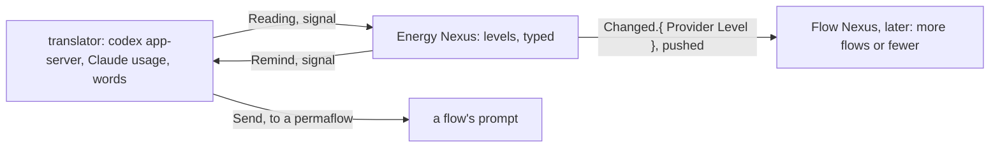

# The Energy Nexus

The Energy Nexus knows how much usage the machine has left, on every provider, and says so: it answers a reading, pushes each change, and sends a reminder when a level is crossed. It is the worked example of a translator: the Nexus holds only typed readings; every word of every provider's API lives in the translator.



## Library

The Address is the Flow Nexus's, from vision:flow-nexus:0. A Percent is 0 to 100 and an Instant is Unix seconds; a Window is one rate limit. In a Reading, Allowed is the provider's own word, and the resets are Codex only, empty for Claude; the level Out is Allowed false. A Threshold is the percent left at which a level begins, and a Recipient is a permaflow a reminder goes to. A Target is Even, which spends the window evenly, or SpendBy, which has this much of the window spent this many hours before it resets and holds for every window after. A Pace gives the window it is of, Session or Week, and Expected is what the target says is used by now, time counted in useful hours; Standing is used against expected, HoursLeft the hours left in the window, UsefulLeft those hours each counted at its usefulness, and PerUsefulHour the percent left per useful hour left.

```ethos
Library
[ flow:[ Address ] ]
[ Provider.[ Claude Codex ]
  Percent.Integer
  Instant.Integer
  Minutes.Integer
  Window.{ Name.[ Session Week ]
           Used.Percent
           Resets.Instant
           Duration.Minutes }
  ResetId.String
  ResetStatus.[ Available Redeeming Redeemed ]
  Reset.{ ResetId ResetStatus Expires.Instant }
  Reading.{ Provider
            Allowed.Boolean
            Vector<Window>
            Vector<Reset>
            At.Instant }
  Level.[ Plenty Fair Low Out ]
  Threshold.{ Level Left.Percent }
  Recipient.Address
  Reminder.{ Provider Level Recipient }
  Target.[ Even
           SpendBy.{ Before.Hours
                     Percent } ]
  ProviderTarget.{ Provider Target }
  Pace.{ Provider
         Name
         Target
         Expected.Percent
         Used.Percent
         Standing.[ Over Under On ]
         HoursLeft.Hours
         UsefulLeft.Decimal
         PerUsefulHour.Decimal } ]
[]
[]
```

## Signal

Read answers a reading now, with the pace of each window that takes a target; Subscribe gives readings and levels as they change, and Changed is pushed on every level change; Redeem redeems the soonest Codex reset under the rule, and RuleRefused says why the rule refused: not out, not expiring.

```ethos
Signal
[ energy:[ Provider Reading Level Reset ResetId Pace ] ]
[ Read.Provider
  Subscribe
  Redeem.Provider ]
[ Read.{ Reading Vector<Pace> }
  Subscribed
  Changed.{ Provider Level Reading }
  Redeemed.Reset
  Refused.[ ProviderDown.Provider
            NoReset
            RuleRefused.String ] ]
[]
```

## Meta

Each Set is one value: a Threshold is one level's boundary, a Reminder says who hears about a level, RedeemExpiring redeems within this many minutes of a reset expiring and RedeemUsedAtLeast when the week is this used, a Target is one provider's pace target, a Span is one span of the schedule, added, an Override is one stretch of time set over the schedule, and a Baseline is the usefulness of every other hour.

```ethos
Signal
[ energy:[ Provider Threshold Reminder Minutes Percent ResetId ProviderTarget Span Override Baseline ] ]
[ Configure.Set ]
[ Configured.Set
  ConfigureRefused.String ]
[ Set.[ Polling.Minutes
        Threshold.Threshold
        Reminder.Reminder
        RemoveReminder.Reminder
        RedeemExpiring.Minutes
        RedeemUsedAtLeast.Percent
        Target.ProviderTarget
        Span
        RemoveSpan.Span
        Override
        RemoveOverride.Override
        Baseline ] ]
```

## Operation

The attempts are Reading, Levelling, which turns a reading into a level and answers Changed if it moved, Reminding and Redeeming; Levelled is Some when the level moved.

```ethos
Operation
[ energy:[ Provider Reading Level Reminder Reset ] ]
[ Reading.Provider
  Levelling.Reading
  Reminding.{ Reminder Reading }
  Redeeming.Provider ]
[ Read.Reading
  Levelled.Option<Level>
  Reminded
  Redeemed.Reset
  Failed.[ ProviderDown NoReset RuleRefused.String ] ]
[]
```

## Emission

The translator's vocabulary. Each emission is one call; the words of the call are the translator's alone.

CodexRateLimits calls codex app-server, account/rateLimits/read; CodexConsumeReset calls account/rateLimitResetCredit/consume; ClaudeUsage calls the Claude usage endpoint with the login; Send is flow Send.{ Address Soft.Notice }, its text composed here.

```ethos
Emission
[ energy:[ Reading ResetId Recipient Level Provider ] ]
[ CodexRateLimits
  CodexConsumeReset.{ ResetId Idempotency.String }
  ClaudeUsage
  Send.{ Recipient Provider Level } ]
[ Observed.Reading
  Consumed.[ Reset NothingToReset NoCredit AlreadyRedeemed ]
  Sent
  Down ]
[]
```

CodexRateLimits is the one place the words live, and the translator types the reply into a Reading.

```rust
impl Emittable for CodexRateLimits {
    type Outcome = ExternalOutcome;
    fn emit(&self, t: &Translator) -> ExternalOutcome {
        t.app_server("account/rateLimits/read", json!({}))
    }
}
```

## Memory

```ethos
Memory
[ energy:[ Provider Reading Level Threshold Reminder Minutes Percent ProviderTarget Span Override Baseline ] ]
[ Latest.{ Provider Reading Level }
  History.Vector<Reading>
  Configuration.{ Polling.Minutes
                  Vector<Threshold>
                  Vector<Reminder>
                  RedeemExpiring.Minutes
                  RedeemUsedAtLeast.Percent
                  Targets.Vector<ProviderTarget>
                  Schedule.Vector<Span>
                  Vector<Override>
                  Baseline }
  Answer.[ Succeeded Failed.String ] ]
```

## Pace: over or under, per day

A reading alone says how much is left; pace says whether the machine is spending it as intended, and is the default answer to every reading. Each provider has a target: Even spends the window evenly; SpendBy has a stated share of the window spent a stated number of hours before it resets, and holds for every window after. Pace is the comparison of what has been used to what the target says should have been used by now.

The session window is a ceiling on the rate of work and takes no target. A session spent out is a fault in the pace: the week was being spent in a burst.

Energy is best spent in the hours it is most useful, so pace measures time in useful hours: each hour of the week counts at the usefulness its owner gave it, and an hour he named nothing for counts at the baseline. The same energy left reads lower with one day and two nights ahead than with two days and one night. Pace says how many hours the window has left, how many useful hours those come to, and what is left per useful hour: the power the machine can run at.

The schedule is its owner's: one who works every day, one who keeps the weekend, and one who has two evenings a week each say so in spans.

Where two spans name the same hour, the more specific one counts: the span naming fewer days, and between two naming as many days, the one naming fewer hours. An override counts over every span.

An Hour is 0 to 23 in the owner's local time; Usefulness is what an hour counts for, 100 being an hour at full use; a Baseline is the usefulness of an hour no span names; a Span counts an hour this much between these hours on these days; an Override counts an hour this much between two instants, whatever the schedule says.

```ethos
Hours.Integer
Hour.Integer
Weekday.[ Monday Tuesday Wednesday Thursday Friday Saturday Sunday ]
Usefulness.Percent
Baseline.Percent
Span.{ Vector<Weekday>
       From.Hour To.Hour
       Usefulness }
Override.{ Since.Instant Until.Instant
           Usefulness }
```

A schedule may be drawn from the record of when its owner was most active, in place of his own estimate.

An override sets the usefulness of one stretch of time, over the schedule: a day away, a meeting, a morning he means to work hard. He sets one by hand; whatever keeps his calendar sets one as an entry is made, an event like any other.

An override whose end has passed is removed at the next change of the schedule.

After the first reading, the spans are examples: one who keeps the weekend has weekdays at full use and the weekend at the baseline; one who has a job has two evenings at full use and the weekend mornings at half; a gradient has the hours around noon at full use and the early morning and the evening at less; and an override is an afternoon at the dentist, two hours at nothing.

```datom
Configure.Baseline.20
Configure.Span.{ [ Monday Tuesday Wednesday Thursday Friday Saturday Sunday ] 8 22 100 }
Read.Codex
Read.{ { Codex true [ { Week 35 1795054860 10080 } ] [] 1794610200 }
       [ { Codex Week Even 25 35 Over 124 83.5 0.78 } ] }
Configure.Span.{ [ Monday Tuesday Wednesday Thursday Friday ] 9 18 100 }
Configure.Span.{ [ Tuesday Thursday ] 19 23 100 }
Configure.Span.{ [ Saturday Sunday ] 9 13 50 }
Configure.Span.{ [ Monday Tuesday Wednesday Thursday Friday Saturday Sunday ] 6 10 60 }
Configure.Span.{ [ Monday Tuesday Wednesday Thursday Friday Saturday Sunday ] 10 14 100 }
Configure.Span.{ [ Monday Tuesday Wednesday Thursday Friday Saturday Sunday ] 14 22 70 }
Configure.Override.{ 1794859200 1794866400 0 }
```

The first target spends the week whole, a day before each reset; the second spends 92 percent a day before each reset.

```datom
Configure.Target.{ Codex SpendBy.{ 24 100 } }
Configure.Target.{ Claude SpendBy.{ 24 92 } }
Read.Codex
Read.{ { Codex true [ { Week 92 1762235580 10080 } ] [ { rc_1 Available 1762450320 } ] 1762210000 }
       [ { Codex Week SpendBy.{ 2 100 } 95 92 Under 5 5.1 1.57 } ] }
```

## The redeem rule

A Codex reset is redeemed when the provider says usage is not allowed and work is waiting, or within RedeemExpiring minutes of its expiry with the week at least 1% used; the reset redeemed is the available one expiring soonest, never a later one while an earlier stands. The rule is the Nexus's; the call is the translator's.

## Later: the Flow Nexus listens

The Flow Nexus subscribes. On Plenty it launches more and higher; on Low it launches fewer and cheaper; on Out it lets flows sleep and wakes them on Changed. What it does at each level is its own configuration, not the Energy Nexus's.

```datom
energy-nexus 'Read.Codex'
Read.{ { Codex true [ { Week 92 1762235580 10080 } ] [ { rc_1 Available 1762450320 } ] 1762210000 }
       [ { Codex Week Even 95 92 Under 7 5.6 1.43 } ] }
Configure.Reminder.{ Codex Low { Psyche core Primary } }
```
