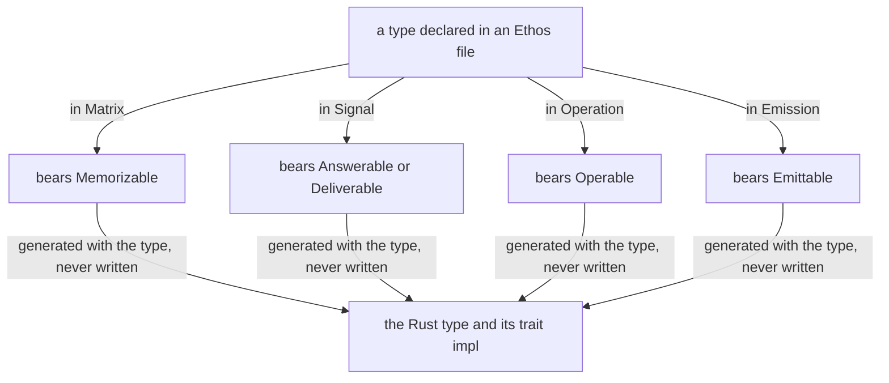

## Ethos and the Rust it generates are shown apart

An example shows the Ethos file and the Rust it generates as two blocks, each named for what it is: the Ethos, then the Rust generated from it.

The Ethos:

```
Library
[ std:[ Clonable Sendable Serializable ] ]
[]
[ Processable<[Clonable Sendable] Serializable>.[] ]
[]
```

The Rust generated from it:

```rust
pub trait Processable<A: Clone + Send, B: Serialize> { /* … */ }
```

In the Rust, the trait's identity is its name and its constraints, two generic parameters with their bounds: what ethos writes as the bounds alone, Rust writes as a named parameter carrying them, and the parameter names are Rust's need, not the trait's.

The generated code writes each imported name fully qualified: `:protos:String` appears as `protos::String`, `:datom:Datom` as `datom::Datom`.

```ethos
Library
[ signal_flow:signal:[ Input Output ]
  signal_flow:[ Call Caller ] ]
```

```rust
pub mod signal { pub enum Input { … } pub enum Output { … } }
pub struct Call { … }
```

In the Ethos and in the Rust, the first is the implied namespace, what the Signal root generated, and the second is the written namespace, what the file declares.

A declaration turns into the Rust type with named fields, bearing the
datom traits through the derive, which Ethos Zero emits with the type.
A field is named after its type in snake case; a constructed type
type-first, `string_vector`, `lock_option`; a repeated type as first
and second.

The Ethos:

```
Library
[]
[ LockId.Integer
  LockName.String
  Lock.{
     LockId
     LockName
     Vector<String>
     Option<Lock> }
  Generation.{
     String
     String } ]
[]
[]
```

The Rust generated from it:

```rust
#[derive(Datomizable, Compositional)] pub struct LockId(pub Integer);
#[derive(Datomizable, Compositional)] pub struct LockName(pub String);
#[derive(Datomizable, Compositional)]
pub struct Lock { pub lock_id: LockId, pub lock_name: LockName, pub string_vector: Vec<String>, pub lock_option: Option<Box<Lock>> }
#[derive(Datomizable, Compositional)]
pub struct Generation { pub first_string: String, pub second_string: String }
```

The Option<Lock> position of Lock is boxed, since the position closes a by-value cycle.

The inline struct or enum is
a full type whose derived name carries an underscore, non-idiomatic
for a Rust type, so it never collides and reads at a glance as
inferred from the sugar.

The Ethos:

```
Library
[]
[ LockId.Integer
  LockName.String
  Lock.{
     LockId
     LockName }
  LockRejection.[
     DuplicateName.Lock
     PathOverlap.{
        Lock
        Lock } ] ]
[]
[]
```

The Rust generated from it:

```rust
#[derive(Datomizable, Compositional)] pub struct LockId(pub Integer);
#[derive(Datomizable, Compositional)] pub struct LockName(pub String);
#[derive(Datomizable, Compositional)]
pub struct Lock { pub lock_id: LockId, pub lock_name: LockName }
#[derive(Datomizable, Compositional)]
pub struct PathOverlap_Data { pub first_lock: Lock, pub second_lock: Lock }
#[derive(Datomizable, Compositional)]
pub enum LockRejection { DuplicateName(Lock), PathOverlap(PathOverlap_Data) }
```

The Ethos:

```
Library
[]
[ FilePath.String
  SyntaxError.Vector<FilePath>
  GenerationFailure.[
     SyntaxError
     Unwritable ] ]
[]
[]
```

The Rust generated from it:

```rust
#[derive(Datomizable, Compositional)] pub struct FilePath(pub String);
#[derive(Datomizable, Compositional)] pub struct SyntaxError(pub Vec<FilePath>);
#[derive(Datomizable, Compositional)]
pub enum GenerationFailure { SyntaxError(SyntaxError), Unwritable }
```

The Ethos:

```
Library
[]
[ FilePath.String
  GenerationFailure.[
     SyntaxError.Vector<FilePath>
     Unwritable.{
        FilePath
        String } ] ]
[]
[]
```

The Rust generated from it:

```rust
#[derive(Datomizable, Compositional)] pub struct FilePath(pub String);
#[derive(Datomizable, Compositional)]
pub struct Unwritable_Data { pub file_path: FilePath, pub string: String }
#[derive(Datomizable, Compositional)]
pub enum GenerationFailure { SyntaxError(Vec<FilePath>), Unwritable(Unwritable_Data) }
```

## Every declared type bears both traits

Ethos Zero emits `Datomizable` and `Compositional` on every struct and
enum it generates, so every ethos-declared type always bears both traits.

```rust
#[derive(Datomizable, Compositional)]
pub enum GenerationFailure { SyntaxError(SyntaxError), Unwritable }
```

## The datom traits are compiled in only where text is spoken

A generated signal library bears `Datomizable` and `Compositional`
conditionally, under a feature the CLI and client enable and the Nexus
does not. The Nexus compiles the same types without any
textualization capability and without datom-codec as a dependency.

```rust
#[cfg_attr(feature = "datom", derive(Datomizable, Compositional))]
pub enum Input { Lock(LockRequest), Release(LockId) }
```
```toml
signal-orchestrate = { version = "…", features = ["datom"] }
signal-orchestrate = { version = "…" }
```

Ethos Zero emits the Rust above into the signal crate; the first manifest line is the CLI's, with the datom feature, and the second is the Nexus's, without it.

The Ethos:

```
Signal
[]
[ Lock.LockRequest
  Release.LockId ]
[ Locked.Lock
  Released.Lock ]
[ LockId.Integer
  LockName.String
  FlowId.String
  LockRequest.{
     LockName
     FlowId }
  Lock.{
     LockId
     LockName } ]
```

The Rust generated from it:

```rust
pub enum Input  { Lock(LockRequest), Release(LockId) }
pub enum Output { Locked(Lock), Released(Lock) }
#[derive(Datomizable, Compositional)] pub struct LockId(pub Integer);
#[derive(Datomizable, Compositional)] pub struct LockName(pub String);
#[derive(Datomizable, Compositional)] pub struct FlowId(pub String);
```

The generated Rust carries a compile-time assertion that the
type bears the trait; the interaction body is hand-written Rust.

The Ethos:

```
Library
[]
[ Record.{
     String
     Integer } ]
[ Summarizable.[ summarize.[ String ] ] ]
[ Record.[ Summarizable ] ]
```

The Rust generated from it:

```rust
#[derive(Datomizable, Compositional)]
pub struct Record { pub string: String, pub integer: Integer }
pub trait Summarizable { fn summarize(&self) -> String; }
const _: () = {
    fn assert_record_summarizable<T: Summarizable>() {}
    let _ = assert_record_summarizable::<Record>;
};
```

The Ethos:

```
Library
[ std:Serializable ]
[ SinkError.[ Closed Full ] ]
[ Fillable.[ push!{ [ Serializable ] [ Result<Integer SinkError> ] }
             drain![ Vector<String> ]
             create:[ Self ] ] ]
[]
```

The Rust generated from it:

```rust
#[derive(Datomizable, Compositional)]
pub enum SinkError { Closed, Full }
pub trait Fillable {
    fn push<N: Serializable>(&mut self, input: N) -> Result<Integer, SinkError>;
    fn drain(&mut self) -> Vec<String>;
    fn create() -> Self;
}
```

The Ethos:

```
Library
[ std:Serializable ]
[]
[ Fillable.[ create:[ Self ] ]
  Streamable.{
     [ Fillable ]
     [ Item<Serializable> ]
     [ CAPACITY.Integer ]
     [ next![ Option<Item> ] ] } ]
[]
```

The Rust generated from it:

```rust
pub trait Fillable { fn create() -> Self; }
pub trait Streamable: Fillable {
    type Item: Serializable;
    const CAPACITY: Integer;
    fn next(&mut self) -> Option<Self::Item>;
}
```



The Ethos, an Emission importing its Signal's Input and Output:

```ethos
Emission
[ signal_capsule:signal:[ Input Output ] ]
[ Command.{ Verb Vector<Argument> } ]
[ Outcome.[ Done Refused.Integer ] ]
[ Verb.[ List Show ]
  Argument.[ Name.String Quiet ] ]
```

The Rust generated from it:

```rust
#[derive(Datomizable, Compositional)]
pub struct Command { pub verb: Verb, pub argument_vector: Vec<Argument> }
pub trait Emittable { type Outcome; fn emit(&self) -> Self::Outcome; }
impl Emittable for Command { type Outcome = Outcome; fn emit(&self) -> Outcome { /* hand-written: the call */ } }
```

The Rust generated from it:

```rust
impl Memorizable for Flow { /* generated */ }
```

The Ethos:

```
Library
[]
[ Sink.{
     String
     Integer } ]
[ Summarizable.[ summarize.[ String ] ]
  Fillable.[ create:[ Self ] ] ]
[ Sink.[
     Summarizable
     Fillable ] ]
```

The Rust generated from it:

```rust
const _: () = {
    fn assert_sink_summarizable<T: Summarizable>() {}
    let _ = assert_sink_summarizable::<Sink>;
    fn assert_sink_fillable<T: Fillable>() {}
    let _ = assert_sink_fillable::<Sink>;
};
```
