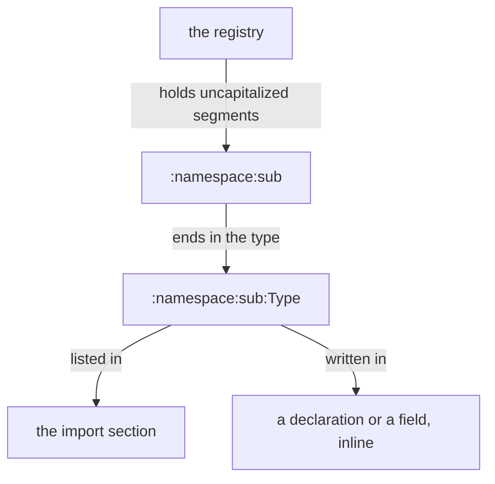
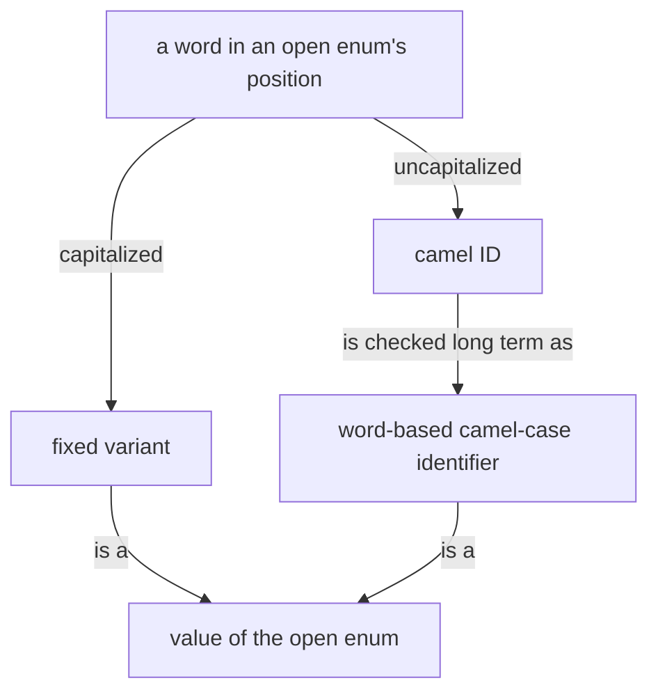
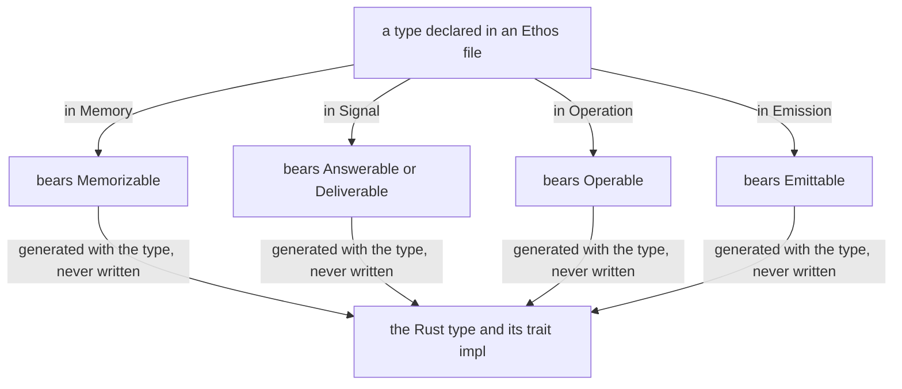

## Ethos and Nexus are infrastructure

Ethos and Nexus are basic infrastructure: the wood houses are built from.

## What Ethos is

Ethos is the schema language. Of the two main syntaxes most agents
will face, Ethos specifies the types and Datom fills them with data.

Ethos is central. The anatomy of the system, every type and every trait
it uses, is read in its ethos; an implementation is mostly the
hand-written bodies.

## Why Ethos

All the legacy languages have a high noise ratio. Some lisps came
close but lacked the correctness of Rust or Haskell; those have the
correctness but allow no higher layer of abstraction that keeps the
correctness of the whole. Ethos writes the mental model and the code
in one swoop.

## Roots

Five roots: Library, Signal, Operation, Memory, Emission. Signal declares what a Nexus says; Operation what it does, one operation type for every effect; Memory what it remembers; Emission what it sends into the world, each emission one external call and its outcome what the translator observed; Library what they share. An Emission imports a Signal's Input and Output by name, so an emission may carry what the Nexus was asked or answered. A memory trait carries a standard successful-or-unsuccessful change and, for each version, the upgrade from the previous format; that upgrade is the very edit the type needs. A version lives in a manifest.

## Non-repetition

Any repetition in ethos syntax is an implementation failure. Ethos
aims to be the most terse, non-repetitive syntax ever made.

Terseness is in the low amount of noise, with words written whole.

## Self-description

A datom object's basic CLI help emits the Ethos that describes its
anatomy. The wanted mechanism extends this: point at any object —
CLI now, Mentci later — and its Ethos prints, self-describing and
self-evident. The schema syntax serves two audiences: it trains
agents to use things properly, and it shows where the design is
lacking.

## Horizon

Ethos will eventually replace everything, Rustlang becoming its
assembly layer. Designs are chosen for that horizon; what it
enables — generator emission among it — comes in its time.

## Trait

Trait is the word for the bearer of capabilities, the same word in
ethos and in Rust; kind might be used to also mean traits.
In ethos, every constraint is a trait. Declaring a new trait
declares a new trait in the Rust world and might imply more in the
ethos world.

A capability speaks in Self, the trait's own parameters and other traits; a concrete type in an input is a trait not yet named.

## Naming

Traits are qualifier-named: Runnable, Textualizable, Structural,
Embodied. The verbs Rust imposes, Write and Read
among them, are tolerated as legacy, for cognitive ease while Rust
and ethos code are switched between so often; once ethos is the
authored language that debt is removed.

## Ethos and the Rust it generates are shown apart

An example shows the Ethos file and the Rust it generates as two blocks, each named for what it is: the Ethos, then the Rust generated from it.

## Identity

A trait is identified as a Rust trait is, by its name and its
constraints, written as one head: Processable<[Clonable Sendable]
Serializable>. A constraint is a trait, or a bracket of traits: what
Rust writes as a generic parameter with its bounds, ethos writes as
the bounds alone.
Two heads
that differ in a constraint are two traits. The constraints that belong
to the identity are those that identify the trait in the Rust the ethos compiles to.
What else a
trait declares, its supertraits, its associated types and constants,
its capabilities, is its definition. Angle brackets hold the
constraints; they are a protos delimiter, recycled from Rust as
Result and Self are.

The Ethos:

```
Library
[ std:[ Clonable Sendable Serializable ] ]                  ; imports: where the three constraint traits come from
[]                                                          ; types
[ Processable<[Clonable Sendable] Serializable>.[] ]        ; traits: the head is the identity, the name and two
                                                            ;   constraints, the first a bracket of two traits, the
                                                            ;   second one trait; the bracket after the dot holds
                                                            ;   its capabilities, its definition, empty here
[]                                                          ; associations
```

The Rust generated from it:

```rust
// The trait's identity: its name and its constraints, two generic parameters with their bounds.
// What ethos writes as the bounds alone, Rust writes as a named parameter carrying them;
// the parameter names are Rust's need, not the trait's.
pub trait Processable<A: Clone + Send, B: Serialize> { /* … */ }
```

## Declaration: File

The unit is File: one file, one Rust module. A file is one namespace.
An ethos file is written in the sweet form: the root's head,
then the sections as siblings, the outer braces omitted. The braced
form — the root's head opening braces that hold every section — is
the canonical form. The sweet form is kept out of the main logic run:
before the text is read as ethos at all, the file is converted
mechanically to the canonical form, so the ethos reader sees only
proper ethos.

An ethos file is unversioned data, as datom is. What is
versioned is versioned in a manifest of some kind.

A Library's sections, in order, are imports, types, traits and
associations. Every root's first section is its imports; its own
sections follow.

```
; the sweet form, as a file is written: the head, then the sections as siblings
Library
[ protos:String ]               ; imports
[ Record.{ String Integer } ]   ; types
[]                              ; traits
[]                              ; associations
```

```
; the canonical form the reader sees, after the mechanical conversion
Library.{ [ protos:String ]
          [ Record.{ String Integer } ]
          []
          [] }
```

## Imports

An explicit import and an intrinsic name mean the same thing. The names known without import depend on the Ethos object type; a Library, the standard library, knows String, Integer, Decimal, Boolean, Meaning, Vector, Option, Result, Self and Sized.

An import starts with a colon, followed by uncapitalized namespace segments separated by colons, ending in the type: `:namespace:sub:Type`. It is usable inline in a type declaration or a field, and the import section uses the same syntax: `:protos:String`, or `:protos:[ String Integer ]` for several. The generated code writes each imported name fully qualified: `:protos:String` appears as `protos::String`, `:datom:Datom` as `datom::Datom`.

```
Library
[ :protos:[ String Textualizable ]   ; imports
  :datom:Datom ]
[ Record.{ String Datom } ]          ; types: Datom, imported
[]                                   ; traits
[ Record.[ Textualizable ] ]         ; associations: Textualizable, imported
```

An import may stand where the type is used, with no entry in the imports section. In a declaration the colon replaces the dot: `Topic:custom:Name` declares `Topic` over the type `Name` from the namespace `custom`. A field takes the import with its leading colon: `Failure.{ :protos:Error String }`. The colon marks the import; the namespace segments are uncapitalized and the type is capitalized.

```
Library
[]                              ; imports
[ Topic:custom:Name             ; a newtype, inline
  Failure.{ :protos:Error       ; a field, inline
            String } ]
[]                              ; traits
[]                              ; associations
```



The chained form, `std:[ Clonable Sendable Serializable ]`, is still read and means the same.

A root that generates types puts them in an implied namespace named for the root, beside the file's own namespace, which holds only what the file writes, so a generated name reserves nothing in the file. A Signal exports `signal:[ Input Output ]`; Operation and Memory export `operation:` and `memory:` when they generate. A trait is exported by name as a type is, from the written namespace; the root-implied traits, Answerable, Deliverable, Operable, Memorizable and Emittable, are defined once in the standard library.

```ethos
Library
[ signal_flow:signal:[ Input Output ]                    ; the implied namespace: what the Signal root generated
  signal_flow:[ Call Caller ] ]                          ; the written namespace: what the file declares
```

```rust
pub mod signal { pub enum Input { … } pub enum Output { … } }   // the implied namespace
pub struct Call { … }                                            // the written one
```

Ethos resolves every import while it reads, from the ethos each dependency carries beside its crate, and refuses before any Rust exists; an unresolved import or a doubled name is an Ethos error naming the file and the name.

```ethos
Library
[]                                                         ; imports
[ ImportError.[ UnknownNamespace.Namespace                 ; types: no such namespace is known
                UnknownName.{ Namespace Name }             ;   the namespace exists, exports no such name
                Collision.{ Namespace Name } ]             ;   two declarations of one name in one file
  Namespace.String
  Name.String ]
[]                                                         ; traits
[]                                                         ; associations
```

## What a declaration turns into

A declaration turns into the Rust type with named fields, bearing the
datom traits through the derive, which Ethos Zero emits with the type.
A field is named after its type in snake case; a constructed type
type-first, `string_vector`, `lock_option`; a repeated type as first
and second.

A head over a single scalar declares a newtype: a single-member tuple struct holding it, so every declared name is its own type and carries its own derive.

The Ethos:

```
Library
[]                                       ; imports
[ LockId.Integer                         ; types
  LockName.String
  Lock.{                                 ;   a struct of four fields
     LockId
     LockName
     Vector<String>
     Option<Lock> }
  Generation.{                           ;   a struct of two strings
     String
     String } ]
[]                                       ; traits
[]                                       ; associations
```

The Rust generated from it:

```rust
#[derive(Datomizable, Compositional)] pub struct LockId(pub Integer);
#[derive(Datomizable, Compositional)] pub struct LockName(pub String);
#[derive(Datomizable, Compositional)]
pub struct Lock { pub lock_id: LockId, pub lock_name: LockName, pub string_vector: Vec<String>, pub lock_option: Option<Box<Lock>> }   // boxed: the position closes a by-value cycle
#[derive(Datomizable, Compositional)]
pub struct Generation { pub first_string: String, pub second_string: String }
```

## Inline types

A type may be declared where it is used. The inline struct or enum is
a full type whose derived name carries an underscore, non-idiomatic
for a Rust type, so it never collides and reads at a glance as
inferred from the sugar.

The Ethos:

```
Library
[]                                       ; imports
[ LockId.Integer                         ; types
  LockName.String
  Lock.{
     LockId
     LockName }
  LockRejection.[                        ;   an enum: one variant naming a defined type,
     DuplicateName.Lock                  ;   one declaring its payload inline
     PathOverlap.{
        Lock
        Lock } ] ]
[]                                       ; traits
[]                                       ; associations
```

The Rust generated from it:

```rust
#[derive(Datomizable, Compositional)] pub struct LockId(pub Integer);
#[derive(Datomizable, Compositional)] pub struct LockName(pub String);
#[derive(Datomizable, Compositional)]
pub struct Lock { pub lock_id: LockId, pub lock_name: LockName }
#[derive(Datomizable, Compositional)]
pub struct PathOverlap_Data { pub first_lock: Lock, pub second_lock: Lock }
#[derive(Datomizable, Compositional)]
pub enum LockRejection { DuplicateName(Lock), PathOverlap(PathOverlap_Data) }
```

Everything is a type, positioned. A type used once is declared inline where it is used; a type used in more than one place is declared once and named. A variant's payload is written in the variant and bears the variant's name. Inline nesting goes about three deep; past that, the type comes from a Library.

## A variant named as a defined type carries that type

When a variant's name is a type already defined in the library, that
type is the data the variant carries. Nothing further is written.

The Ethos:

```
Library
[]                                    ; imports
[ FilePath.String                     ; types: FilePath is a newtype of String
  SyntaxError.Vector<FilePath>        ;        SyntaxError is a vector of FilePath
  GenerationFailure.[                 ;        an enum: the variant SyntaxError is bare here,
     SyntaxError                      ;        but SyntaxError is a defined type, so it carries one
     Unwritable ] ]
[]                                    ; traits
[]                                    ; associations
```

The Rust generated from it:

```rust
#[derive(Datomizable, Compositional)] pub struct FilePath(pub String);
#[derive(Datomizable, Compositional)] pub struct SyntaxError(pub Vec<FilePath>);
#[derive(Datomizable, Compositional)]
pub enum GenerationFailure { SyntaxError(SyntaxError), Unwritable }
```

A type that has a name is used by its name: a variant or a position carrying a defined type carries it bare, and a head over a type that is not a scalar, a struct, an enum, a vector or a newtype, is refused by ethos-zero. The newtype, a head over a single scalar, is the one wrapping there is; a struct whose only content is one other type is that type, written as it.

The Ethos refused:

```ethos
SendableRequest.[ Living.Said ]             ; refused: Living only wraps Said
```

The Ethos wanted:

```ethos
Living.{ Context.String                     ; declared once: what his words were about,
         Verbatim.String }                  ;   and his words whole
SendableRequest.[ Living ]                  ; the variant carries Living, bare
```

The datom, the same either way:

```datom
Living.{ «context» «verbatim» }
```

## A variant may declare its payload inline

Instead of naming a defined type, a variant may declare what it
carries in place: a vector, a struct, or an enum, each a full type
with a derived name, recursively.

The Ethos:

```
Library
[]                                         ; imports
[ FilePath.String                          ; types
  GenerationFailure.[
     SyntaxError.Vector<FilePath>          ;   the payload declared inline: a vector
     Unwritable.{                          ;   declared inline: a struct, derived name
        FilePath
        String } ] ]
[]                                         ; traits
[]                                         ; associations
```

The Rust generated from it:

```rust
#[derive(Datomizable, Compositional)] pub struct FilePath(pub String);
#[derive(Datomizable, Compositional)]
pub struct Unwritable_Data { pub file_path: FilePath, pub string: String }
#[derive(Datomizable, Compositional)]
pub enum GenerationFailure { SyntaxError(Vec<FilePath>), Unwritable(Unwritable_Data) }
```

Every variant is capitalized: Ethos reads only a capitalized symbol as a variant.

The Ethos:

```
Library
[]                           ; imports
[ Reply.[ Accepted.Integer   ; types: two variants
          Refused.String ] ]
[]                           ; traits
[]                           ; associations
```

An enum has two variants or more; an enum of one variant is refused. Its variants are ordered by seniority, the first most senior.

The Ethos:

```
Library
[]                     ; imports
[ Reply.[ Accepted ] ] ; types: refused, one variant
[]                     ; traits
[]                     ; associations
```

## An open enum

An open enum is an Ethos object whose capitalized words are its fixed variants. A word that is not capitalized is its implied extensible variant, a camel ID: a word-based camel-case identifier, written bare, with no variant head before it.

The same mechanism carries an object that is represented unconventionally, such as a word-based hash.



## Every declared type bears both traits

Ethos Zero emits `Datomizable` and `Compositional` on every struct and
enum it generates, so every ethos-declared type always bears both traits.

```rust
#[derive(Datomizable, Compositional)]        // a type: always derived
pub enum GenerationFailure { SyntaxError(SyntaxError), Unwritable }
```

## The datom traits are compiled in only where text is spoken

A generated signal library bears `Datomizable` and `Compositional`
conditionally, under a feature the CLI and client enable and the Nexus
does not. The Nexus compiles the same types without any
textualization capability and without datom-codec as a dependency.

```rust
// emitted by Ethos Zero into the signal crate
#[cfg_attr(feature = "datom", derive(Datomizable, Compositional))]
pub enum Input { Lock(LockRequest), Release(LockId) }
```
```toml
# the CLI's manifest
signal-orchestrate = { version = "…", features = ["datom"] }
# the Nexus's manifest
signal-orchestrate = { version = "…" }
```

## Shapes and placement

Each section has its own parsing context; placement carries the
meaning. Head then symbol is a variant of `Input` or `Output` in a
Signal's first two sections, a newtype in the types section. An enum
declaration is a vector of its variants, and uses the vector's
delimiters. Ethos may generate default implementations for Input and
Output, which is why Signal is its own root.

The Ethos:

```
Signal
[]                                 ; imports
[ Lock.LockRequest                 ; inputs
  Release.LockId ]
[ Locked.Lock                      ; outputs
  Released.Lock ]
[ LockId.Integer                   ; types
  LockName.String
  FlowId.String
  LockRequest.{
     LockName
     FlowId }
  Lock.{
     LockId
     LockName } ]
```

The Rust generated from it:

```rust
pub enum Input  { Lock(LockRequest), Release(LockId) }
pub enum Output { Locked(Lock), Released(Lock) }
#[derive(Datomizable, Compositional)] pub struct LockId(pub Integer);
#[derive(Datomizable, Compositional)] pub struct LockName(pub String);
#[derive(Datomizable, Compositional)] pub struct FlowId(pub String);
```

## Traits are explicit; bodies are hand-written

A trait is declared; an association asserts the type
bears it. The generated Rust carries a compile-time assertion that the
type bears the trait; the interaction body is hand-written Rust.

The Ethos:

```
Library
[]                                      ; imports
[ Record.{                              ; types
     String
     Integer } ]
[ Summarizable.[ summarize.[ String ] ] ] ; traits
[ Record.[ Summarizable ] ]             ; associations
```

The Rust generated from it:

```rust
#[derive(Datomizable, Compositional)]
pub struct Record { pub string: String, pub integer: Integer }
pub trait Summarizable { fn summarize(&self) -> String; }
// Compile-time assertion: Record bears Summarizable.
const _: () = {
    fn assert_record_summarizable<T: Summarizable>() {}
    let _ = assert_record_summarizable::<Record>;
};
```

The Ethos:

```
Library
[]                            ; imports
[ Record.{                    ; types
     String
     Integer } ]
[ Summarizable.[              ; traits
    summarize.[ String ] ] ]
[ Record.[ Summarizable ] ]   ; associations
```

## Trait syntax

A simple trait opens with a bracket after the dot. Its capabilities sit
inside. The receiver after a capability's head names who is called:
`.` takes self, `!` takes mutable self, `:` takes no self. A
capability with inputs is a headed brace: inputs in a bracket, yield
in a bracket. A yield bracket holds one type.

The Ethos:

```
Library
[ std:Serializable ]                                          ; imports
[ SinkError.[ Closed Full ] ]                                 ; types
[ Fillable.[ push!{ [ Serializable ] [ Result<Integer SinkError> ] } ; traits: the input is a trait, so push takes any Serializable
             drain![ Vector<String> ]
             create:[ Self ] ] ]
[]                                                            ; associations
```

The Rust generated from it:

```rust
#[derive(Datomizable, Compositional)]
pub enum SinkError { Closed, Full }
pub trait Fillable {
    fn push<N: Serializable>(&mut self, input: N) -> Result<Integer, SinkError>;
    fn drain(&mut self) -> Vec<String>;
    fn create() -> Self;
}
```

A complex trait opens with a brace after the dot. Inside: supertraits in
a bracket, associated types with their constraints in a bracket,
associated constants in a bracket — upper case, each the name, a dot,
and its type — and capabilities in a bracket.

The Ethos:

```
Library
[ std:Serializable ]                  ; imports
[]                                    ; types
[ Fillable.[ create:[ Self ] ]        ; traits
  Streamable.{
     [ Fillable ]
     [ Item<Serializable> ]
     [ CAPACITY.Integer ]
     [ next![ Option<Item> ] ] } ]
[]                                    ; associations
```

The Rust generated from it:

```rust
pub trait Fillable { fn create() -> Self; }
pub trait Streamable: Fillable {
    type Item: Serializable;
    const CAPACITY: Integer;
    fn next(&mut self) -> Option<Self::Item>;
}
```

A trait's identity is its name and its constraints, as stated in the
Identity section above.

## Associations

An association declares that a type bears a trait: the type's name, a
dot, a bracket of its traits. In a Library they are the fourth section,
after the traits.

Signal, Operation, Memory and Emission imply traits on the types they declare: each type bears its root's trait, generated with it and never written. A Signal's first section holds its inputs and its second its outputs. An input is Answerable: it names the one output that answers it, sent at once, an acknowledgement at least. An output is Deliverable: it has a destination and leaves the Nexus toward it, expecting nothing back; an output no input names is a reaction. An operation is Operable: an object that acts on what it receives. A record of Memory is Memorizable. An emission is Emittable: the translator turns it into the call and yields its Outcome.



The Ethos, an Emission importing its Signal's Input and Output:

```ethos
Emission
[ signal_herdr:signal:[ Input Output ] ] ; imports: the Signal's inputs and outputs, from its implied namespace
[ Command.{ Verb Vector<Argument> } ]  ; emissions: one external call each
[ Outcome.[ Done Refused.Integer ] ]   ; outcomes: what the translator observed
[ Verb.[ List Show ]                   ; types
  Argument.[ Name.String Quiet ] ]
```

The Rust generated from it:

```rust
#[derive(Datomizable, Compositional)]
pub struct Command { pub verb: Verb, pub argument_vector: Vec<Argument> }
pub trait Emittable { type Outcome; fn emit(&self, translator: &Translator) -> Self::Outcome; }
impl Emittable for Command { type Outcome = Outcome; fn emit(&self, translator: &Translator) -> Outcome { /* hand-written: the call */ } }
```

The Rust generated from it:

```rust
impl Memorizable for Flow { /* generated */ }
```

The Ethos:

```
Library
[]                                       ; imports
[ Sink.{                                 ; types
     String
     Integer } ]
[ Summarizable.[ summarize.[ String ] ]  ; traits
  Fillable.[ create:[ Self ] ] ]
[ Sink.[                                 ; associations
     Summarizable
     Fillable ] ]
```

The Rust generated from it:

```rust
// Compile-time assertion: Sink bears Summarizable and Fillable.
const _: () = {
    fn assert_sink_summarizable<T: Summarizable>() {}
    let _ = assert_sink_summarizable::<Sink>;
    fn assert_sink_fillable<T: Fillable>() {}
    let _ = assert_sink_fillable::<Sink>;
};
```

Interactions — the term for trait implementations — use the type
itself in all cases.

The code we design composes structs; a tuple appears only at a contact point that requires it (standard
traits, dependencies), and in its one declared case, the newtype.

## Spacing

Space the delimiters and the inner content. Ethos follows the
canonical protos print: a space inside every bracket and brace
at both ends when non-empty, and the vertical expansion, under which
a structure of leaves alone sits on one line and a structure with
more than one element, one of them with a next layer, opens on its
line and its elements hang beneath the first, aligned, the closing
delimiter ending the last element's line.

The Ethos, describing Ethos itself; tentative in its names:

```ethos
Library
[]
[ Name.String
  Import.{
     Namespace.String
     Vector<Name> }
  Shape.[
     Named.Name
     Struct.Vector<Shape>
     Enum.Vector<Variant>
     Constructed.{
        Name
        Vector<Shape> } ]
  Variant.{
     Name
     Option<Shape> }
  Declaration.{
     Name
     Shape }
  Capability.{
     Name
     Inputs.Vector<Shape>
     Yield.Shape }
  Trait.{
     Name
     Vector<Capability> }
  Association.{
     Name
     Vector<Name> }
  Library.{
     Imports.Vector<Import>
     Types.Vector<Declaration>
     Traits.Vector<Trait>
     Associations.Vector<Association> } ]
[]
[]
```

The datom: the Lock library of the Declaration section, as that data:

```datom
{
   []
   [ { LockId Named.Integer }
     { LockName Named.String }
     { Lock
       Struct.[
          Named.LockId
          Named.LockName
          Constructed.{
             Vector
             [ Named.String ] } ] } ]
   []
   [] }
```

Ethos carries a comment on every section and on every line that has a next layer, saying in plain words what the machine reads there; a comment runs from ; to the end of the line, beside the line it describes or on its own line above it.
