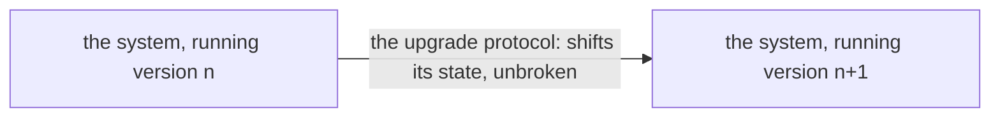

## The upgrade protocol

In the far term the system holds all of its state and upgrades itself through an upgrade protocol: a running system shifts its state from one version to the next, understanding how to shift it without breaking anything, and keeps running through the upgrade. The protocol is what Nix lacks: Nix holds only part of the state and upgrades by killing and restarting, so the declaration cannot carry the whole state, and the far system carries what Nix cannot.

