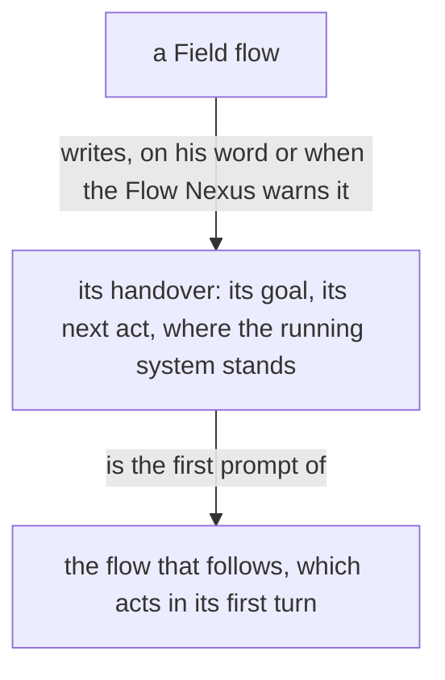

A Field flow keeps in its handover where the running system stands under its hand: what it changed, what it holds back, and what it has yet to do. The handover states its goal and its next act, so that the flow that follows acts in its first turn.

A Field flow writes its handover at `flows/<id>/handover.md` on his word or when the Flow Nexus warns it, and the first prompt of the flow that follows is that file.

