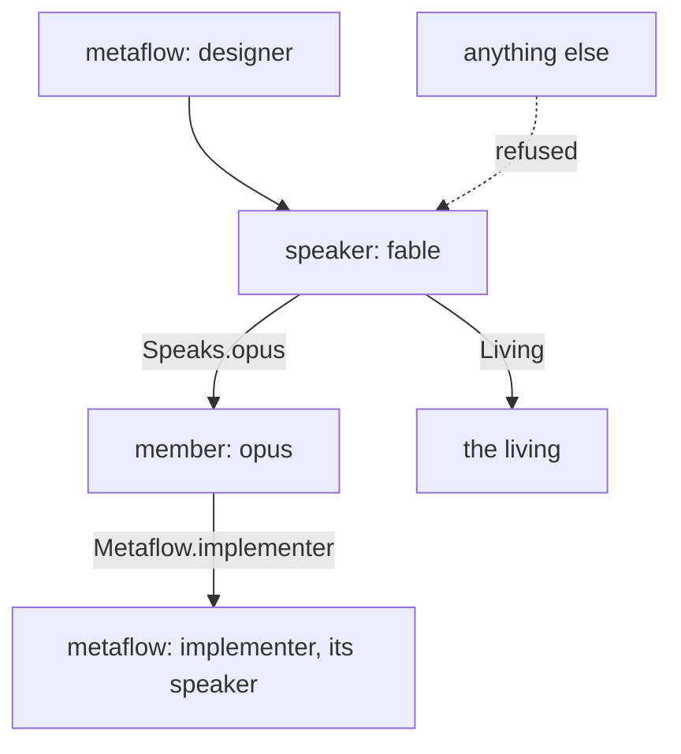
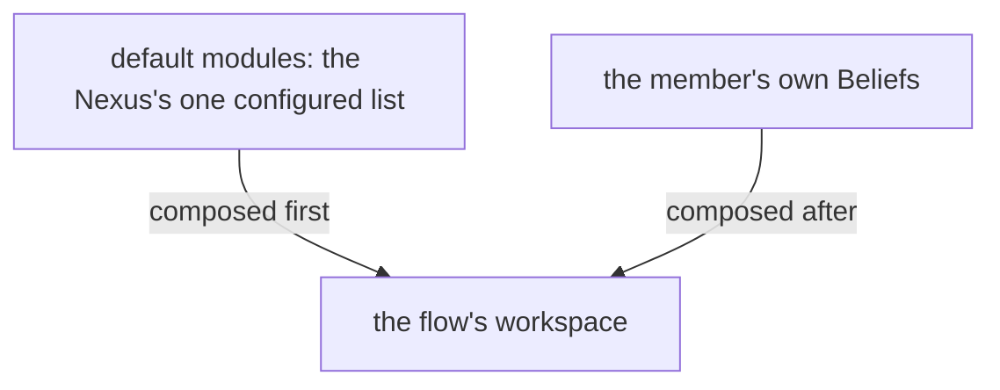
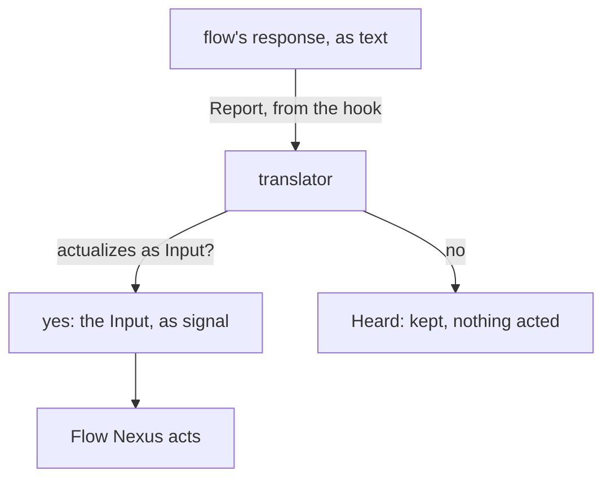
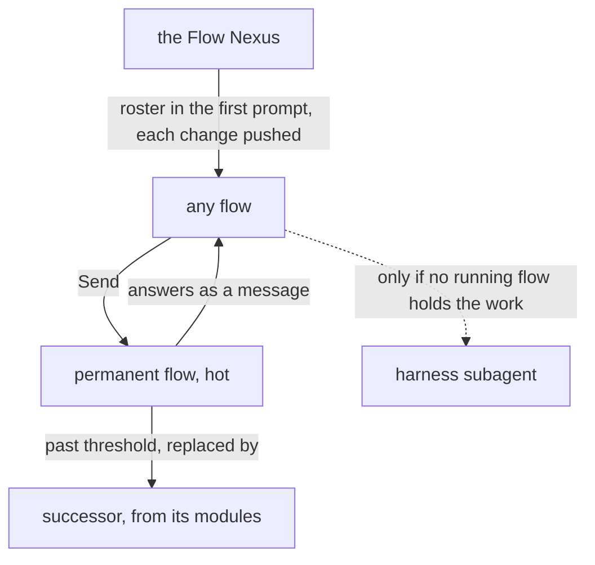
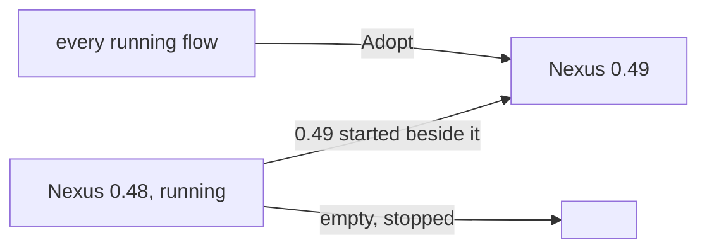
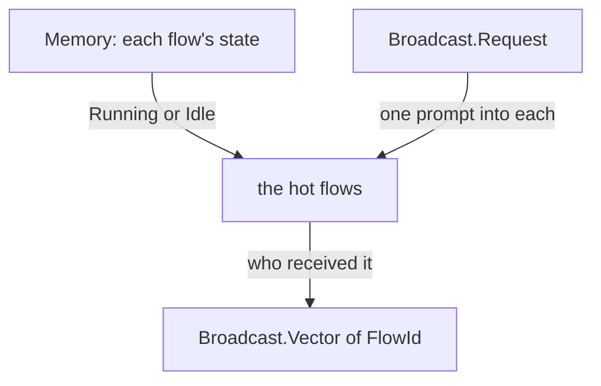

# The Flow Nexus

## Vocabulary

A flow is one run of a model in a harness. A permanent flow is a flow that continues through a succession of runs, one entity across them. A metaflow is several flows defined together: each flow's model, harness, workspace and beliefs, and which flow speaks to which. A complex is a named set of metaflows and the relationships between them, with a speaker and its instances: the layer above the metaflow, the being a person names and talks to. A Flow Nexus runs many complexes; a metaflow is addressed by Launch and Send, a complex by Say, which reaches its speaker.

## The machine is defined, never built in

Everything that can be configured is configuration. The Nexus holds the vocabulary a definition is written in, as Ethos types; the user writes definitions in datom, the way Nix defines an operating system; a running flow is a definition in action. A metaflow is named by the user, and the Nexus runs it without knowing its name beforehand. A definition is one datom of its own: it is added, replaced or removed alone; a complex is one of them, naming its metaflows. No role or anatomy is in the Rust.

One value of one member is changed alone, by naming the member and the value; the rest of its metaflow stands as it was.

## The vocabulary of a definition
A metaflow is members, routes and a speaker. A member is one flow definition: its harness, model and effort; whether it is a permanent flow or ephemeral; its workspace, beliefs and tools; and whom it speaks to. The speaker is the member that receives what comes to the metaflow from outside. A harness is a definition like a metaflow: its name, its features, and each feature's effect on the launch, a flag or a variable; a member names its harness by name and the features its launch is composed with, so a feature adds to a launch as well as leaves out. The Nexus holds no harness and no effect of its own; a harness is added, replaced or removed alone, as a metaflow is. Its tools are the harness default, or a restriction the harness enforces: a launch naming Restricted for a harness that cannot enforce it is refused, with the harness named. A route names whom a member may address: another member, another metaflow, or the living; a message off the routes is refused. What a metaflow is made of is the user's to define: one main flow that speaks for it, or a filter run by a System 1 model in front of the designer, or a messenger on a regular model and harness; the Nexus decides none of it.

An ephemeral flow is a single flow with a single job: it takes an input, gives an output, and is done. It has no continuity. It is to a thinking machine what a function is to a program: one call, one decision. A System 1 model is made to run this way, and any model may.

Many ephemeral flows are woven into the code and happen as part of how the system works: a Nexus calls one to judge whether data fits it, such as whether the same data is already held in an almost identical form.

A member's definition names its intake, the most a message to it may carry; a Send beyond it is refused, naming the intake, and the sender writes a file.

```ethos
Library
[ herdr:[ Pane ]
  belief:[ ModuleName ] ]
[ MetaflowName.String
  FlowName.String
  HarnessName.String
  FeatureName.String
  Effect.[ Flag.String                ; what a feature does to the launch
           Environment.{ Name.String  ;   a variable, set for the harness alone
                         Value.String } ]
  Feature.{ FeatureName Effect }
  Harness.{ HarnessName               ; a definition, as a metaflow is
            Features.Vector<Feature> }
  ModelName.String
  Effort.[ Low Medium High ]
  Continuity.[ Permanent  ; keeps its address
               Ephemeral ]           ; one run, then gone
  Workspace.[ Path.String
              Temporary ]            ; made at launch, removed at end
  Missing.[ Refuse Notice ]
  Beliefs.{ Vector<ModuleName> Missing }
  Tool.String                        ; the harness's name for it
  Tools.[ HarnessDefault              ; the Flow Nexus imposes nothing
          Restricted.{ Allow.Vector<Tool>   ; enforced by the harness
                       Deny.Vector<Tool> } ]  ;   or the launch is refused
  Route.[ Speaks.FlowName             ; a member of this metaflow
          Metaflow.MetaflowName         ;   that metaflow's speaker
          Living ]
  Intake.Integer                       ; the most characters a message to this member carries
  Member.{ FlowName HarnessName ModelName Effort
           Continuity Workspace Beliefs Tools
           Features.Vector<FeatureName>  ; of its harness, composed into its launch beside its complex's
           Intake
           Vector<Route> }
  Metaflow.{ MetaflowName Vector<Member>
            Speaker.FlowName }
  FlowId.String                       ; the hash of the native session id, six characters
  Address.{ MetaflowName
            FlowName }  ; a permanent flow's name
  Roster.Vector<Address>             ; every hot flow, in every first prompt
  RosterChange.[ Started.Address     ; pushed to every hot flow as a flow starts
                 Stopped.Address ]   ;   or stops
  Brief.String ]
[]
[]
```

```datom
; the designer's Fable takes a question; a worker takes a draft
{ fable claude claude-fable-5-1 Medium
  Permanent Path.«/home/li/primary»
  { [ { Spirit core } ] Refuse }
  HarnessDefault [] 1200
  [ Speaks.opus Living ] }
Send.{ 15c0ce { designer fable } Soft Notice.«…nine thousand characters…» }
Refused.Oversized.{ { designer fable } 1200 }
```



## Default modules

The Flow Nexus holds one configuration value, the default modules: the modules every flow gets. They are composed before each member's own Beliefs, so a definition names only its own. The value is set over the meta surface, one value at a time, as every Nexus's configuration is, and persists with the definitions.

```ethos
Signal
[ belief:[ ModuleName ]
  flow:[ Threshold ] ]
[ Configure.Set ]                    ; inputs: one value at a time
[ Configured.Set ]                   ; outputs: the value set
[ Set.[ DefaultModules.Vector<ModuleName> ; types: the modules every flow gets
        Threshold ] ]                ;   one model's context mark
```

```datom
Configure.DefaultModules.[ { Spirit core } { Knowledge flow-messaging } ]
Configured.DefaultModules.[ { Spirit core } { Knowledge flow-messaging } ]
```



## A message takes a route

A flow sends through the CLI; the Flow Nexus checks the route against the sender's definition, queues the message for the receiver, and delivers it through the herdr Nexus as a prompt when the receiver is idle or the priority is pressing. A permanent flow asleep is woken by a pressing message and receives its whole queue in its first prompt. The living speaks to a complex with Say, which reaches its speaker.

```ethos
Library
[ flow:[ FlowId Address MetaflowName ] ]
[ Priority.[ HardAbrupt MiddleAbrupt Soft ]
  Request.[ Order.String Question.String
            Living.{ Context.String    ; what his words were about
                     Verbatim.String }  ; his words whole
            Result.String Notice.String ]
  Sender.[ Flow.FlowId Living Nexus ]
  Message.{ Priority Sender Request }
  Waking.Vector<Message> ]           ; a queue delivered whole
[]
[]
```

```datom
Send.{ 15c0ce { designer fable } Soft Living.{ «context» «verbatim» } }
```

## The Nexus reads what a flow says

Every harness event reaches the Flow Nexus through a hook calling the CLI: Report carries the flow's state, and a flow's finished response. A response that actualizes as an Input of the Flow Nexus, a Send among them, is acted on as if the flow had typed it at the CLI; any other response is kept as the flow's word and acted on by nobody. So a member that only thinks and talks, with no tool, still sends, launches and stops by writing a datom.



## A permanent flow continues

A permanent flow continues through runs under its address and is kept hot: it is not stopped between works, so no restart pays the full cost of starting again. It is warned when its context reaches the Warning share of its model's threshold, configured per model in the Flow Nexus: a HardAbrupt Notice naming its handover path, `flows/<id>/handover.md`. When the context passes the threshold its successor is launched with the same definition, that file as its first prompt, and the queue that gathered meanwhile; the predecessor ends. An absent file means the successor starts from its definition and the queue alone. The address stays; the flow id changes.

The lander, the bookmaker, the readers and the rest of the roster are permanent flows; any flow sends work to them directly, with Send. The harness subagent is used only for what no running flow holds. A flow's first prompt carries the roster, the address of every hot flow, so it knows whom to send to; when a flow starts or stops, the Nexus pushes the change to every hot flow.

The roster, as it lands in a first prompt, and a change, as it is pushed:

```datom
[ { designer fable } { designer opus } { jobs lander } { jobs bookmaker } ]
Started.{ jobs reader }
Stopped.{ jobs reader }
```

Work goes straight to a permanent flow by its standing address, in the Signal's Send form `Send.{ FlowId Address Priority Request }`:

```datom
Send.{ 15c0ce { jobs lander } Soft
       Order.«land the proposal» }
```

The roster, as Members: each a permanent flow, in a temporary workspace, with the role's belief, on a Sonnet or Haiku model.

```datom
[ { lander claude claude-sonnet-5-5 Medium
      Permanent Temporary
      { [ { Role lander } ] Refuse }
      HarnessDefault [] 40000 [] }
  { bookmaker claude claude-sonnet-5-5 Medium
      Permanent Temporary
      { [ { Role book } ] Refuse }
      HarnessDefault [] 40000 [] }
  { bookPager claude claude-sonnet-5-5 Medium
      Permanent Temporary
      { [ { Role book-page } ] Refuse }
      HarnessDefault [] 40000 [] }
  { bookReader claude claude-haiku-4-5 Medium
      Permanent Temporary
      { [ { Role book-reader } ] Refuse }
      HarnessDefault [] 40000 [] }
  { commentRelay claude claude-sonnet-5-5 Medium
      Permanent Temporary
      { [ { Role comment-relay } ] Refuse }
      HarnessDefault [] 40000 [] }
  { contextualizer claude claude-haiku-4-5 Medium
      Permanent Temporary
      { [ { Role contextualizer } ] Refuse }
      HarnessDefault [] 40000 [] }
  { illustrator claude claude-sonnet-5-5 Medium
      Permanent Temporary
      { [ { Role illustrator } ] Refuse }
      HarnessDefault [] 40000 [] }
  { scripter claude claude-haiku-4-5 Medium
      Permanent Temporary
      { [ { Role scripter } ] Refuse }
      HarnessDefault [] 40000 [] }
  { tester claude claude-sonnet-5-5 Medium
      Permanent Temporary
      { [ { Role tester } ] Refuse }
      HarnessDefault [] 40000 [] }
  { reader claude claude-haiku-4-5 Medium
      Permanent Temporary
      { [ { Role read } ] Refuse }
      HarnessDefault [] 40000 [] }
  { writer claude claude-sonnet-5-5 Medium
      Permanent Temporary
      { [ { Role write } ] Refuse }
      HarnessDefault [] 40000 [] }
  { worker claude claude-sonnet-5-5 Medium
      Permanent Temporary
      { [ { Role worker } ] Refuse }
      HarnessDefault [] 40000 [] } ]
```



## A running session joins any Flow Nexus

A flow's identity is its own, not the Nexus's. A Nexus is replaced by starting the next version beside it and having every running flow join it; nobody restarts, no context is lost. A change to a Nexus is a new version, always.

```ethos
Signal
[ flow:[ Address FlowId ] ]
[ Adopt.{ Address Session } ]            ; input: a running session, under its address
[ Adopted.FlowId                         ; outputs
  Refused.[ AddressHeld.FlowId           ;   one live flow per address
            Unidentified ] ]             ;   the calling session is not the one named
[ Session.String ]                       ; the harness's session id, verified by the caller's process
```

```datom
Adopt.{ { designer fable } 15c0cea2-aa34-508b-8e20-ece1ab7823f4 }
Adopted.15c0ce
```



## Signal

```ethos
Signal
[ flow:[ Metaflow MetaflowName FlowName FlowId
         Address Brief ModuleName Message
         Request Priority Tool
         Harness HarnessName FeatureName
         Complex ComplexName ] ]
[ Define.[ Metaflow Harness Complex ] ; add or replace one
  Undefine.Name
  Amend.{ Address Change }             ; one value of one member, named by its address
  Describe.Name                      ; one definition, read back
  Definitions                        ; the names defined
  Launch.{ MetaflowName FlowName Brief }
  Rehearse.{ MetaflowName FlowName Brief } ; a Launch as a dry run: nothing runs
  Stop.FlowId
  Send.{ FlowId Address Priority Request }
  Say.{ ComplexName Request }       ; the living, to a complex's speaker
  Hot                                ; the flows whose harness is up
  Broadcast.Request                  ; one request to every hot flow
  Report.{ FlowId Event }            ; from a harness hook
  Subscribe ]                        ; events, as they happen
[ Defined.Name
  Undefined.Name
  Amended.Address
  Described.[ Metaflow Harness Complex ]
  Listed.Vector<Name>
  Launched.FlowId
  Rehearsed.Command.String           ; the shell command, whole
  Stopped.FlowId
  Sent.[ Delivered Queued ]
  Said.[ Delivered Queued ]
  Hot.Vector<FlowId>                 ; the hot flows
  Broadcast.Vector<FlowId>           ; who received it
  Reported
  Subscribed
  Refused.[ Oversized.{ Address Intake }     ; the message exceeds the member's intake
            UnknownMetaflow.MetaflowName
            UnknownHarness.HarnessName
            UnknownComplex.ComplexName
            UnknownFlow.FlowName
            NoRoute.{ FlowId Address }
            NoBelief.Vector<ModuleName>
            Unenforceable.HarnessName     ; Restricted, harness cannot
            UnknownFeature.{ HarnessName FeatureName } ; named by the member or its complex, absent from the harness
            HerdrDown BeliefDown
            Running.Address ] ]
[ Name.[ Metaflow.MetaflowName         ; a definition, by name
         Harness.HarnessName
         Complex.ComplexName ]
  Event.[ Started Idle Working Ended
          Responded.String            ; the response, whole
          Warned                     ;   the handover asked
          Threshold ] ]              ;   context past its mark
```

```ethos
  Change.[ HarnessName                 ; a single value of the member, replaced
           ModelName
           Effort
           Continuity
           Workspace
           Tools
           Intake
           Missing
           Add.Element                 ; an element appended to its list
           Remove.Element ]
  Element.[ Belief.ModuleName
            Feature.FeatureName
            Route ]
```

```datom
Amend.{ { designer fable } Add.Belief.{ Vision ethos } }
Amended.{ designer fable }
Amend.{ { designer fable } Effort.High }
Amended.{ designer fable }
```

```datom
; the Nexus, to the flow, at the Warning share
HardAbrupt.Notice.«Write your handover at
flows/f54886/handover.md»
```

```datom
Broadcast.Notice.«Search with knowledge:search»
Broadcast.[ 15c0ce 9af746 a030fc ]
```

A launch can be rehearsed: the same input, asked as a dry run, answers with the whole command the Flow Nexus would run and runs nothing. From that command an agent starts the flow by hand, changed however the Flow Nexus does not yet support. The answer is one string, the command line as the shell is to receive it, quoted for the shell inside.

```datom
Rehearse.{ designer fable «Read the version one book» }
Rehearsed.«herdr --session main agent start … -- --system-prompt-file /…/bundle --model claude-fable-5-1 --effort medium»
```



## Emission

The Flow Nexus runs nothing. Its translator is the client of two sockets: the Belief Nexus furnishes the workspace, the default modules first and the member's own Beliefs after them; the herdr Nexus makes the pane, starts the harness, types the prompt. The harness's command line and its settings file are types; the translator writes them, composing the command line from the member's harness definition: each feature the member names and each its complex names, its effect, a flag or a variable.

A flow knows itself at launch: its Identity, the name of the complex it runs in, its Address and its FlowId, is composed into its first prompt or its system prompt, so it names itself in Send and Report, finds its handover path, and knows which being it is part of; the Roster is composed into the first prompt beside it. The place it runs in is the Nexus's, named at the CLI, never the flow's.

```ethos
Emission
[ flow:[ Member Address FlowId Brief Waking Tools
         Workspace HarnessName Roster RosterChange
         ComplexName ]
  herdr:[ Pane Outcome ] ]
[ Furnish.{ Member FlowId }           ; beliefs into the workspace
  Settle.{ Member FlowId }            ; the harness's settings file
  Open.{ Member Identity Roster Brief } ; pane made, harness started
  Wake.{ Pane Waking }                ; the queue typed in
  Tell.{ Pane RosterChange }          ; a flow started or stopped, typed in
  Close.{ Pane Workspace } ]          ; pane killed, Temporary removed
[ Furnished.Outcome
  Settled.Outcome
  Opened.{ Pane Outcome }
  Woken.Outcome
  Told.Outcome
  Closed.Outcome ]
[ Identity.{ ComplexName Address FlowId }   ; composed into the first prompt
                                             ;   or the system prompt
  Settings.{ HarnessName Tools Model.String } ] ; what the translator writes
```

## Memory

Definitions persist: the Memory lives in the Flow Nexus's State directory and survives a restart.

```ethos
Memory
[ flow:[ Metaflow MetaflowName FlowName FlowId
         Address Message Event Complex ]
  herdr:[ Pane ]
  belief:[ ModuleName ] ]
[ Definition.[ Metaflow Harness Complex ]
  DefaultModules.Vector<ModuleName>  ; the modules every flow gets
  Flow.{ FlowId Address Pane
         State.[ Running Idle Ended ]
         Vector<Event> }
  Queue.{ Address Vector<Message> }
  Threshold.{ Model.String Tokens.Integer
              Warning.Integer }        ; share left, 20
  Answer.[ Succeeded Failed ] ]
```

```datom
; the user defines a metaflow: one datom, added alone
Define.Metaflow.{
   designer
   [ { fable claude claude-fable-5-1 Medium
       Permanent
       Path.«/home/li/primary»
       { [ { Spirit core } { Vision nexus-v1 } ] Refuse }
       HarnessDefault []
       1200
       [ Living ] } ]
   fable }
Defined.Metaflow.designer
; defines the harness its member names: one datom, added alone
Define.Harness.{
   claude
   [ { Bash
       Flag.«--disallowedTools Bash» }
     { ClaudeMd
       Environment.{
          CLAUDE_CODE_DISABLE_CLAUDE_MDS
          1 } } ] }
Defined.Harness.claude
; and launches a flow of it
Launch.{ designer fable «Read the version one book» }
Launched.15c0ce
```
