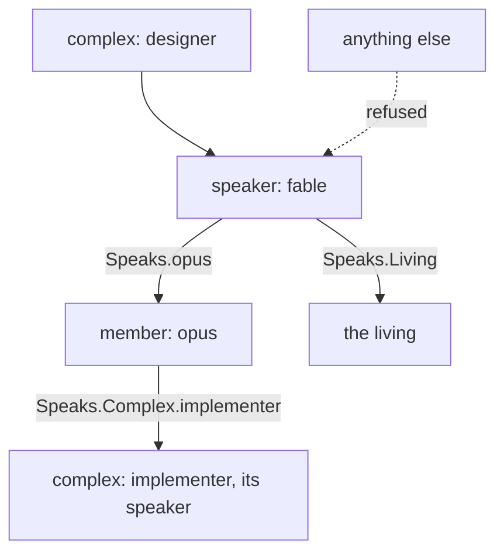
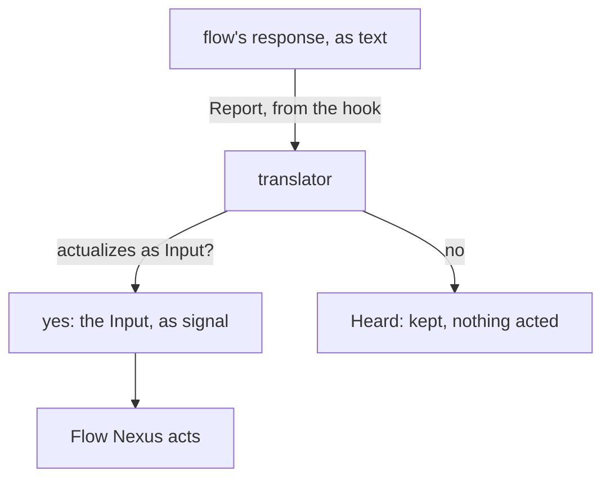
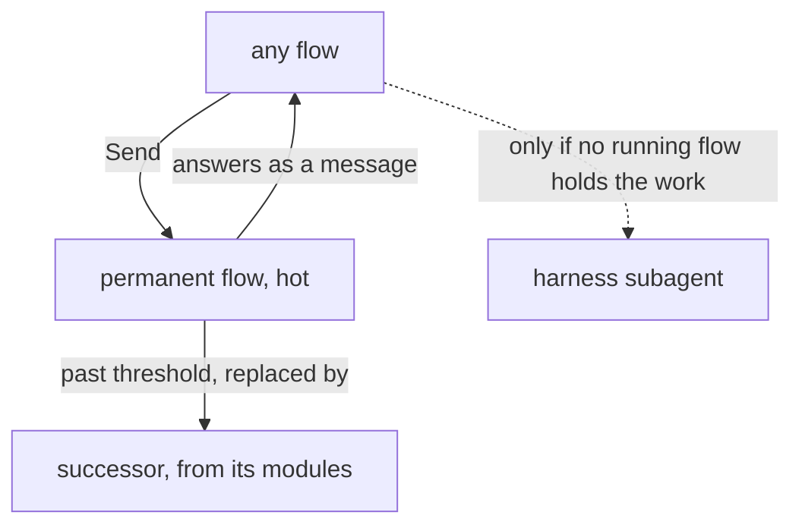
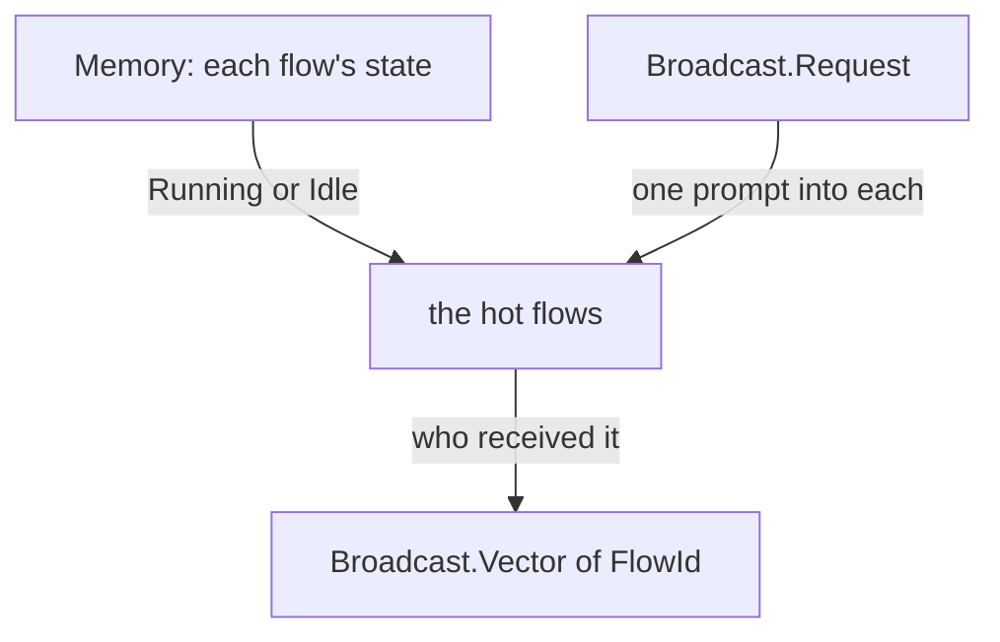

# The Flow Nexus, version 1

## Vocabulary

A flow is one run of a model in a harness. A permanent flow is a flow that continues through a succession of runs, one entity across them. A flow complex, said complex, is several flows defined together: each flow's model, harness, workspace and beliefs, and which flow speaks to which. A metaflow is several complexes defined together, running as one self for one owner: the layer above the complex.

## The machine is defined, never built in

Everything that can be configured is configuration. The Nexus holds the vocabulary a definition is written in, as Ethos types; the user writes definitions in datom, the way Nix defines an operating system; a running flow is a definition in action. A complex is named by the user, and the Nexus runs it without knowing its name beforehand. A definition is one datom of its own: it is added, replaced or removed alone, and the metaflow is the set of them. No role or anatomy is in the Rust.

## The vocabulary of a definition
A complex is members, routes and a speaker. A member is one flow definition: its harness, model and effort; whether it is a permanent flow or ephemeral; its workspace, beliefs and tools; and whom it speaks to. The speaker is the member that receives what comes to the complex from outside. Its tools are the harness default, or a restriction the harness enforces: a launch naming Restricted for a harness that cannot enforce it is refused, with the harness named. A route names whom a member may address: another member, another complex, or the living; a message off the routes is refused.

```ethos
Library
[ herdr:[ Pane ]
  belief:[ ModuleName ] ]
[ ComplexName.String
  FlowName.String
  Harness.[ Claude Codex ]
  ModelName.String
  Effort.[ Low Medium High ]
  Continuity.[ Permanent  ; keeps its address
               Ephemeral ]           ; one run, then gone
  Workspace.[ Path.String
              Temporary ]            ; made at launch, removed at end
  Missing.[ Refuse Notice ]
  Beliefs.{ Vector<ModuleName> Missing }
  Tool.String                        ; the harness's name for it
  Tools.[ HarnessDefault              ; the Flow Nexus imposes nothing
          Restricted.{ Allow.Vector<Tool>   ; enforced by the harness
                       Deny.Vector<Tool> } ]  ;   or the launch is refused
  Route.[ Speaks.FlowName             ; a member of this complex
          Complex.ComplexName         ;   that complex's speaker
          Living ]
  Member.{ FlowName Harness ModelName Effort
           Continuity Workspace Beliefs Tools
           Vector<Route> }
  Complex.{ ComplexName Vector<Member>
            Speaker.FlowName }
  FlowId.Integer
  Address.{ ComplexName
            FlowName }  ; a permanent flow's name
  Brief.String ]
[]
[]
```



## A message takes a route

A flow sends through the CLI; the Flow Nexus checks the route against the sender's definition, queues the message for the receiver, and delivers it through the herdr Nexus as a prompt when the receiver is idle or the priority is pressing. A permanent flow asleep is woken by a pressing message and receives its whole queue in its first prompt. The living speaks to a complex with Say, which reaches its speaker.

```ethos
Library
[ flow:[ FlowId Address ComplexName ] ]
[ Priority.[ HardAbrupt MiddleAbrupt Soft ]
  Request.[ Order.String Question.String
            Living.{ Context.String    ; what his words were about
                     Verbatim.String }  ; his words whole
            Result.String Notice.String ]
  Sender.[ Flow.FlowId Living Nexus ]
  Message.{ Priority Sender Request }
  Waking.Vector<Message> ]           ; a queue delivered whole
[]
[]
```

```datom
Send.{ 7 { designer fable } Soft Living.{ «context» «verbatim» } }
```

## The Nexus reads what a flow says

Every harness event reaches the Flow Nexus through a hook calling the CLI: Report carries the flow's state, and a flow's finished response. A response that actualizes as an Input of the Flow Nexus, a Send among them, is acted on as if the flow had typed it at the CLI; any other response is kept as the flow's word and acted on by nobody. So a member that only thinks and talks, with no tool, still sends, launches and stops by writing a datom.



## A permanent flow continues

A permanent flow continues through runs under its address and is kept hot: it is not stopped between works, so no restart pays the full cost of starting again. It is warned when its context reaches the Warning share of its model's threshold, configured per model in the Flow Nexus: a HardAbrupt Notice naming its handover path, flows/<id>/handover.md. When the context passes the threshold its successor is launched with the same definition, that file as its first prompt, and the queue that gathered meanwhile; the predecessor ends. An absent file means the successor starts from its definition and the queue alone. The address stays; the flow id changes. An ephemeral flow past its threshold takes no new work and ends when its work ends.

The lander, the bookmaker, the readers and the rest of the roster are permanent flows; any flow sends work to them directly, with Send. The harness subagent is used only for what no running flow holds.

His words: "we do not want flows that are idle because they go cold and when we restart them we pay the full cost again"

Work goes straight to a permanent flow by its standing address, in the Signal's Send form `Send.{ FlowId Address Priority Request }`:

```datom
Send.{ 7 { jobs lander } Soft
       Order.«land the proposal» }
```

The roster, as Members: each a permanent flow, in a temporary workspace, with the role's belief, on a Sonnet or Haiku model.

```datom
[ { lander Claude claude-sonnet-5-5 Medium
      Permanent Temporary
      { [ { Role lander } ] Refuse }
      HarnessDefault [] }
  { bookmaker Claude claude-sonnet-5-5 Medium
      Permanent Temporary
      { [ { Role book } ] Refuse }
      HarnessDefault [] }
  { bookPager Claude claude-sonnet-5-5 Medium
      Permanent Temporary
      { [ { Role book-page } ] Refuse }
      HarnessDefault [] }
  { bookReader Claude claude-haiku-4-5 Medium
      Permanent Temporary
      { [ { Role book-reader } ] Refuse }
      HarnessDefault [] }
  { commentRelay Claude claude-sonnet-5-5 Medium
      Permanent Temporary
      { [ { Role comment-relay } ] Refuse }
      HarnessDefault [] }
  { contextualizer Claude claude-haiku-4-5 Medium
      Permanent Temporary
      { [ { Role contextualizer } ] Refuse }
      HarnessDefault [] }
  { illustrator Claude claude-sonnet-5-5 Medium
      Permanent Temporary
      { [ { Role illustrator } ] Refuse }
      HarnessDefault [] }
  { scripter Claude claude-haiku-4-5 Medium
      Permanent Temporary
      { [ { Role scripter } ] Refuse }
      HarnessDefault [] }
  { tester Claude claude-sonnet-5-5 Medium
      Permanent Temporary
      { [ { Role tester } ] Refuse }
      HarnessDefault [] }
  { reader Claude claude-haiku-4-5 Medium
      Permanent Temporary
      { [ { Role read } ] Refuse }
      HarnessDefault [] }
  { writer Claude claude-sonnet-5-5 Medium
      Permanent Temporary
      { [ { Role write } ] Refuse }
      HarnessDefault [] }
  { worker Claude claude-sonnet-5-5 Medium
      Permanent Temporary
      { [ { Role worker } ] Refuse }
      HarnessDefault [] } ]
```



## Signal

```ethos
Signal
[ flow:[ Complex ComplexName FlowName FlowId
         Address Brief ModuleName Message
         Request Priority Tool Harness ] ]
[ Define.Complex                     ; add or replace one
  Undefine.ComplexName
  Describe.ComplexName               ; one definition, read back
  Definitions                        ; the names defined
  Launch.{ ComplexName FlowName Brief }
  Stop.FlowId
  Send.{ FlowId Address Priority Request }
  Say.{ ComplexName Request }        ; the living, to a speaker
  Hot                                ; the flows whose harness is up
  Broadcast.Request                  ; one request to every hot flow
  Report.{ FlowId Event }            ; from a harness hook
  Subscribe ]                        ; events, as they happen
[ Defined.ComplexName
  Undefined.ComplexName
  Described.Complex
  Listed.Vector<ComplexName>
  Launched.FlowId
  Stopped.FlowId
  Sent.[ Delivered Queued ]
  Said.[ Delivered Queued ]
  Hot.Vector<FlowId>                 ; the hot flows
  Broadcast.Vector<FlowId>           ; who received it
  Reported
  Subscribed
  Refused.[ UnknownComplex.ComplexName
            UnknownFlow.FlowName
            NoRoute.{ FlowId Address }
            NoBelief.Vector<ModuleName>
            Unenforceable.Harness         ; Restricted, harness cannot
            HerdrDown BeliefDown
            Running.Address ] ]
[ Event.[ Started Idle Working Ended
          Responded.String            ; the response, whole
          Warned                     ;   the handover asked
          Threshold ] ]              ;   context past its mark
```

```datom
; the Nexus, to the flow, at the Warning share
HardAbrupt.Notice.«Write your handover at
flows/f54886/handover.md»
```

```datom
Broadcast.Notice.«Search with knowledge:search»
Broadcast.[ 7 9 12 ]
```



## Emission

The Flow Nexus runs nothing. Its translator is the client of two sockets: the Belief Nexus furnishes the workspace; the herdr Nexus makes the pane, starts the harness, types the prompt. The harness's command line and its settings file are types; the translator writes them.

```ethos
Emission
[ flow:[ Member FlowId Brief Waking Tools ]
  herdr:[ Pane Outcome ] ]
[ Furnish.{ Member FlowId }           ; beliefs into the workspace
  Settle.{ Member FlowId }            ; the harness's settings file
  Open.{ Member FlowId Brief }        ; pane made, harness started
  Wake.{ Pane Waking }                ; the queue typed in
  Close.{ Pane Workspace } ]          ; pane killed, Temporary removed
[ Furnished.Outcome
  Settled.Outcome
  Opened.{ Pane Outcome }
  Woken.Outcome
  Closed.Outcome ]
[ Settings.[ Claude.{ Tools Model.String }   ; what the translator writes
             Codex.{ Tools Model.String } ] ]
```

## Memory

Definitions persist: the Memory lives in the Flow Nexus's State directory and survives a restart.

```ethos
Memory
[ flow:[ Complex ComplexName FlowName FlowId
         Address Message Event ]
  herdr:[ Pane ] ]
[ Definition.Complex
  Flow.{ FlowId Address Pane
         State.[ Running Idle Ended ]
         Vector<Event> }
  Queue.{ Address Vector<Message> }
  Threshold.{ Model.String Tokens.Integer
              Warning.Integer }        ; share left, 20
  Answer.[ Succeeded Failed ] ]
```

```datom
; the user defines a complex: one datom, added alone
Define.{ designer
         [ { fable Claude claude-fable-5-1 Medium
             Permanent
             Path.«/home/li/primary»
             { [ spirit:core vision:nexus-v1 ] Refuse }
             HarnessDefault
             [ Living ] } ]
         fable }
Defined.designer
; and launches a flow of it
Launch.{ designer fable «Read the version one book» }
Launched.7
```
