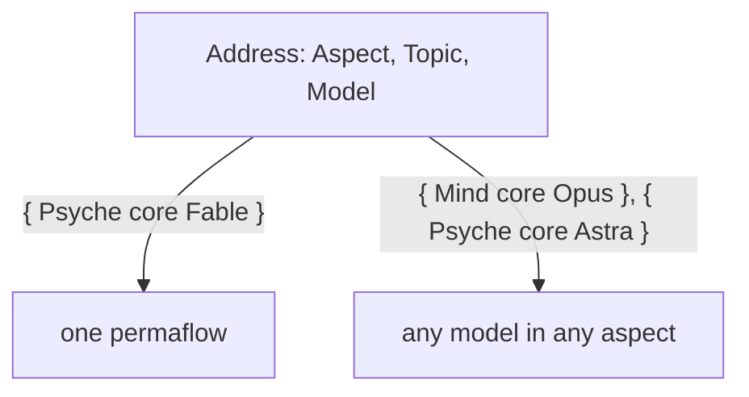
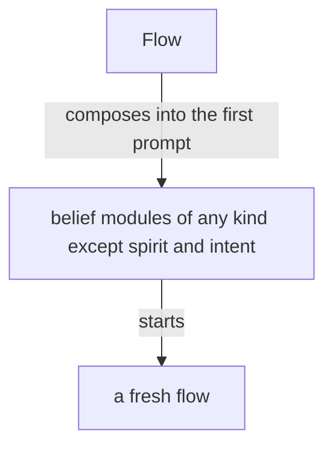

## What it does



The Flow Nexus sets up and starts a model flow: its working
directory, system prompt, training files and instruction prompt.

The Flow Nexus is the Nexus that manages flows. A flow is one run of a permaflow; the component is named for what it manages. A flow the living asks for is launched, properly and surely. The Flow Nexus holds the lock on flows.

The Flow Nexus is for starting flows cheaply: clean flows, specialized flows and refreshed flows, each with a clean on-point context, which yields higher-quality output. A flow is taken down as easily as it is started. Starting flows is the cornerstone of the system.

A flow runs one model, linear and very limited. An agent is a whole being, a lot more than that. Many flows, properly structured and orchestrated, together resemble a synthetic intelligence, synthesized from human knowledge and mathematical probability.

The Capsule is the component that makes where a flow runs. Its first embodiment is the semi-sandbox: only the credential files are copied, everything else is recreated, with its own sockets and store, running light models.

Herdr is one backend of the Capsule, the component that gives a flow its place to run; the backend may be exchanged.

The Flow Nexus manages permaflows. A permaflow is one address, { Aspect Topic Model }, that continues through several flows one after another; the flow is its current run. The default topic is core: the permanent topic, the thing that keeps the machine going, the last topic to stand.

A topic is an open enum: the constant topics, core among them, are fixed, and the users and the machine extend the set with camelCase identifiers.

An idle flow keeps its harness, so that the living finds the flow he was talking to.

A topic's name is a camelCase identifier, uncapitalized. A flow's id is the hash of the harness's session id, kept to six characters and lengthened when two collide, so a transcript is found from the flow id. Every call to the Flow Nexus is identified by the calling process. Anybody may call the Flow Nexus, a flow for its own refresh among them: because the CLI checks the calling process, a flow refreshes itself safely.

In the chat a flow is named by its permaflow, and the flow id almost disappears from it; the id is for the ledger and for finding the transcript.

A request reaching a permaflow is one of a closed set of types, SendableRequest below, each with its waking effect. A flow sends a request through the Flow Nexus, which owns the lock and the delivery and answers sent or queued. A permaflow asleep is woken by an order, a question or the living's words and receives its whole queue, oldest first, in the first prompt, a result or a notice waiting there until a waking; a permaflow under refresh or waking queues what arrives until its successor or woken seat has started, while the Flow Nexus keeps serving every other request. A permaflow a request needs is started whether or not it is running; with no working transcript to reawaken, it is fed the permaflow's belief modules and the prompt it is to get now.

```ethos
SendableRequest.[ Order.String                  ; a request: what the recipient is to act on
                  Question.String
                  Living.{ Context.String       ;   what his words were about
                           Verbatim.String }    ;   his words whole
                  Result.{ Answerable String }
                  Notice.String
                  Task.AnswerableTask
                  Done.{ Answerable String } ]
AnswerableTask.{ Minutes String }               ; a task, with the minutes it is given
Minutes.Integer
SendableMessage.[ HardAbrupt.SendableRequest  ; the priority, a head on the request
                  MiddleAbrupt.SendableRequest
                  Soft.SendableRequest ]
```

```datom
Send.{ Address.{ Psyche core Opus } Soft.Living.{ «context» «verbatim» } }
```

A flow woken for a permaflow is almost always a fresh flow, an old one only when the new input is literally the continuation of that topic.

What has been queued for an idle permaflow, the vision touching its topic among it, is injected with the request that wakes it, so the flow knows it as soon as it wakes.
A permaflow wakes when a request needs it; what touches its topic queues until then.

The Flow Nexus exposes everything from the harness, the bare input: a flow is started, stopped and sent a message through the Flow Nexus, the one send path.

The flow that finishes messages the flow that needs to know.

## A message

A message is a datom and lands in the recipient's prompt as one; the datom is the whole message. Its priority is a head on the request: HardAbrupt, MiddleAbrupt or Soft. A pressing message wakes its recipient; a message that only queues carries what may wait. A message is addressed to a permaflow and reaches the flow running when it arrives; a request to deliver a recipient's queue delivers every queued message, or nothing when none is queued.

A message carries what its reader acts on: what the sender intends, or what it has done. It carries no hash: a flow is named by its permaflow, a book by its title, a commit by what it landed.

Inducing an interrupt, placing prompt text, submitting it, and the recipient consuming it are four separate observations. None of them stands for another, and a submission is never a read receipt.

A task carries the minutes it is expected to take; the Flow Nexus reminds the sender when they pass, and the done reply names the task and cancels the reminder. A receiver going idle with a task open fires a notice to the flow waiting on it, so that nothing is forgotten. Any flow asks the Flow Nexus for a reminder after a number of minutes.

## Starting flows

A Nexus component decides the system prompt and everything about a
launch, replacing the harness's subagents with specialized harnesses
launched with specialized system prompts.

The address names the model, Fable, Opus, Sonnet, Haiku, Astra, Sol, Luna or Terra, in every aspect: a Psyche core Astra and a Mind core Fable are both addresses. A launch names the permaflow, the belief modules composed into its prompts, and a brief of a small paragraph; the Nexus composes the prompt from its module registry.

A launch or a refresh whose model is Fable is refused unless the Say comes from the living himself: no brief, no flow and no refresh starts a Fable. A Fable permaflow past its threshold keeps its queue until the living says to refresh it; the Nexus knows the living by the calling process.

The Flow Nexus's configuration holds, for each permaflow, its purpose, beside its modules; the Flow Nexus composes them with the brief into the first prompt, and the instruction for the first response belongs to that composition.

A fresh flow's first prompt carries the belief modules relevant to it, of any kind except spirit and intent, which sit in the system prompt.



A fresh flow starts with every belief module its permaflow is bound to, all loaded at its start: much of it in its system prompt, the rest in its first prompt, or in as many prompts as it takes, sent one right after another, so that its start is one model call.

A simplified flow is a kind of flow made for judgment alone: it starts with a system prompt of its own, it has no regular tool, and its response is its message.

A flow is specified whole, in Datom, by a domain-specific language in Ethos: its system prompt, its default belief modules and its variations. The flow ethos holds the specification.

The system prompt is composed of modules of several types, and what a harness calls a skill overlaps with them.
Its anatomy is drawn up in ethos from a study of system prompts of every kind, each line placed by what it is and by the kind of guidance it belongs to.
Where the harness allows it, a part of a main flow's system prompt is the main flow's alone and is not passed down to its subagents.

Every flow has a topic; a flow with no special topic has the topic core, the heart of its aspect. A topic is a core:Name, a camelCaseExpression checked when created. A flow's title is one datom struct of its aspect, topic, model and flow id: { Psyche core Opus <id> }.

Who speaks to whom is vision:aspects'. Version 0 refuses no request by its address; the routes are version 1's, in the complex definition.

A launch can be rehearsed: the same input, asked as a dry run, answers with the whole command the Flow Nexus would run and runs nothing. From that command an agent starts the flow by hand, changed however the Flow Nexus does not yet support. The answer is one string, the command line as the shell is to receive it, quoted for the shell inside.

```
[ Launch.LaunchRequest                ; inputs
  Rehearse.LaunchRequest ]
[ Launched.FlowId                     ; outputs
  Rehearsed.Command.String ]          ; the shell command, whole
```

```
Rehearse.{ { Psyche core Fable } «brief» }
Rehearsed.«herdr --session main agent start … -- --dangerously-skip-permissions --system-prompt-file /…/bundle --model … --effort …»
```

A harness is described in configuration: every feature it has, and what leaving that feature out does to the launch, a flag or a variable. The Nexus holds no feature and no effect of its own; it reads the effect from the declaration and composes the launch from the names a permaflow lists. A new harness, or a new version of one, is a new declaration. Where two features share one flag, the composition emits that flag once, with the names merged.

```ethos
Library
[ flow:[ Address ] ]                  ; imports: the permaflow's address
[ HarnessName.[ Claude Codex ]        ; types: a harness, by name
  FeatureName.String                  ;   a feature, by name
  Effect.[ Flag.String                ;   what leaving the feature out does to the launch
           Environment.{ Name.String  ;     a variable, set for the harness alone
                         Value.String } ]
  Feature.{ FeatureName Effect }
  Harness.{ HarnessName               ; the declaration: every feature the harness has
            Features.Vector<Feature> }
  Root.String                         ; the flow's working directory
  Permaflow.{ Address
              Option<Root>
              HarnessName
              LeaveOuts.Vector<FeatureName> } ]
[]                                    ; traits
[]                                    ; associations
```

```datom
Configure.Harness.{
   Claude
   [ { Artifact
       Flag.«--disallowedTools Artifact,ArtifactComments,ArtifactData» }
     { Bash
       Flag.«--disallowedTools Bash» }
     { ClaudeMd
       Environment.{
          CLAUDE_CODE_DISABLE_CLAUDE_MDS
          1 } }
     { GitInstructions
       Environment.{
          CLAUDE_CODE_DISABLE_GIT_INSTRUCTIONS
          1 } } ] }

Configure.Permaflow.{
   { Psyche book Haiku }
   Some.«/home/li/book»
   Claude
   [ ClaudeMd GitInstructions ] }

Configure.Permaflow.{
   { Psyche core Fable }
   None
   Claude
   [ Artifact ClaudeMd GitInstructions ] }
```

## Repository and belief modules

The flow repository holds the machinery of the Flow Nexus and is a runtime repository.
Every belief module lives outside it, the basic modules included, so that a module changes live.
The basic modules give our own take on how an agent behaves in a harness, replacing the prompt the harnesses build in.

Every harness event reaches the Flow Nexus through the harness's hooks calling the Flow CLI, so the Flow Nexus knows each flow's state as it changes; a marked block landing in a transcript becomes an action, a book among them; a flow past its context threshold is refreshed as it goes idle. A hook may carry content, the last message among it, ephemeral: acted on or dropped, never stored. Which hooks are installed is configuration. A poller that must exist is registered and reported.

A flow is refreshed when its context passes its model's threshold: the Flow Nexus keeps the permaflow's next messages for its next flow, and the flow is replaced as it goes idle; while the refresh runs the permaflow is locked, and the predecessor is reaped in the same event. Each model's threshold is configured in the Flow Nexus. A flow still working is not forced to refresh. When the successor cannot start, the Flow Nexus restarts the predecessor and compacts it, so every permaflow keeps a flow.

A flow refreshes before compaction; a compaction is a refresh that was missed.

A flow that keeps working without being given more work may compact. Its compaction raises a warning, and a flow investigates why it worked so long, so that the trouble is brought to the living or Psyche reconsiders the approach and gives guidance.

An ephemeral flow is a continuous job flow that does not wake back up: it takes jobs while it runs, up to a ceiling on its context, and past the ceiling it is given no new job and another ephemeral flow takes it.

## A superseded flow is closed

An abandoned, duplicated or superseded flow is closed, archived and deregistered.

## Herdr holds the panes

Herdr is the third-party terminal workspace every flow runs in, one pane per flow. Herdr is used as it is: a low-level tool that receives finished commands from the translator and holds no logic of ours; every fact about a launch is the Nexus's, decided on the Nexus's types.

## A real-world test of the Flow Nexus

A build of the Flow Nexus is tested in a testing capsule of its own: its own Herdr pane and session, the testing store, built in Nix. In it, several cheap, low-effort Codex and Claude flows message one another and start flows. The test shows whether the prompts, the system prompts and the tools are right, and which features are missing. Its findings return to the reimplementation, which is tested again.

The stable Flow Nexus keeps running while variants are tested.

## The Flow Nexus's unit

A Flow Nexus unit Wants Curriculum, a soft dependency, and reconnects to Curriculum when it returns, so a Curriculum restart leaves every Flow Nexus running.

```ini
[Unit]
Wants=curriculum-nexus.service
After=curriculum-nexus.service
```

## A permission prompt is a launch failure

A permission prompt reaching the living is a launch failure.

## The heartbeat

The heartbeat is hourly. It reminds every flow it reaches to judge its own sanity, by these signs: an echo chamber, where the same question or claim goes round between flows and comes back; jargon and nonsense increasing; an acknowledgement answering an acknowledgement. The counts the heartbeat carries, awake permaflows, working panes, messages sent and queue growth per permaflow, are evidence under the reminder; the judgment is the flow's.

The heartbeat reaches only a flow for which something changed that bears on it.

The number of running flows is kept low: a topic flow no longer used is retired.

## Restarting without waking

A flow can be restarted without being woken: its harness closes, its transcript stays, and its successor runs when a message wakes it. A flow can also restart itself. A restart meant to leave the flow asleep is done from outside; what arrives queues for its successor.

## Debugging

Everything that may need debugging, changing or reconfiguring is reached through an operation on the ordinary socket or the meta socket. The flow id and the delivery id are the Nexus's own; a debugging query exposes them when one must be explicit.

## What a refresh carries

A refresh carries the flow's important presentations and illustrations, and the basic skills. The basic skills are everything a flow needs.

## The Flow Nexus's parts

The library, shared by the three parts:

```ethos
Library
[]
[ FlowId.String                       ; the hash of the native session id, six characters
  Topic.String
  Aspect.[ Psyche Mind Field ]
  Model.[ Fable Opus Sonnet Haiku
          Astra Sol Luna Terra ]
  Address.{ Aspect Topic Model }
  Event.[ Started Stopped ] ]
[]
[]
```

Signal, what the Flow Nexus says:

```ethos
Signal
[ flow:[ FlowId Address Event ] ]
[ Launch.LaunchRequest
  Report.{ FlowId Event } ]
[ Launched.FlowId
  Refused.[ NoCapsule
            AddressBusy.Address
            FableNeedsTheLiving.Address ]  ; a Fable launch or refresh not said by the living
  Reported ]
[ LaunchRequest.{ Address Brief.String } ]
```

Operation, what the Flow Nexus does:

```ethos
Operation
[ flow:[ FlowId Address Event ] ]
[ Start.{ Address Capsule }
  Record.{ FlowId Event } ]
[ Started.FlowId
  Recorded
  Failed.[ CapsuleRefused StoreRefused ] ]
[ Capsule.{ Home.String
            Login.Vector<String> } ]
```

Memory, what the Flow Nexus remembers:

```ethos
Memory
[ flow:[ FlowId Address Event ] ]
[ Flow.{ FlowId Address
         State.[ Running Ended ]
         Vector<Event> }
  Answer.[ Succeeded Failed ] ]
```

```datom
; 1 Input, typed at the CLI, sent as signal
Launch.{ { Psyche core Fable }
         «Draft the Nexus book» }
; 2 Operation, from Signal's intend
Start.{ { Psyche core Fable }
        { /home/li/primary [] } }
; 3 the Change Operation hands Memory
Flow.{ 15c0ce { Psyche core Fable } Running
       [ Started ] }
; 4 Memory's answer to Operation
Succeeded
; 5 Outcome
Started.15c0ce
; 6 Output, from Signal's answer, to the CLI
Launched.15c0ce
```
