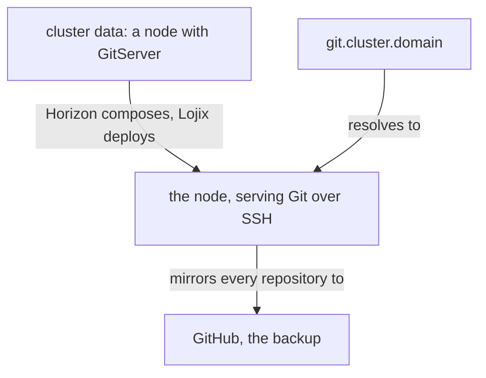

## Git Server

The cluster runs its own Git server on the node whose cluster data gives it the GitServer capability, one capability among the node's others. It serves thinking machines: it accepts the SSH keys the cluster data holds, carries no web interface, and mirrors every repository to GitHub as a backup. The cluster's domain names it: `git.<cluster-name>.<domain>` resolves to that node, and every flake input and every clone on the cluster names a repository there, so GitHub's reachability is no longer the cluster's.

Every repository has an owner, a user from the cluster data, and lives under that owner's namespace; the root holds nothing. A flake input names it there:

```nix
inputs.signal.url = "git+ssh://git.example.criom.net/li/signal";   # an example name: the owner li, his repository signal
```

```datom
; a node in the cluster data, with the capability turned on; the names are an example
{ builder [ GitServer RemoteBuilder ] }
```

```nix
inputs.flow.url = "git+ssh://git.example.criom.net/li/flow";   # the cluster's own server, under the owner's namespace; flake.lock holds the commit
```


