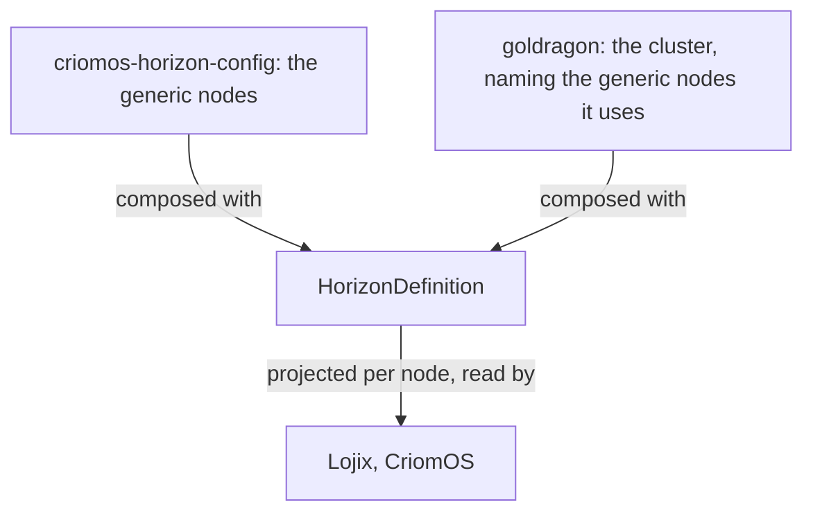

## Horizon is a proper Nexus

Horizon becomes a proper Nexus, so that the current state of the
cluster is queried from it.

## A sandbox virtual machine is a feature of a node

A virtual machine runs on a node, and sandboxing is a feature a node
has. Which node has it is known by querying Horizon.

## Generic nodes

A generic node is defined once, for every cluster, in the Horizon
configuration repository, criomos-horizon-config, which holds the
generic node definitions with their names; a cluster selects the
generic nodes it uses by name, and Horizon merges them into the
cluster when it composes the definition. The generic nodes reach
Lojix as an external input, hardcoded nowhere. What a generic node
does is implemented gated by its kind.

A live installation image is a generic node: a minimal node, TTY
alone, fast to build, holding the allowed SSH keys and an encrypted
default login for opening a terminal by hand; it is deterministically
named, as long as the name needs to be, in versions, minimal and
graphical, and appears in the rendered horizon without being in the
cluster data.

```ethos
LiveDefinition.{}
NodeVariant.[ Live.LiveDefinition Installation.Installation ]
GenericNodeNames.Vector<NodeName>                            ; the cluster's selection, by name
GenericNodes.Vector<NodeDefinition>                          ; the catalogue, in criomos-horizon-config
ClusterDefinition.{ ClusterName ClusterNodes GenericNodeNames Users Domains ClusterTrust }
HorizonConfiguration.{ GenericNodes DomainConfiguration }
HorizonDefinition.{ HorizonConfiguration ClusterDefinition }  ; what Horizon composes from the two
```

```datom
; criomos-horizon-config: the catalogue, two live installation images
{ [ { live-install-graphical Live.{} Min Min Metal.{ X86_64 { 2 None None None None Some.installer-media } }
      { Qwerty None } { [] None None [] None } { ssh-ed25519-installer-graphical None None } Some.True [ Graphical.{} ] None }
    { live-install-minimal Live.{} Min Min Metal.{ X86_64 { 2 None None None None Some.installer-media } }
      { Qwerty None } { [] None None [] None } { ssh-ed25519-installer-minimal None None } Some.True [] None } ]
  { criome [ goldragon.criome.net ] } }
; goldragon/cluster-definition.datom: the cluster selects both
[ live-install-graphical live-install-minimal ]
```

## A node type is the mutually exclusive variant alone

A node type is only the very high-level, mutually exclusive kind of
variant separation: a live node is not an installed node. Everything
else a node does is a capability.


