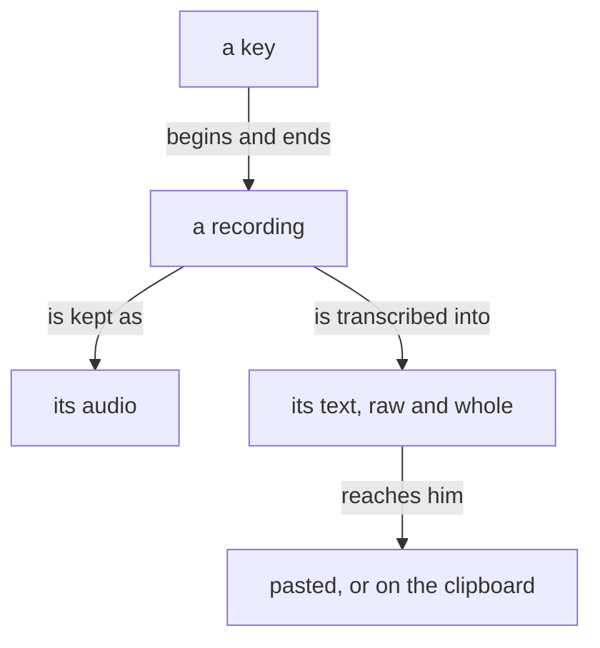

A recording begins at once, whatever is still being transcribed.

The text is what he said, raw and whole: every hesitation, stutter, silence, self-correction and rewording is in it.

Everything he says is kept: the audio outlives whatever becomes of its transcription.
