The Listener is a Nexus of architecture 1. The microphone, the encoding and the kept audio are its own, inside it: Signal carries no audio, and the translator takes no part in it. The translator speaks to the speech service and to the desktop.

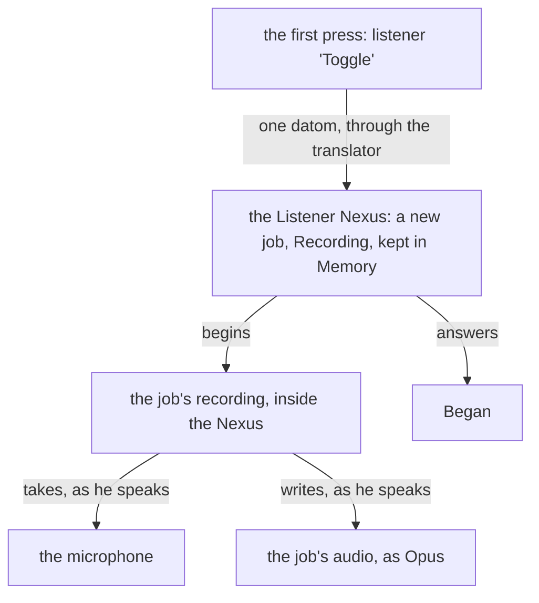

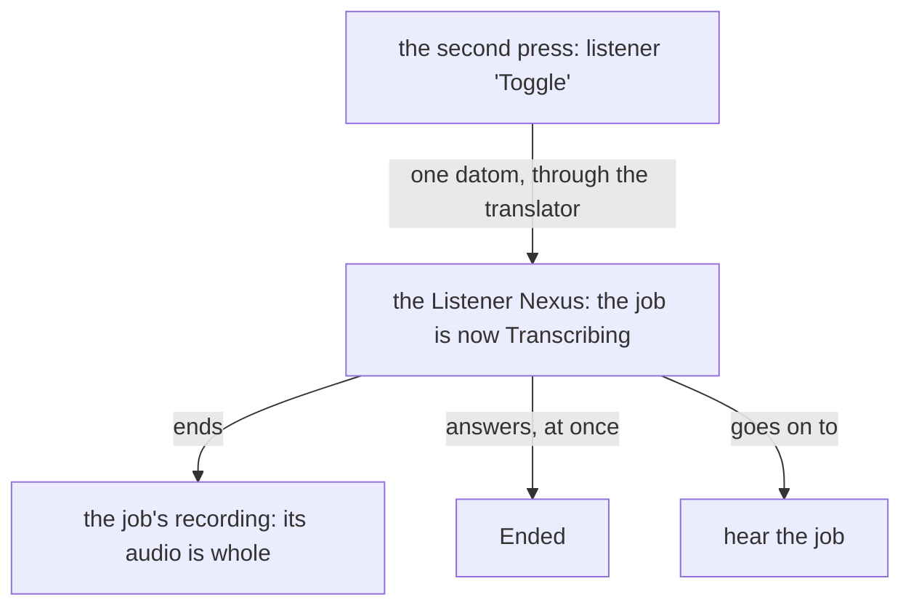

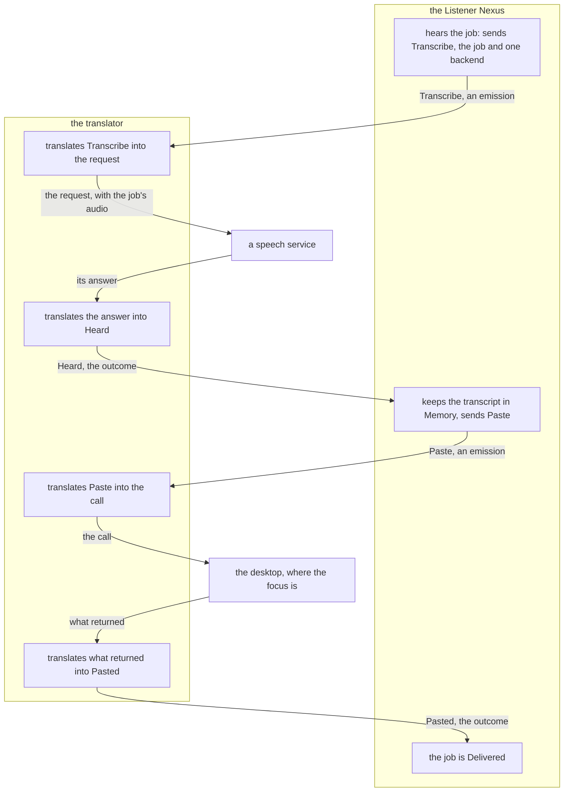

```ethos sketch
Library
[ nexus:[ Unobserved ] ]
[ JobId.String
  Text.String
  Moment.Integer
  BackendName.String
  ModelName.String
  ServiceAddress.String
  SecretEntry.String
  Language.String
  Instruction.String
  Term.String
  Failure.String
  SourceName.String
  ProviderId.String
  Seconds.Integer
  Days.Integer
  Kilobits.Integer
  HistoryLength.Integer
  Protocol.[ OpenAiTranscription Gemini ]
  Backend.{
     BackendName
     Protocol
     ServiceAddress
     ModelName
     SecretEntry
     Language
     Instruction
     Timeout.Seconds }
  Delivery.[ Pasted Copied Kept ]
  Options.{ Option<Delivery> Option<Vector<BackendName>> }
  Sequence.[ AsRecorded AsReady ]
  Retention.[ Forever Days ]
  Source.[ Default Named.SourceName ]
  Failing.[ Failure Unobserved ]
  Try.{ BackendName Failing }
  Transcript.{ BackendName Option<ProviderId> Text }
  State.[ Recording Transcribing Waiting Delivered Failed Cancelled ]
  JobState.{ JobId State }
  Ready.{ JobId Text Delivery }
  Past.{ JobId Moment Text }
  Hearing.[
     Heard.{
        Transcript
        Vector<Try> }
     Exhausted.Vector<Try> ]
  Handing.[ Pasted Copied Kept ]
  Configuration.{
     Vector<Backend>
     Order.Vector<BackendName>
     Delivery
     Sequence
     AudioKept.Retention
     TextKept.Retention
     Vector<Term>
     Kilobits
     Source
     HistoryLength } ]
[]
[]
```

A job is one recording and what becomes of it. A SecretEntry is where a backend's key is kept; the call that reaches the backend reads it there. An Instruction is what a backend is told about how to transcribe; a Term is a word it is told to expect. A Failure is something the world refused, in its own words, and Unobserved is an emission that had no outcome, as the Nexus vision has it. A Try is one backend that did not hear a job, and how it failed. A Transcript is one hearing of a job: the backend that heard it, the provider's own id for that hearing where it gives one, and the text. Waiting is a job whose text is ready and whose turn has not come.

## One key

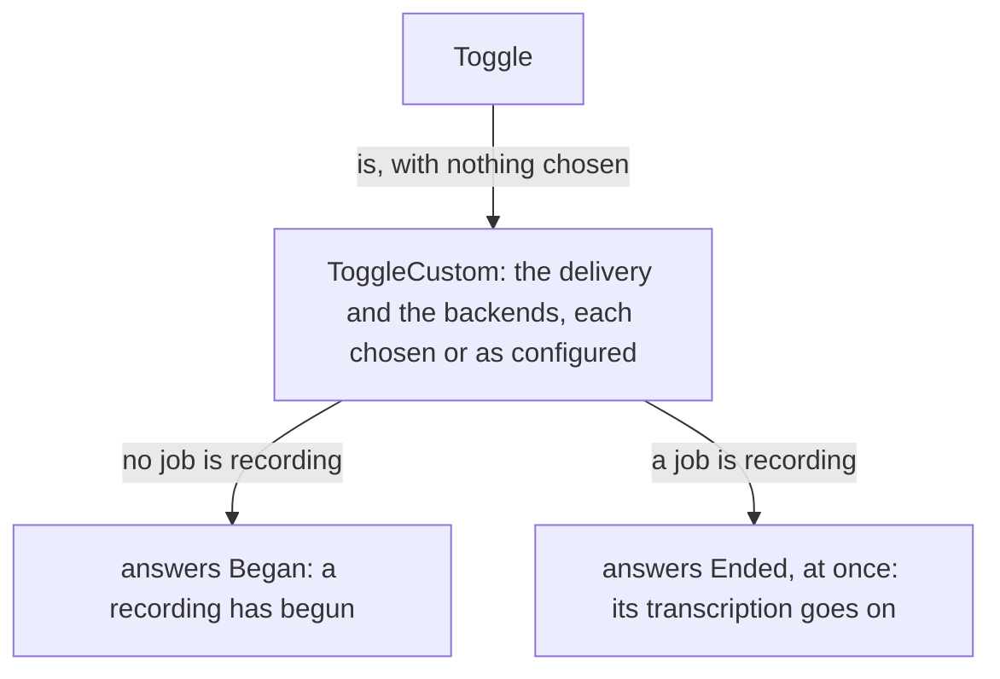

```ethos sketch
Signal
[ listener:[ JobId Text Options JobState Past ] ]
[ Toggle
  ToggleCustom.Options
  Cancel
  Recall
  RecallJob.JobId
  Retranscribe.JobId
  Jobs
  History
  Subscribe ]
[ Began.JobId
  Ended.JobId
  Cancelled.JobId
  Recalled.Text
  Retranscribing.JobId
  Jobs.Vector<JobState>
  History.Vector<Past>
  Subscribed.Stream<Vector<JobState> JobState>
  Refused.[
     NothingRecording
     NothingKept
     NoBackend
     NoSuchJob
     NoMicrophone
     Unwritable ] ]
[ NoSuchJob.JobId ]
```

Cancel ends the recording in progress and transcribes nothing; its audio is kept. Recall hands over the last text again, and RecallJob that of one job. Retranscribe hears a job's kept audio anew. Jobs answers the jobs not yet delivered, and History the latest kept, as many as configured. NoMicrophone and Unwritable are a recording that could not begin.

The keys of a desktop, as an example:

```sh
listener 'Toggle'
listener 'ToggleCustom.{ Some.Copied None }'
listener 'Cancel'
listener 'Recall'
```

One key pressed three times, the first job still being transcribed:

```datom
Toggle
Began.a1
Toggle
Ended.a1
Toggle
Began.a2
```

## The recording

A recording is a part of the Nexus that lives from the first press to the second, and it owns what it holds: the microphone's stream, the encoder and the job's file. Each job has its own, so one that is finishing and one that is beginning stand side by side.

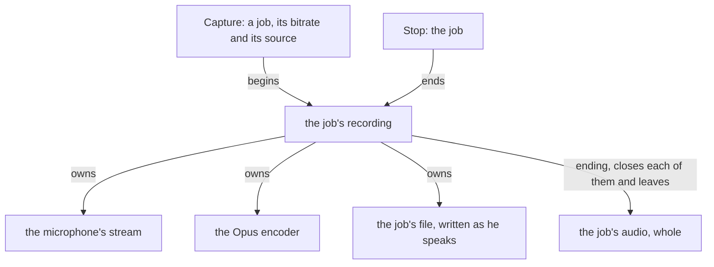

```ethos sketch
Library
[ listener:[ JobId Kilobits Source ] ]
[ Capture.{ JobId Kilobits Source }
  Stop.JobId
  Erase.Vector<JobId>
  Capturing.[ Begun NoMicrophone Unwritable ]
  Stopped
  Erased ]
[]
[]
```

Capture, Stop and Erase are effects of the Nexus itself, with hand-written bodies. The audio is written as he speaks, so a recording cut short keeps what was said until then. A job's audio is named by its JobId, in the Listener's own place.

## What one press does

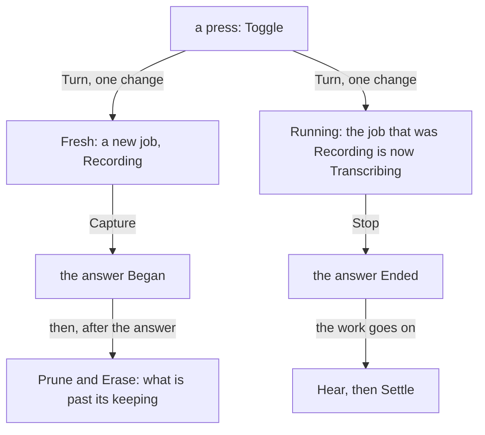

A recording that cannot begin is dropped, and the press is refused with what stopped it.

Four pieces of the Listener's work have names. Hear is the trying of one job's backends, in order. Hand is the handing over of one text, by its delivery. Settle is Record and then, for as long as a text is deliverable, Deliver. Deliver is Hand, then Finish.

## The backends, tried in order

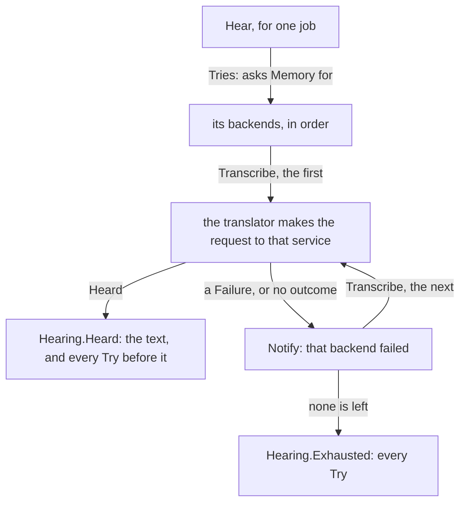

```ethos sketch
Emission
[ listener:[ JobId Text ProviderId Backend Term Try Failure ] ]
[ Transcribe.{
     JobId
     Backend
     Vector<Term> }
  Paste.Text
  Copy.Text
  Notify.Notice ]
[ Transcription.[
     Heard.{ Text Option<ProviderId> }
     Failure ]
  Pasting.[ Pasted Failure ]
  Copying.[ Copied Failure ]
  Notifying.[ Notified Failure ] ]
[ Notice.[ BackendFailed.Try
           Exhausted.JobId
           Copied.JobId ] ]
```

Each emission is one call the translator makes, and everything the call needs is in it: Transcribe carries the whole Backend, its address, its model, where its key is kept and the seconds it is allowed. The translator finds the job's audio by its JobId, in the place it was started with. A protocol is how one kind of service is spoken to, and the words of its request are the translator's: a new kind of service is a new variant of Protocol and a new body there.

## Any number at once

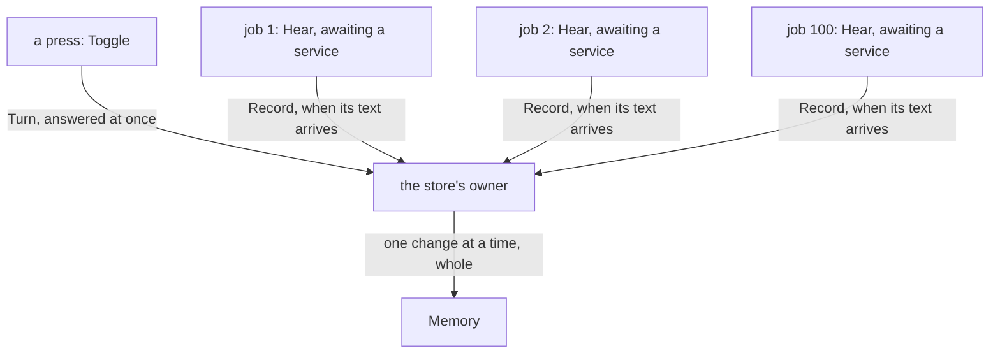

## Each text in its turn

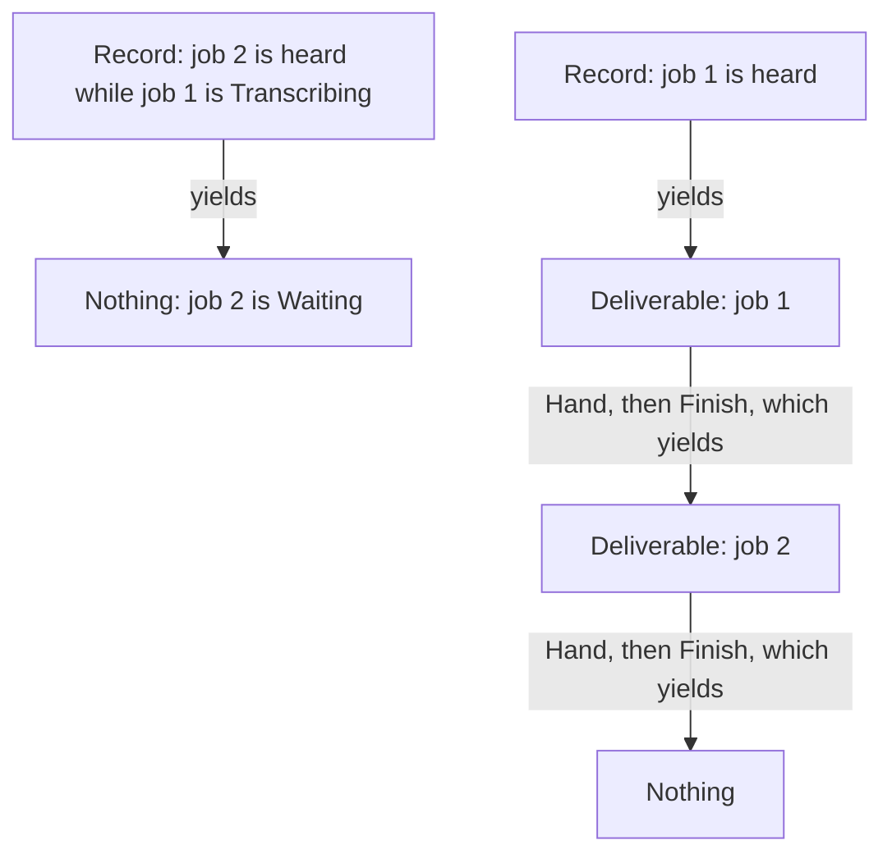

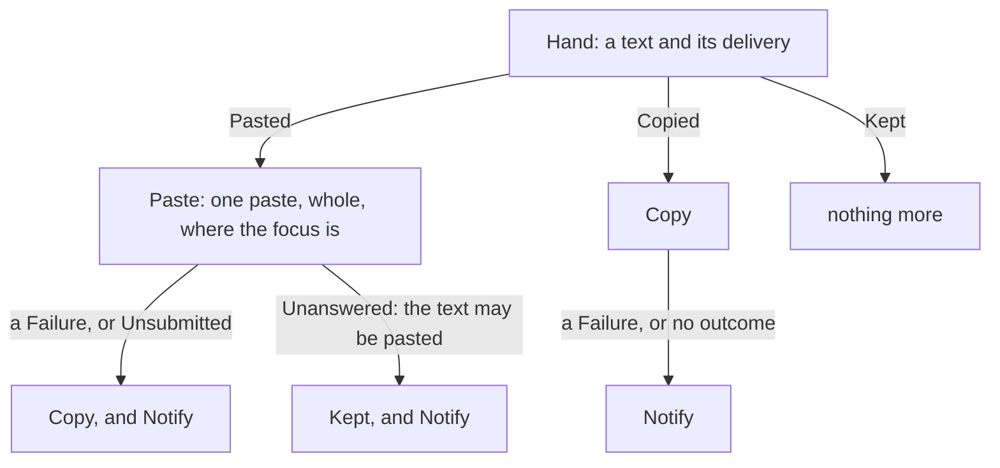

A job is finished however its text was handed over, so no job holds up the ones after it; a job whose every backend failed leaves the order. With AsReady each text is handed over as soon as it is heard.

## What the Listener remembers

```ethos sketch
Memory
[ listener:[ JobId Text Moment BackendName Backend Term Kilobits Source Options Try Transcript State
             JobState Ready Past Hearing Handing Delivery Configuration ]
  listener:signal:[ NoSuchJob ]
  listener:meta:[ Set UnknownBackend ] ]
[ Job.{
     JobId
     Moment
     State
     Delivery
     Vector<BackendName>
     Vector<Transcript>
     Vector<Try>
     Option<Handing> }
  Configuration ]
[ Turn.Options
  Drop
  Requeue.JobId
  Tries.JobId
  Record.{ JobId Hearing }
  Finish.{ JobId Handing }
  Prune
  Last
  Find.JobId
  Pending
  Recollect
  Apply.Set
  Settings
  Import.{ Moment Text } ]
[ Turning.[
     Fresh.{
        JobId
        Kilobits
        Source }
     Running.JobId
     NoBackend ]
  Dropping.[ Dropped.JobId NothingRecording ]
  Requeueing.[ Requeued.JobId NoSuchJob ]
  Trial.{
     Vector<Backend>
     Vector<Term> }
  Next.[ Deliverable.Ready Nothing ]
  Next
  Pruned.Vector<JobId>
  Lasting.[ Ready NothingKept ]
  Finding.[ Ready NoSuchJob ]
  Standing.Vector<JobState>
  Recollected.Vector<Past>
  Applying.[ Applied.Set UnknownBackend ]
  Configuration
  Imported.JobId ]
[]
```

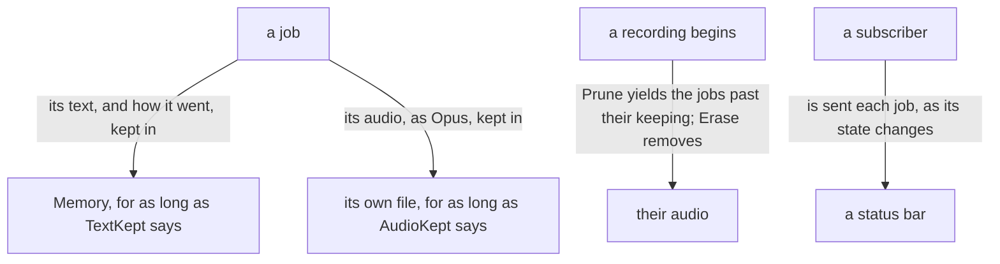

## Every value is configuration

```ethos sketch
Signal
[ listener:[ JobId Text Moment Backend BackendName Delivery Sequence Retention Term
             Kilobits Source HistoryLength Configuration ] ]
[ Configure.Set
  Configuration
  Remember.{ Moment Text } ]
[ Configured.Set
  Configuration
  Remembered.JobId
  Refused.[ UnknownBackend ] ]
[ Set.[
     Backend
     RemoveBackend.BackendName
     Order.Vector<BackendName>
     Delivery
     Sequence
     AudioKept.Retention
     TextKept.Retention
     AddTerm.Term
     RemoveTerm.Term
     Kilobits
     Source
     HistoryLength ]
  UnknownBackend.BackendName ]
```

Order is the backends tried when none is chosen, first to last: it is the fallback. Every name, address and figure below is an example.

```datom
Configure.Backend.{ first OpenAiTranscription «https://first.example» transcribe-large «example/first-key» en «Write every word as it is said, with every hesitation, repetition and restart.» 120 }
Configure.Backend.{ second Gemini «https://second.example» audio-large «example/second-key» en «Write every word as it is said, with every hesitation, repetition and restart.» 120 }
Configure.Order.[ first second ]
Configure.Delivery.Pasted
Configure.Sequence.AsRecorded
Configure.AudioKept.Forever
Configure.TextKept.Forever
Configure.AddTerm.Rust
Configure.Kilobits.24
Configure.HistoryLength.50
```

## A job found standing when the Listener starts

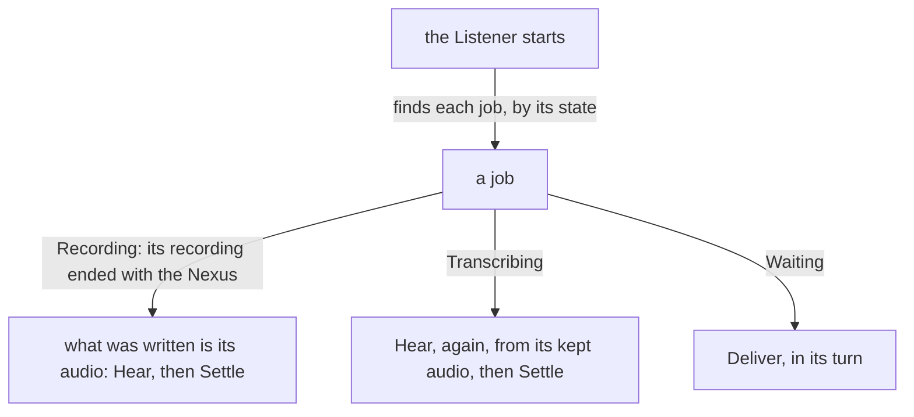
