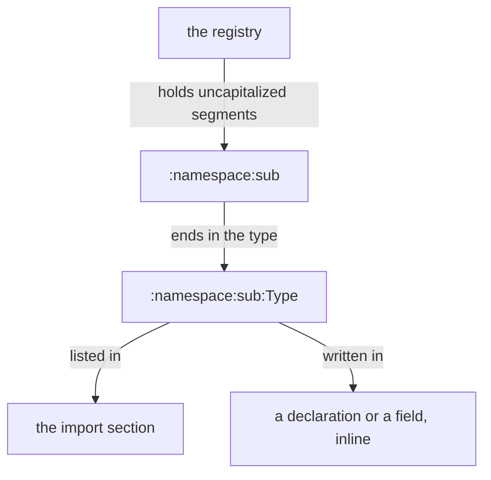

## The colon import form

In the long term, imports take the colon form.

An import starts with a colon, followed by uncapitalized namespace segments separated by colons, ending in the type: `:namespace:sub:Type`. It is usable inline in a type declaration or a field, and the import section uses the same syntax: `:protos:String`, or `:protos:[ String Integer ]` for several.

```
Library
[ :protos:[ String Textualizable ]   ; imports
  :datom:Datom ]
[ Record.{ String Datom } ]          ; types: Datom, imported
[]                                   ; traits
[ Record.[ Textualizable ] ]         ; associations: Textualizable, imported
```

The generated code writes each imported name
fully qualified: `:protos:String` appears as `protos::String`,
`:datom:Datom` as `datom::Datom`.

An import may stand where the type is used, with no entry in the imports section. In a declaration the colon replaces the dot: `Topic:custom:Name` declares `Topic` over the type `Name` from the namespace `custom`. A field takes the import with its leading colon: `Failure.{ :protos:Error String }`. The colon marks the import; the namespace segments are uncapitalized and the type is capitalized.

```
Library
[]                              ; imports
[ Topic:custom:Name             ; a newtype, inline
  Failure.{ :protos:Error       ; a field, inline
            String } ]
[]                              ; traits
[]                              ; associations
```



