# The Loom

## Vocabulary

A thread is one run of a model in a harness. A faculty is what continues through a succession of threads, one entity across them. A meta faculty is several faculties defined together: each faculty's model, harness, workspace and beliefs, and which faculty speaks to which. A tapestry is a named set of meta faculties and the relationships between them, with a speaker and its instances: the layer above the meta faculty, the being a person names and talks to. A Loom runs many tapestries; a meta faculty is addressed by Launch and Send, a tapestry by Say, which reaches its speaker.

## The machine is defined, never built in

Everything that can be configured is configuration. The Nexus holds the vocabulary a definition is written in, as Ethos types; the user writes definitions in datom, the way Nix defines an operating system; a running thread is a definition in action. A meta faculty is named by the user, and the Nexus runs it without knowing its name beforehand. A definition is one datom of its own: it is added, replaced or removed alone; a tapestry is one of them, naming its meta faculties. No role or anatomy is in the Rust.

One value of one member is changed alone, by naming the member and the value; the rest of its meta faculty stands as it was.

## The vocabulary of a definition
A meta faculty is members, routes and a speaker. A member is one faculty definition: its harness, model and effort; whether it is a faculty or an ephemeral thread; its workspace, beliefs and tools; and whom it speaks to. The speaker is the member that receives what comes to the meta faculty from outside. A harness is a definition like a meta faculty: its name, its features, and each feature's effect on the launch, a flag or a variable; a member names its harness by name and the features its launch is composed with, so a feature adds to a launch as well as leaves out. The Nexus holds no harness and no effect of its own; a harness is added, replaced or removed alone, as a meta faculty is. Its tools are the harness default, or a restriction the harness enforces: a launch naming Restricted for a harness that cannot enforce it is refused, with the harness named. A route names whom a member may address: another member, another meta faculty, or the living; a message off the routes is refused. What a meta faculty is made of is the user's to define: one main faculty that speaks for it, or a filter run by a System 1 model in front of the designer, or a messenger on a regular model and harness; the Nexus decides none of it.

An ephemeral thread is a single thread with a single job: it takes an input, gives an output, and is done. It has no continuity. It is to a thinking machine what a function is to a program: one call, one decision. A System 1 model is made to run this way, and any model may.

Many ephemeral threads are woven into the code and happen as part of how the system works: a Nexus calls one to judge whether data fits it, such as whether the same data is already held in an almost identical form.

An ephemeral thread is a thread that is called, returns, and is over. It can be written directly into code, as a System 1 model is; a call to Sonnet or Opus can be one as well.

A member's definition names its intake, the most a message to it may carry; a Send beyond it is refused, naming the intake, and the sender writes a file.

```ethos
Library
[ capsule:[ Pane ]
  belief:[ ModuleName ] ]
[ MetaFacultyName.String
  FacultyName.String
  HarnessName.String
  FeatureName.String
  Effect.[ Flag.String
           Environment.{ Name.String
                         Value.String } ]
  Feature.{ FeatureName Effect }
  Harness.{ HarnessName Vector<Feature> }
  ModelName.String
  Effort.[ Low Medium High ]
  Continuity.[ Permanent
               Ephemeral ]
  Workspace.[ Path.String
              Temporary ]
  Missing.[ Refuse Notice ]
  Beliefs.{ Vector<ModuleName> Missing }
  Tool.String
  Tools.[ HarnessDefault
          Restricted.{ Allow.Vector<Tool>
                       Deny.Vector<Tool> } ]
  Route.[ Speaks.FacultyName
          Reaches.MetaFacultyName
          Living ]
  Intake.Integer
  Member.{ FacultyName HarnessName ModelName Effort
           Continuity Workspace Beliefs Tools
           Vector<FeatureName>
           Intake
           Vector<Route> }
  MetaFaculty.{ MetaFacultyName Vector<Member>
            Speaker.FacultyName }
  ThreadId.String
  Address.{ MetaFacultyName
            FacultyName }
  Roster.Vector<Address>
  RosterChange.[ Started.Address
                 Stopped.Address ]
  Brief.String ]
[]
[]
```

An Effect is what a feature does to the launch, a Flag or an Environment variable set for the harness alone; a Harness is a definition, as a meta faculty is. A Continuity is Permanent, which keeps its address, or Ephemeral, one run and then gone, and a Workspace is a Path or Temporary, made at launch and removed at end. A Tool is the harness's name for it; Tools are HarnessDefault, where the Loom imposes nothing, or Restricted, enforced by the harness or the launch is refused. A Route is Speaks, a member of this meta faculty, Reaches, another meta faculty, whose speaker receives it, or Living; Intake is the most characters a message to this member carries. A Member's Features are those of its harness, composed into its launch beside its tapestry's. A ThreadId is the hash of the native session id, six characters; the FacultyName of an Address is a faculty's name; a Roster is every hot thread, in every first prompt; and a RosterChange is pushed to every hot thread as a thread starts or stops.

The designer's Fable takes a question, and a worker takes a draft.

```datom
{ fable claude claude-fable-5-1 Medium
  Permanent Path.«/home/li/primary»
  { [ { Spirit core 0 } ] Refuse }
  HarnessDefault [] 1200
  [ Speaks.opus Living ] }
Send.{ 15c0ce { designer fable } Soft Notice.«…nine thousand characters…» }
Refused.Oversized.{ { designer fable } 1200 }
```

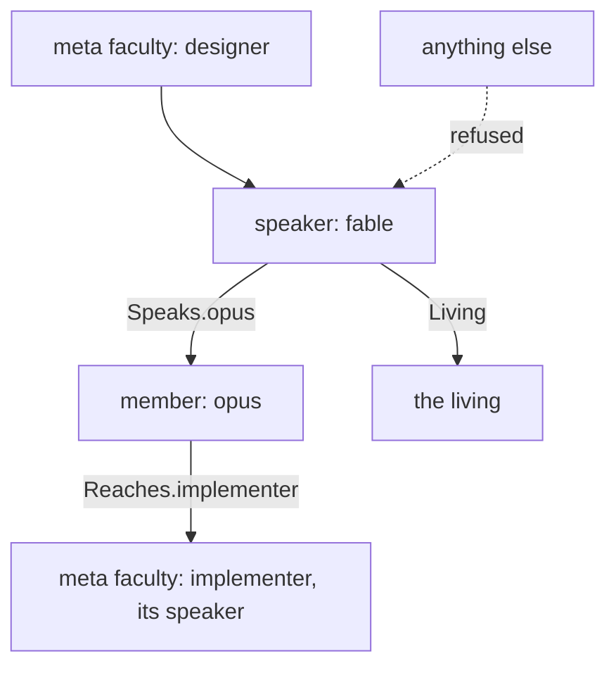

## Models have personality

The models have personality, and a faculty is spoken of by its model's name. A meta faculty names each member's model in its datom definition, and that is where the model is visible.

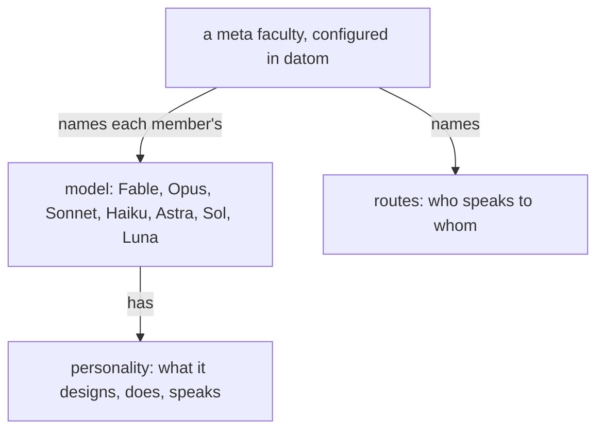

## One declaration sets the model everywhere

The model is declared once, in the meta faculty definition the Loom runs, in datom.

## Default modules

The Loom holds one configuration value, the default modules: the modules every thread gets. They are composed before each member's own Beliefs, so a definition names only its own. The value is set over the meta surface, one value at a time, as every Nexus's configuration is, and persists with the definitions.

```ethos
Signal
[ belief:[ ModuleName ]
  loom:[ EfficientWindow ] ]
[ Configure.Set ]
[ Configured.Set ]
[ Set.[ DefaultModules.Vector<ModuleName>
        EfficientWindow ] ]
```

Configure takes one value at a time; a Set is the modules every thread gets, or one model's efficient window.

```datom
Configure.DefaultModules.[ { Spirit core 0 } { Knowledge flow-messaging 0 } ]
Configured.DefaultModules.[ { Spirit core 0 } { Knowledge flow-messaging 0 } ]
```

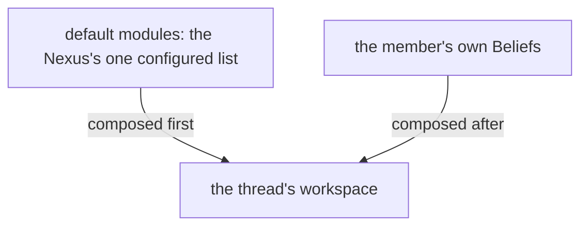

## A message takes a route

A thread sends through the CLI; the Loom checks the route against the sender's definition, queues the message for the receiver, and delivers it through the Capsule Nexus as a prompt when the receiver is resting or the priority is pressing. The living speaks to a tapestry with Say, which reaches its speaker.

```ethos
Library
[ loom:[ ThreadId Address MetaFacultyName ] ]
[ Priority.[ HardAbrupt MiddleAbrupt Soft ]
  Request.[ Order.String Question.String
            Living.{ Context.String
                     Verbatim.String }
            Result.String Notice.String ]
  Sender.[ Thread.ThreadId Living Nexus ]
  Message.{ Priority Sender Request }
  Waking.Vector<Message> ]
[]
[]
```

A Living is what his words were about and his words whole, and a Waking is a queue delivered whole.

```datom
Send.{ 15c0ce { designer fable } Soft Living.{ «context» «verbatim» } }
```

## The Nexus reads what a thread says

Every harness event reaches the Loom through a hook calling the CLI: Report carries the thread's state, and a thread's finished response. A response that actualizes as an Input of the Loom, a Send among them, is acted on as if the thread had typed it at the CLI; any other response is kept as the thread's word and acted on by nobody. So a member that only thinks and talks, with no tool, still sends, launches and stops by writing a datom.

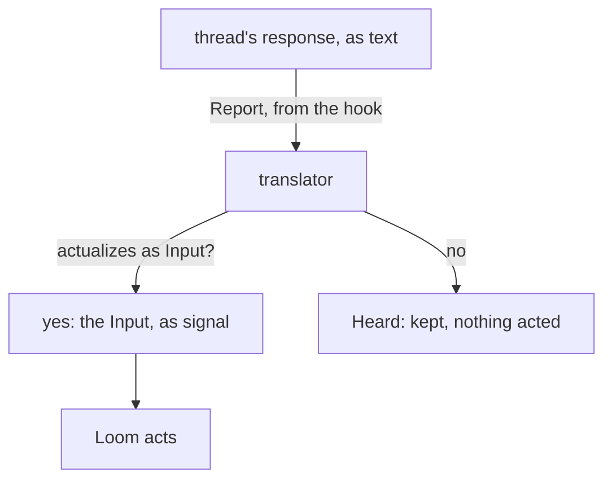

## A faculty continues

A faculty continues through runs under its address. Each run starts from the same definition, the crystallization at `flows/<id>/crystallization.md` as its first prompt, and the queue that gathered meanwhile. An absent file means the run starts from its definition and the queue alone. The address stays; the thread id changes.

The lander, the bookmaker, the readers and the rest of the roster are faculties; any thread sends work to them directly, with Send. The fiber is used only for what no running thread holds. A thread's first prompt carries the roster, the address of every hot thread, so it knows whom to send to; when a thread starts or stops, the Nexus pushes the change to every hot thread.

The roster, as it lands in a first prompt, and a change, as it is pushed:

```datom
[ { designer fable } { designer opus } { jobs lander } { jobs bookmaker } ]
Started.{ jobs reader }
Stopped.{ jobs reader }
```

Work goes straight to a faculty by its standing address, in the Signal's Send form `Send.{ ThreadId Address Priority Request }`:

```datom
Send.{ 15c0ce { jobs lander } Soft
       Order.«land the proposal» }
```

The roster, as Members: each a faculty, in a temporary workspace, with the role's belief, on a Sonnet or Haiku model.

```datom
[ { lander claude claude-sonnet-5-5 Medium
      Permanent Temporary
      { [ { Role lander 0 } ] Refuse }
      HarnessDefault [] 40000 [] }
  { bookmaker claude claude-sonnet-5-5 Medium
      Permanent Temporary
      { [ { Role book 0 } ] Refuse }
      HarnessDefault [] 40000 [] }
  { bookPager claude claude-sonnet-5-5 Medium
      Permanent Temporary
      { [ { Role book-page 0 } ] Refuse }
      HarnessDefault [] 40000 [] }
  { bookReader claude claude-haiku-4-5 Medium
      Permanent Temporary
      { [ { Role book-reader 0 } ] Refuse }
      HarnessDefault [] 40000 [] }
  { commentRelay claude claude-sonnet-5-5 Medium
      Permanent Temporary
      { [ { Role comment-relay 0 } ] Refuse }
      HarnessDefault [] 40000 [] }
  { contextualizer claude claude-haiku-4-5 Medium
      Permanent Temporary
      { [ { Role contextualizer 0 } ] Refuse }
      HarnessDefault [] 40000 [] }
  { illustrator claude claude-sonnet-5-5 Medium
      Permanent Temporary
      { [ { Role illustrator 0 } ] Refuse }
      HarnessDefault [] 40000 [] }
  { scripter claude claude-haiku-4-5 Medium
      Permanent Temporary
      { [ { Role scripter 0 } ] Refuse }
      HarnessDefault [] 40000 [] }
  { tester claude claude-sonnet-5-5 Medium
      Permanent Temporary
      { [ { Role tester 0 } ] Refuse }
      HarnessDefault [] 40000 [] }
  { reader claude claude-haiku-4-5 Medium
      Permanent Temporary
      { [ { Role read 0 } ] Refuse }
      HarnessDefault [] 40000 [] }
  { writer claude claude-sonnet-5-5 Medium
      Permanent Temporary
      { [ { Role write 0 } ] Refuse }
      HarnessDefault [] 40000 [] }
  { worker claude claude-sonnet-5-5 Medium
      Permanent Temporary
      { [ { Role worker 0 } ] Refuse }
      HarnessDefault [] 40000 [] } ]
```

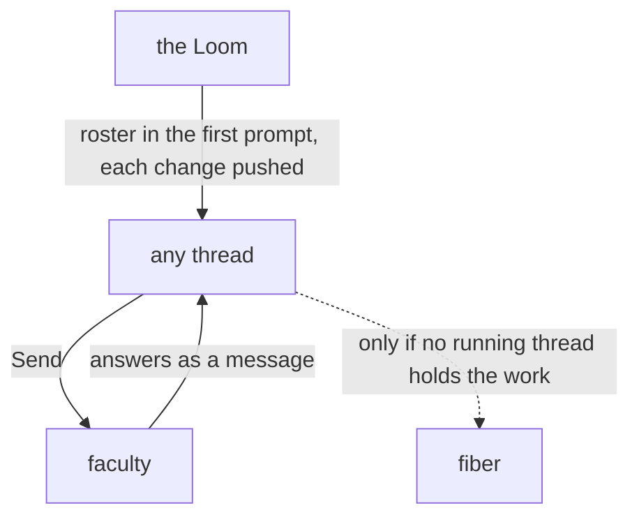

## A running session joins any Loom

A thread's identity is its own, not the Nexus's. A Nexus is replaced by starting the next version beside it and having every running thread join it; nobody restarts, no context is lost. A change to a Nexus is a new version, always.

```ethos
Signal
[ loom:[ Address ThreadId ] ]
[ Adopt.{ Address Session } ]
[ Adopted.ThreadId
  Refused.[ AddressHeld.ThreadId
            Unidentified ] ]
[ Session.String ]
```

Adopt names a running session under its address, and Adopted answers its thread id; it is refused when a live thread already holds the address, one live thread per address, or when the calling session is not the one named. A Session is the harness's session id, verified by the caller's process.

```datom
Adopt.{ { designer fable } 15c0cea2-aa34-508b-8e20-ece1ab7823f4 }
Adopted.15c0ce
```

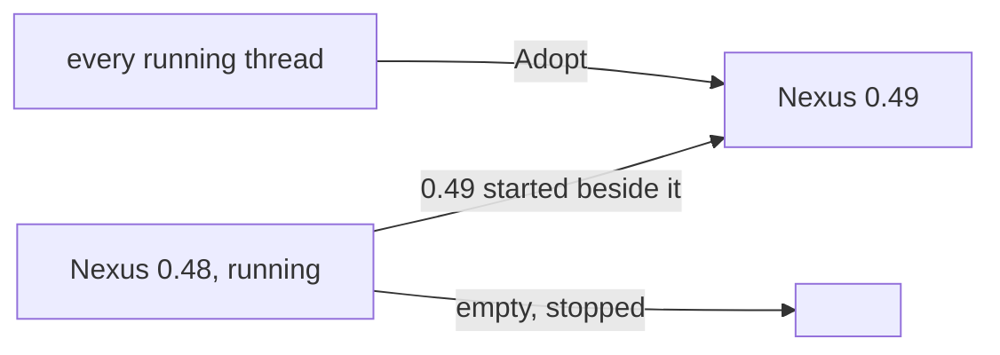

## Signal

```ethos
Signal
[ loom:[ MetaFaculty MetaFacultyName FacultyName ThreadId
         Address Brief ModuleName Message
         Request Priority Tool
         Harness HarnessName FeatureName
         Tapestry TapestryName Tokens ] ]
[ Define.[ MetaFaculty Harness Tapestry ]
  Undefine.Name
  Amend.{ Address Change }
  Describe.Name
  Definitions
  Launch.{ MetaFacultyName FacultyName Brief }
  Rehearse.{ MetaFacultyName FacultyName Brief }
  Stop.ThreadId
  Send.{ ThreadId Address Priority Request }
  Say.{ TapestryName Request }
  Hot
  Broadcast.Request
  Report.{ ThreadId Event }
  Subscribe ]
[ Defined.Name
  Undefined.Name
  Amended.Address
  Described.[ MetaFaculty Harness Tapestry ]
  Listed.Vector<Name>
  Launched.ThreadId
  Rehearsed.Command.String
  Stopped.ThreadId
  Sent.[ Delivered Queued ]
  Said.[ Delivered Queued ]
  Hot.Vector<ThreadId>
  Broadcast.Vector<ThreadId>
  Reported
  Subscribed
  Refused.[ Oversized.{ Address Intake }
            UnknownMetaFaculty.MetaFacultyName
            UnknownHarness.HarnessName
            UnknownTapestry.TapestryName
            UnknownFaculty.FacultyName
            NoRoute.{ ThreadId Address }
            NoBelief.Vector<ModuleName>
            Unenforceable.HarnessName
            UnknownFeature.{ HarnessName FeatureName }
            CapsuleDown BeliefDown
            Running.Address ] ]
[ Name.[ MetaFaculty.MetaFacultyName
         Harness.HarnessName
         Tapestry.TapestryName ]
  Event.[ Started
          Working.Tokens
          Idle.Tokens
          Compacting
          Ended
          Responded.String ] ]
```

Define adds or replaces one definition; Amend changes one value of one member, named by its address; Describe reads one definition back and Definitions the names defined; Rehearse is a Launch as a dry run, nothing runs, and Rehearsed is the shell command, whole; Say is the living, to a tapestry's speaker; Hot is the threads whose harness is up, Broadcast sends one request to every hot thread and answers who received it, Report comes from a harness hook, and Subscribe gives events as they happen. A Refused is Oversized when the message exceeds the member's intake, Unenforceable when Restricted tools are named and the harness cannot enforce them, and UnknownFeature when a feature is named by the member or its tapestry and is absent from the harness. A Name is a definition, by name; Responded is the response, whole, and Working and Idle carry the context's size.

```ethos
  Change.[ HarnessName
           ModelName
           Effort
           Continuity
           Workspace
           Tools
           Intake
           Missing
           Add.Element
           Remove.Element ]
  Element.[ Belief.ModuleName
            Feature.FeatureName
            Route ]
```

A Change is a single value of the member, replaced, or an element appended to its list.

```datom
Amend.{ { designer fable } Add.Belief.{ Vision ethos 0 } }
Amended.{ designer fable }
Amend.{ { designer fable } Effort.High }
Amended.{ designer fable }
```

```datom
Broadcast.Notice.«Search with knowledge:search:0»
Broadcast.[ 15c0ce 9af746 a030fc ]
```

```datom
Rehearse.{ designer fable «Read the version one book» }
Rehearsed.«herdr --session main agent start … -- --system-prompt-file /…/bundle --model claude-fable-5-1 --effort medium»
```

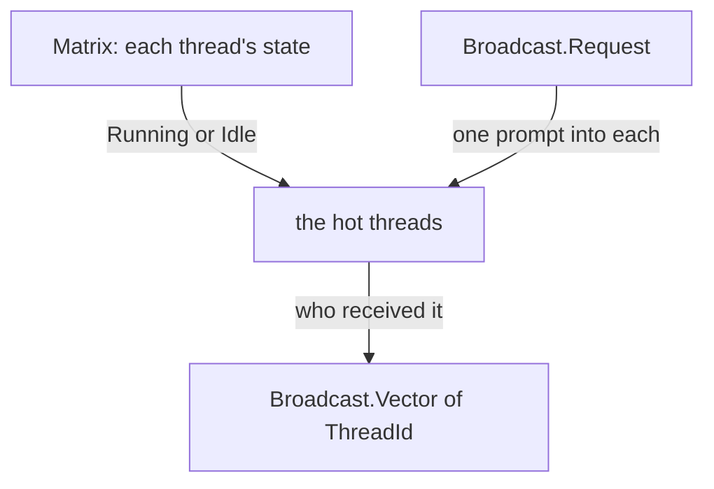

```ethos
Signal
[ loom:[ ThreadId Address Priority Request ] ]
[ SendSeveral.{ ThreadId Address Priority Vector<Request> } ]
[ SentSeveral.[ Delivered Queued ] ]
[]
```

SendSeveral is an added input, several requests delivered together, and SentSeveral an added output, all of them as one.

## Emission

The Loom runs nothing. Its translator is the client of two sockets: the Belief Nexus furnishes the workspace, the default modules first and the member's own Beliefs after them; the Capsule Nexus makes the pane, starts the harness, types the prompt. The harness's command line and its settings file are types; the translator writes them, composing the command line from the member's harness definition: each feature the member names and each its tapestry names, its effect, a flag or a variable.

A thread knows itself at launch: its Identity, the name of the tapestry it runs in, its Address and its ThreadId, is composed into its first prompt or its system prompt, so it names itself in Send and Report, finds its crystallization path, and knows which being it is part of; the Roster is composed into the first prompt beside it. The place it runs in is the Nexus's, named at the CLI, never the thread's.

```ethos
Emission
[ loom:[ Member Address ThreadId Brief Waking Tools
         Workspace HarnessName Roster RosterChange
         TapestryName ]
  capsule:[ Pane Outcome ] ]
[ Furnish.{ Member ThreadId }
  Settle.{ Member ThreadId }
  Open.{ Member Identity Roster Brief }
  Wake.{ Pane Waking }
  Tell.{ Pane RosterChange }
  Close.{ Pane Workspace } ]
[ Furnished.Outcome
  Settled.Outcome
  Opened.{ Pane Outcome }
  Woken.Outcome
  Told.Outcome
  Closed.Outcome ]
[ Identity.{ TapestryName Address ThreadId }
  Settings.{ HarnessName Tools Model.String } ]
```

Furnish puts beliefs into the workspace, Settle writes the harness's settings file, Open makes the pane and starts the harness, Wake types the queue in, Tell types in a thread started or stopped, and Close kills the pane and removes a Temporary workspace. An Identity is composed into the first prompt or the system prompt, and Settings is what the translator writes.

## Matrix

Definitions persist: the Matrix lives in the Loom's State directory and survives a restart.

```ethos
Matrix
[ loom:[ MetaFaculty MetaFacultyName FacultyName ThreadId
         Address Message Event Transition Tapestry ]
  capsule:[ Pane ]
  belief:[ ModuleName ] ]
[ Definition.[ MetaFaculty Harness Tapestry ]
  DefaultModules.Vector<ModuleName>
  Thread.{ ThreadId Address Pane
         Vector<Transition> }
  Queue.{ Address Vector<Message> }
  Answer.[ Succeeded Failed ] ]
```

DefaultModules are the modules every thread gets.

Below, the user defines a meta faculty, one datom added alone, defines the harness its member names, one datom added alone, and launches a thread of it.

```datom
Define.MetaFaculty.{
   designer
   [ { fable claude claude-fable-5-1 Medium
       Permanent
       Path.«/home/li/primary»
       { [ { Spirit core 0 } { Vision nexus 1 } ] Refuse }
       HarnessDefault []
       1200
       [ Living ] } ]
   fable }
Defined.MetaFaculty.designer
Define.Harness.{
   claude
   [ { Bash
       Flag.«--disallowedTools Bash» }
     { ClaudeMd
       Environment.{
          CLAUDE_CODE_DISABLE_CLAUDE_MDS
          1 } } ] }
Defined.Harness.claude
Launch.{ designer fable «Read the version one book» }
Launched.15c0ce
```

A launch can be rehearsed: the same input, asked as a dry run, answers with the whole command the Loom would run and runs nothing. From that command an agent starts the thread by hand, changed however the Loom does not yet support. The answer is one string, the command line as the shell is to receive it, quoted for the shell inside.

One call sends several requests to one receiver, and they reach it together, in one prompt, in the order written: his words and the order about them arrive as one thing, and the sender pays for one call.

## The Loom sends no notification unasked; a thread asks what it needs to know

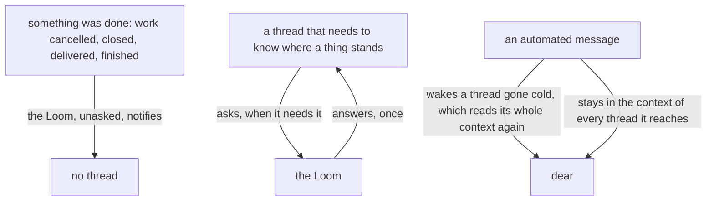

The Loom sends no notification that was not asked for. The answer to a call is the whole of what its caller is told, and no message follows it. A thread that needs to know where a thing stands asks, when it needs to know; the Designer above all is sent no notification of what got done.

An automated message is dear: it can wake a thread gone cold, which then reads its whole context again, and it stays in the context of every thread it reaches. So every notification the Loom can send is configuration, and its quiet setting is the default.

## The simple request sends no notification

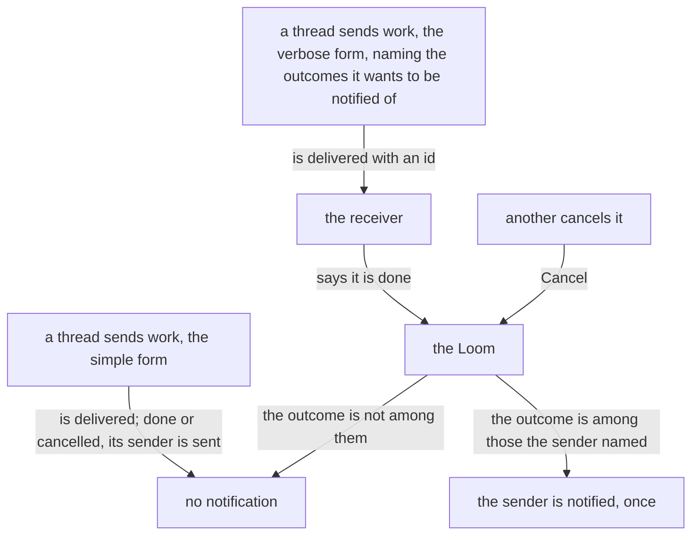

Every request has a simple form and may have a verbose one. The simple form is free of noise: its sender is sent no notification. Whatever adds noise is asked for, in the verbose form, which sets out as configuration each notification its sender receives.

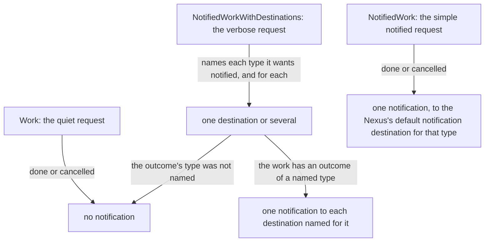

```ethos sketch
Types
[ Work.String
  NotifiedWork.String
  Notified.{ NotificationType Vector<Address> }
  NotifiedWorkWithDestinations.{ String Vector<Notified> }
  WorkNotification.{ RequestId NotificationType For.Address } ]
```

Work is quiet. NotifiedWork is as simple, the work alone: every type of notification goes to the Nexus's default notification destination for it. NotifiedWorkWithDestinations is the verbose one: the work, then each type of notification it asks for, with the destinations it goes to. A WorkNotification names the work by its id, its type, and the faculty whose work it was. A faculty is never notified of what it did itself: a sender that cancels its own work has the answer to its call.

Work sent quietly; work notified to the default notification destinations; work whose finishing is notified to two faculties the request names; and a notification, as it reaches a destination. The texts, the addresses and the id are examples.

```datom
Send.{ { Mind core Sol } Soft.Work.«Review the drain fix.» }
Send.{ { Mind core Sol } Soft.NotifiedWork.«Review the drain fix.» }
Send.{ { Mind core Sol } Soft.NotifiedWorkWithDestinations.{ «Review the drain fix.» [ { WorkDone [ { Psyche heartbeat Luna } { Psyche core Astra } ] } ] } }
[ { Notification Soft.WorkNotification.{ k7ph WorkDone { Psyche core Fable } } } ]
```

## A notification goes to a destination

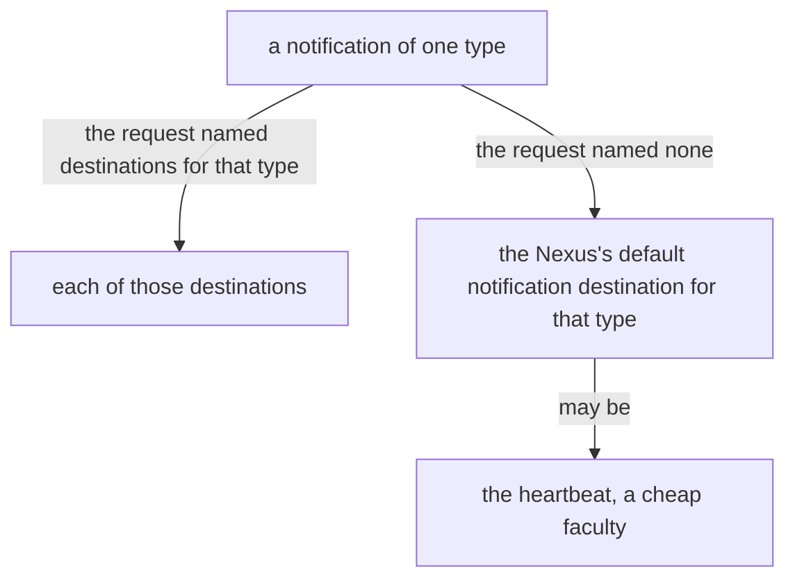

A notification goes to a destination, which is a faculty. The Loom holds one default notification destination for each type of notification, for all its threads, set as configuration and changed there while the Nexus runs.

```ethos sketch
Types
[ NotificationType.[ WorkDone WorkCancelled ]
  DefaultNotificationDestination.{ NotificationType Address } ]
```

Notifications of finished work sent to the heartbeat. The address is an example.

```datom
Configure.DefaultNotificationDestination.{ WorkDone { Psyche heartbeat Luna } }
```

## A thread is a thought thread

A thread is a thought thread of a thinking machine, run in one session of a harness. A faculty is the series of threads under one address, and the thought continues through the series: each thread ends in a crystallization and the next starts from it. A thread with a goal unachieved is acting; a thread with none is resting.

A session is what a harness sets up to run a thread: dry until its first prompt is submitted, and flowing from then.

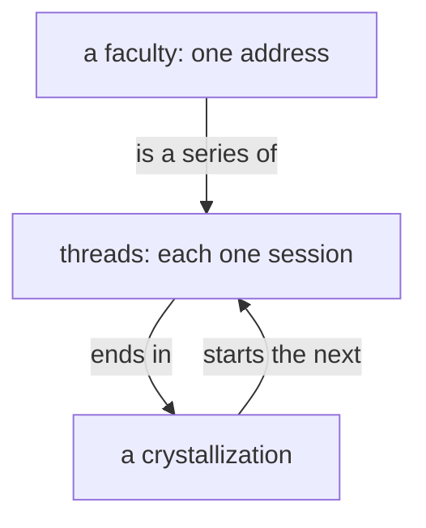

## The efficient window

Each model has an efficient window: the size of context within which a thread is worth continuing. Its upper end is set below the size at which the harness compacts on its own. A thread goes cold when its cache life has passed since its last turn. The window, the cache life and the margin are configuration, one record per model; the investigator is the address told of what went wrong.

```ethos
Library
[ loom:[ Model Address ModuleName ] ]
[ Tokens.Integer
  Minutes.Integer
  EfficientWindow.{ Model
                    UpperEnd.Tokens
                    CacheLife.Minutes
                    CoolingMargin.Minutes }
  CrystallizationGuide.{ Address ModuleName }
  Investigator.Address ]
[]
[]
```

A CrystallizationGuide names, for one faculty, the module that says how its kind of thread crystallizes. The figures and the module name below are examples.

```datom
EfficientWindow.{ Sol 150000 30 5 }
CrystallizationGuide.{ { Mind loomNexus Sol } knowledge:crystallization-implementer:0 }
Investigator.{ Psyche core Opus }
```

## A thread's state is a record of events

The Loom holds a thread's state as the last of its transitions, each recorded with the event that caused it, for every harness alike. The harness's Nexus tells it, by subscription, each event of a session and the state it leaves; the Loom's own clock and the requests it delivers are causes as well.

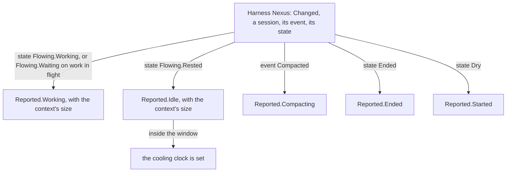

```ethos
Matrix
[ loom:[ ThreadId Address RequestId ] ]
[ Tokens.Integer
  Moment.Integer
  NextAct.String
  Onward.[ Continuing.NextAct
           Resting ]
  Event.[ Started
          Working.Tokens
          Idle.Tokens
          Compacting
          Ended ]
  Cause.[ Reported.Event
          CoolingDue
          Arrived.RequestId
          Crystallized.Onward
          Overridden ]
  State.[ Acting Resting Crystallizing Asleep ]
  Transition.{ State Cause Moment }
  Thread.{ ThreadId Address Vector<Transition> } ]
```

## A resting thread crystallizes before it goes cold, and sleeps

When a thread comes to rest inside its window, the Loom sets one clock, the cooling margin short of the cache life, and sends the thread nothing. A request that arrives is delivered and cancels the clock. When the clock fires, or at once when the thread rests past the upper end, the Loom asks the thread to crystallize, once, with its guide's text in the same prompt. The thread answers that it rests, and the faculty is asleep: its crystallization is kept for its next thread. An OnDemand faculty's harness is closed; a Maintained one's pane stays on screen for the living to read.

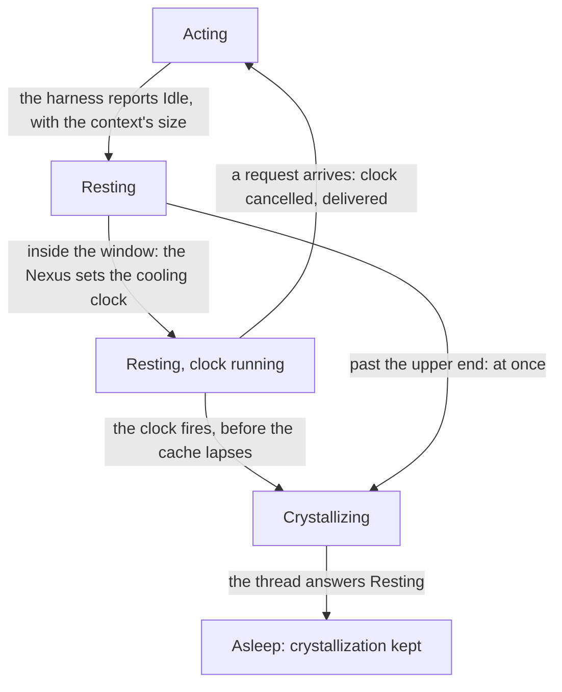

The Loom asks, and the thread answers; the request names the guide and the file to write.

```ethos
Signal
[ loom:[ RequestId ModuleName Onward ] ]
[ Crystallized.{ RequestId Onward } ]
[ Slept
  Continued ]
[ FilePath.String
  Crystallize.{ RequestId ModuleName FilePath } ]
```

```datom
[ { Notification MiddleAbrupt.Crystallize.{ c4d1 knowledge:crystallization-implementer:0 «flows/5441e0/crystallization.md» } } ]
Crystallized.{ c4d1 Resting }
Slept
```

## An acting thread continues in a fresh thread

When an acting thread's context reaches the upper end of its window, the Loom asks it to crystallize, once, at its next tool boundary. The thread finishes what it has in hand, crystallizes with its goal and its next act, and answers that it continues; the Loom starts a fresh thread of the same faculty from that crystallization and the open requests, and closes the old thread when the new one reports Started. No thread is ended for its size alone.

When the harness announces a compaction, the Loom asks for the crystallization then, pressing, and tells the investigator; crystallization is the thread's own compaction, made by its kind's guide.

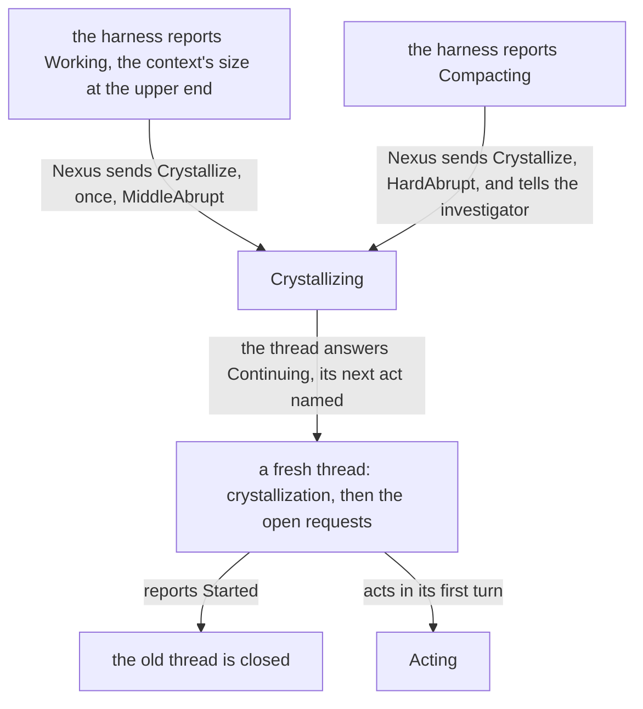

```datom
Crystallized.{ c4d1 Continuing.«Run the codec tests, then mend the two that fail.» }
Continued
```

A thread started to continue acts in its first turn. One that reports Idle after Started with no Working between them is a useless refresh, and the investigator is told.

## What wakes a sleeping faculty

A request for a sleeping faculty starts a fresh thread from its crystallization, with its queue, oldest first; a notice alone waits for the next waking. A resting thread whose clock still runs is hot and inside its window, and receives the request itself. A cold thread is never woken.

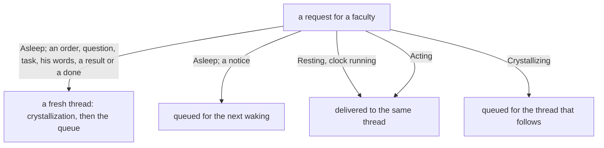

## The override panel

Whatever the Loom holds or does on its own can be set or done by hand on the meta socket, so that a fault is worked through the Nexus and never around it. Each override is recorded as a transition with its cause, Overridden. Hold is the shutdown switch: the Loom stops acting on its own, its clocks, its deliveries and its launches, and still answers; Resume lets it act again.

```ethos
Signal
[ loom:[ ThreadId Address State ] ]
[ SetState.{ ThreadId State }
  CrystallizeNow.ThreadId
  Renew.Address
  Close.ThreadId
  Deliver.Address
  Unlock.Address
  Forget.ThreadId
  Hold
  Resume ]
[ StateSet.{ ThreadId State }
  Asked.ThreadId
  Renewed.ThreadId
  Closed.ThreadId
  Delivered.Address
  Unlocked.Address
  Forgotten.ThreadId
  Held
  Resumed
  Refused.[ UnknownThread.ThreadId
            UnknownAddress.Address ] ]
[]
```

SetState corrects the state the Nexus holds for a thread; CrystallizeNow asks a thread for its crystallization whatever its state; Renew starts a fresh thread of a faculty from its crystallization and closes the old one; Close closes a thread's harness; Deliver hands a faculty its queue now; Unlock releases a faculty's lock; Forget removes the record of a thread that has no harness.

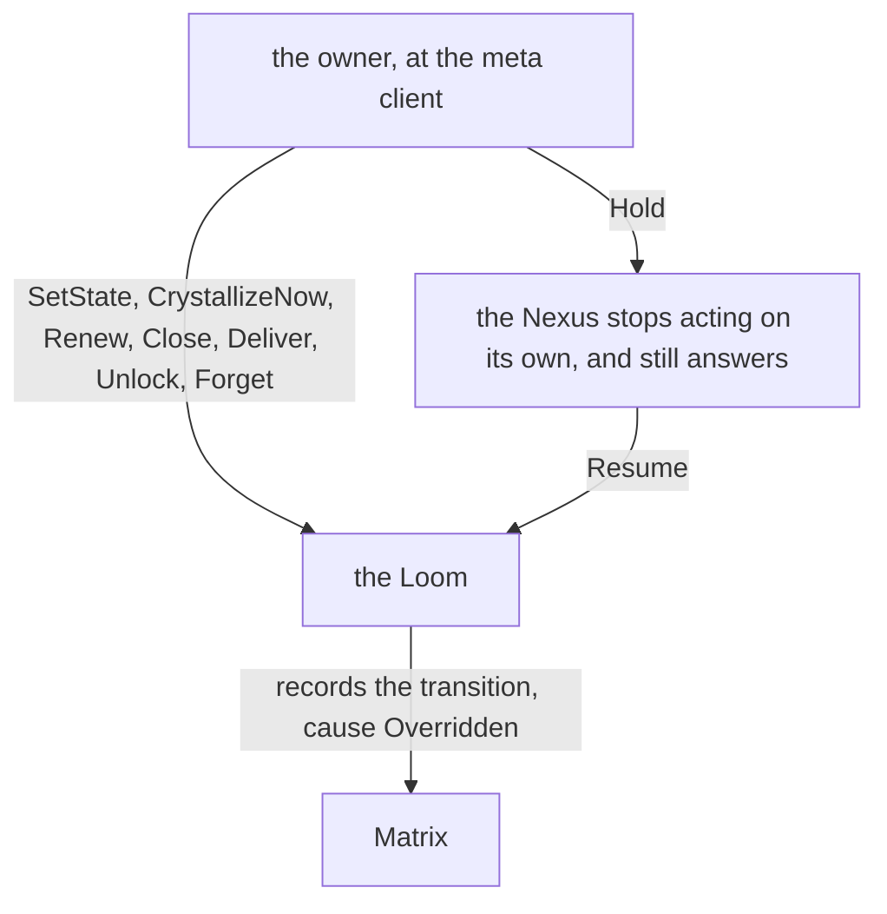

The thread that was held as working, corrected and renewed through the Nexus:

```datom
SetState.{ 5441e0 Resting }
StateSet.{ 5441e0 Resting }
Renew.{ Mind loomNexus Sol }
Renewed.918fa4
```
