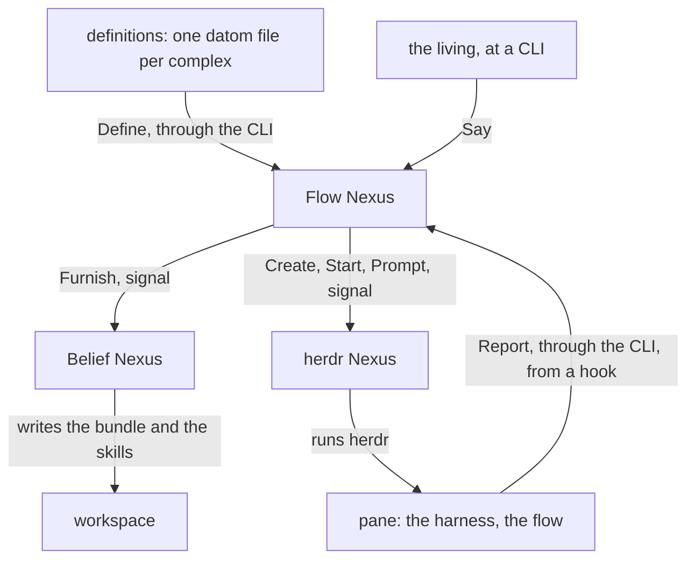

# The metaflow

Version 1. A metaflow is several complexes defined together, running as one self for one owner: the layer above the complex. Three Nexuses run it, from the definitions given them, and the flows run from those.



## A Nexus starts in its place

A Nexus reads nothing from the environment; the CLI's two default roots come from the standard XDG variables and from nothing else. A Nexus is started with one datom, its place. Runtime holds the sockets of the Nexus and defaults to `$XDG_RUNTIME_DIR/metaflow/<place-name>/`; State holds its memory and defaults to `~/.local/state/metaflow/<place-name>/`. A CLI resolves `<place-name>` under the runtime root and finds the sockets. Two places are two names, and the stable one keeps running while the next is tried. The CLI is `<nexus-name> <place-name> '<datom>'`: named after the Nexus; the place name picks the instance. Both roots are the CLI's fixed defaults, never an argument.

```ethos
Library
[]
[ PlaceName.String                   ; main, next
  Place.{ PlaceName                  ; what every Nexus starts with
          Runtime.String             ; the sockets
          State.String } ]           ; the memories
[]
[]
```

```datom
; each Nexus, started by the shell
{ main /run/user/1001/metaflow/main
  /home/li/.local/state/metaflow/main }
; the sockets it makes there
; <nexus>.sock  <nexus>-meta.sock  <nexus>-translator.sock  <nexus>-meta-translator.sock
; the meta CLI's text arrives at <nexus>-meta-translator.sock and becomes signal for <nexus>-meta.sock; the ordinary translator refuses meta text
; flow.sock  flow-meta.sock  flow-translator.sock  flow-meta-translator.sock
; herdr.sock herdr-meta.sock herdr-translator.sock herdr-meta-translator.sock
; belief.sock belief-meta.sock belief-translator.sock belief-meta-translator.sock
```

```sh
# the CLI: the place's name, then one datom
flow-nexus main 'Launch.{ designer fable «Read the book» }'
herdr-nexus main 'Prompt.{ { main wQ:pT } «hello» }'
```

## The metaflow is a Nix shell

The repository metaflow holds the Nix that builds the three Nexuses, their translators and CLIs, and a shell that starts each of them with its place under the owner's login. It is not a sandbox: a flow in it has the owner's credentials and files.

```sh
nix develop github:LiGoldragon/metaflow -- metaflow start next
```

## Everything in a metaflow is a definition

The Nexuses hold vocabulary; the owner writes definitions in datom. A definition is one file, one datom; the definition files are the owner's sources, kept wherever he keeps them and given by Define and replaced the same way; the running set is the Flow Nexus's Memory in its State directory. A change to one definition touches no other. The Rust knows no role, model name or topic.

```datom
; definitions/designer.datom: one complex
{ designer
  [ { fable Claude claude-fable-5-1 Medium
      Permanent
      Path.«/home/li/primary»
      { [ { Spirit core } { Vision nexus-v1 } ] Refuse }
      { [ Bash Edit ] [ Artifact ] }
      [ Speaks.opus Speaks.Living ] }
    { opus Claude claude-opus-4 Medium Ephemeral
      Temporary
      { [ { Spirit core } { Role worker } ] Notice }
      { [] [] }
      [ Speaks.fable Speaks.Complex.implementer ] } ]
  fable }                            ; the speaker
```
