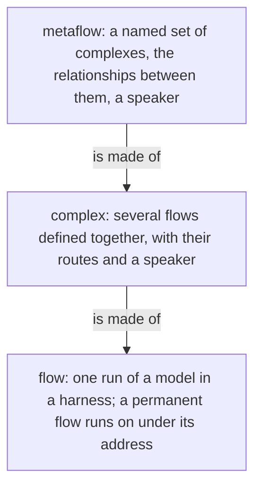
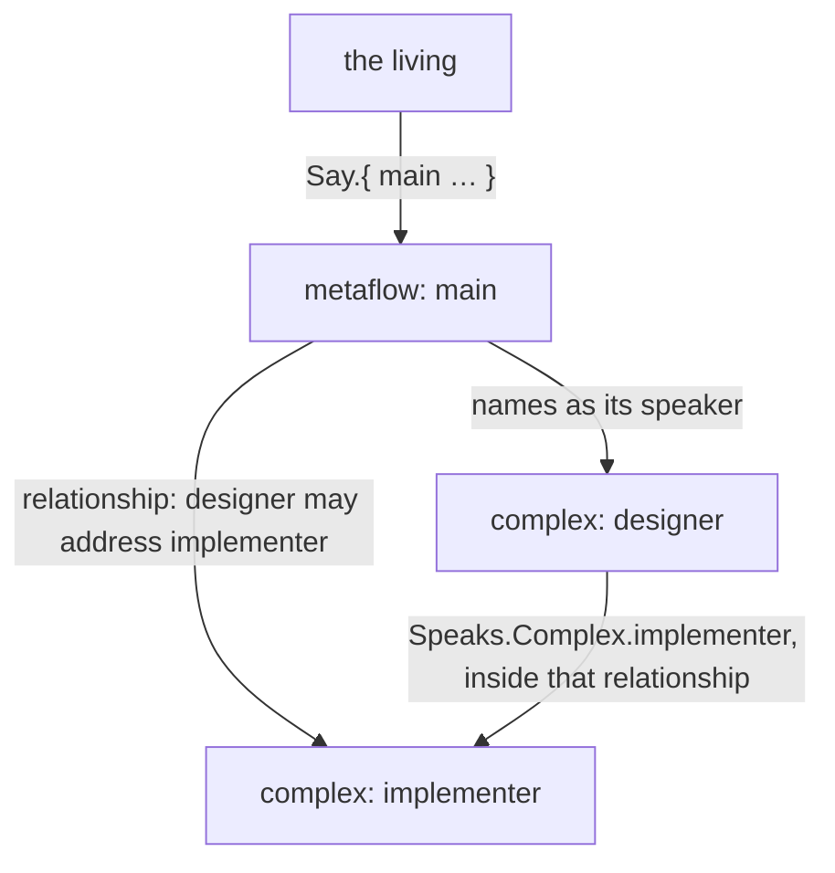
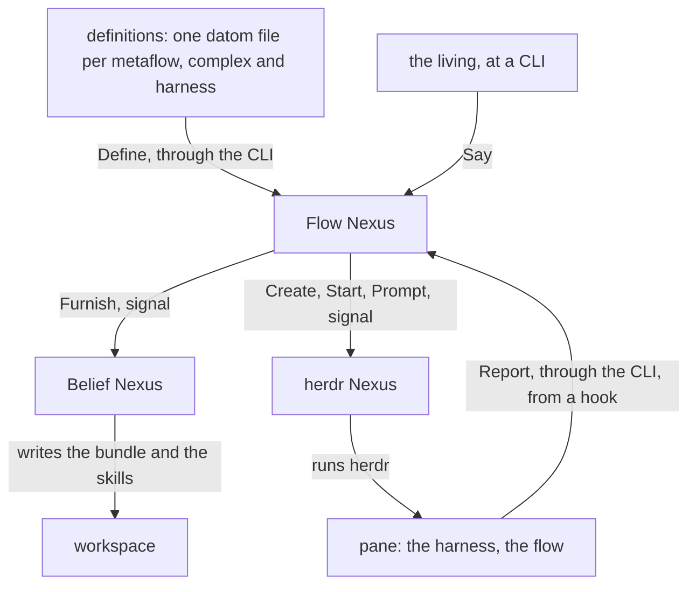

# The metaflow

Version 1. A metaflow is a named set of complexes and the relationships between them: the layer above the complex, and the being one talks to, what people today call an agent. It is a definition, as a complex is: it names its complexes, the relationships between them and its speaker, and it has no directory, process or socket of its own. A Flow Nexus runs many metaflows. Three Nexuses run them, from the definitions given them, and the flows run from those.

His words: "the metaflow is all of the flows and all of the flow complexes of a particular unit. It's like a unit that living human beings can think of. It's kind of like the equivalent of what people think of today when they think of an agent: a thing they can talk to. [...] It's going to be interacting with that whole complex of complexes, which is the metaflow. [...] You can have multiple metaflows on a single host and they're all running on the same Flow Nexus." and "it is going to have to define the relationships between the complexes also."

## The layers

Each layer is defined in terms of the one below it. A flow is one run of a model in a harness. A permanent flow continues through a succession of runs, one entity under one address. A complex is several flows defined together: each flow's model, harness, workspace, beliefs and tools, and which flow speaks to which. A metaflow is several complexes defined together, with the relationships between them and a speaker.



## One self

The complexes of a metaflow are one self because they speak to one another: the metaflow defines the relationships between its complexes, each one that this complex may address that one, and a member's route to another complex holds only inside them; a message to a complex reaches its speaker. The living talks to the metaflow: Say addresses it by name and reaches its speaker, the complex that receives what comes to the metaflow. What one complex says, does or leaves undone, the whole answers for.

A flow knows its metaflow by name: the name is set at launch, in the Identity composed into its first prompt or its system prompt beside its Address and FlowId, so a flow names the being it is part of.

```datom
; the Identity composed into a flow's prompt: metaflow, address, flow id
{ main { designer fable } 7 }
```



## One owner

A metaflow runs for one owner: the login whose Nexuses run it. The definitions are his sources; the flows run with his credentials and files; it is not a sandbox.

## Where a metaflow lives

A metaflow is a definition the Flow Nexus holds in its Memory, given by Define and read back by Describe, the names by Definitions, as a complex and a harness are; it names its complexes by name, and a Flow Nexus holds many. A change to one definition touches no other.

```ethos
Library
[ flow:[ ComplexName ] ]
[ MetaflowName.String                ; the being's name: main
  Relationship.{ From.ComplexName    ; this complex
                 To.ComplexName }    ;   may address that one
  Metaflow.{ MetaflowName
             Complexes.Vector<ComplexName>      ; its complexes, by name
             Relationships.Vector<Relationship> ; the relationships between them
             Speaker.ComplexName } ] ; receives what comes to the metaflow; tentative
[]
[]
```

```ethos
Memory
[ flow:[ Complex Harness Metaflow ] ]
[ Definition.[ Complex Harness Metaflow ] ] ; each held alone; a Metaflow names its complexes, a Member its harness
```

```datom
; definitions/main.datom: one metaflow
{ main
  [ designer implementer ]
  [ { designer implementer } ]
  designer }                         ; the speaker
Say.{ main Order.«Read the book» }   ; the living, to its speaker
```



## The Nexuses that run it

The Flow Nexus, the Belief Nexus and the herdr Nexus run a metaflow. Each is started in its place, a Nexus startup fact of vision:nexus-v1: the three that run one metaflow share one place name, and a CLI reaches them by it. Two place names are two sets of Nexuses, so the stable set keeps running while the next is tried; the metaflows are whatever the Flow Nexus at that place holds.

```sh
# the CLI: the place's name, then one datom
flow-nexus main 'Launch.{ designer fable «Read the book» }'
herdr-nexus main 'Prompt.{ { main wQ:pT } «hello» }'
```

## The Nexuses are built and started by Nix

The repository metaflow holds the Nix that builds the three Nexuses, their translators and CLIs, and a shell that starts each of them with its place under the owner's login.

```sh
nix develop github:LiGoldragon/metaflow -- metaflow start next
```

## Everything in a metaflow is a definition

The Nexuses hold vocabulary; the owner writes definitions in datom. A definition is one file, one datom; the definition files are the owner's sources, kept wherever he keeps them and given by Define and replaced the same way; the running set is the Flow Nexus's Memory in its State directory. A change to one definition touches no other. The Rust knows no role, model name or topic.

A new place is told its metaflows by replaying the definition files, one Define per file, harnesses before the complexes that name them and complexes before the metaflows that name them; nothing is migrated from the place before it, and the set of files is the whole of what a place needs to know.

```sh
# the owner's definitions, replayed into a fresh place
for f in definitions/*.datom; do flow-nexus next "Define.$(cat "$f")"; done
```

```datom
; definitions/designer.datom: one complex
{ designer
  [ { fable claude claude-fable-5-1 Medium
      Permanent
      Path.«/home/li/primary»
      { [ { Spirit core } { Vision nexus-v1 } ] Refuse }
      { [ Bash Edit ] [ Artifact ] }
      [ ClaudeMd ]
      [ Speaks.opus Speaks.Living ] }
    { opus claude claude-opus-4 Medium Ephemeral
      Temporary
      { [ { Spirit core } { Role worker } ] Notice }
      { [] [] }
      []
      [ Speaks.fable Speaks.Complex.implementer ] } ]
  fable }                            ; the speaker
```
