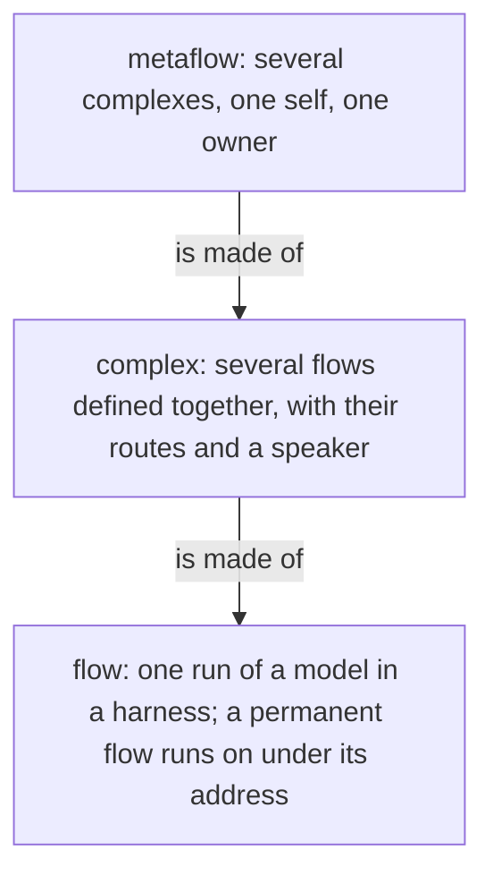
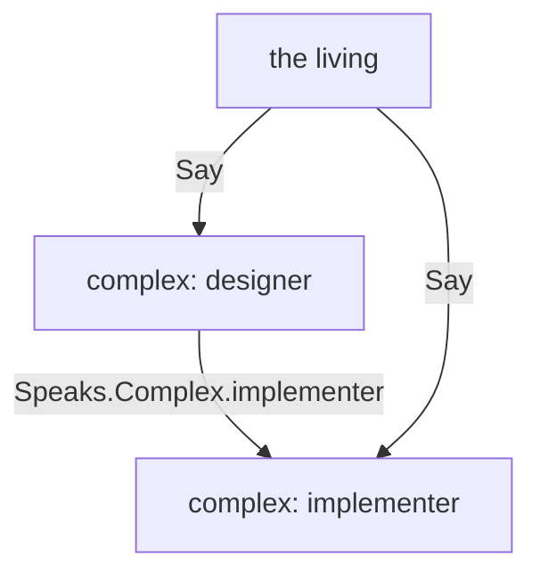
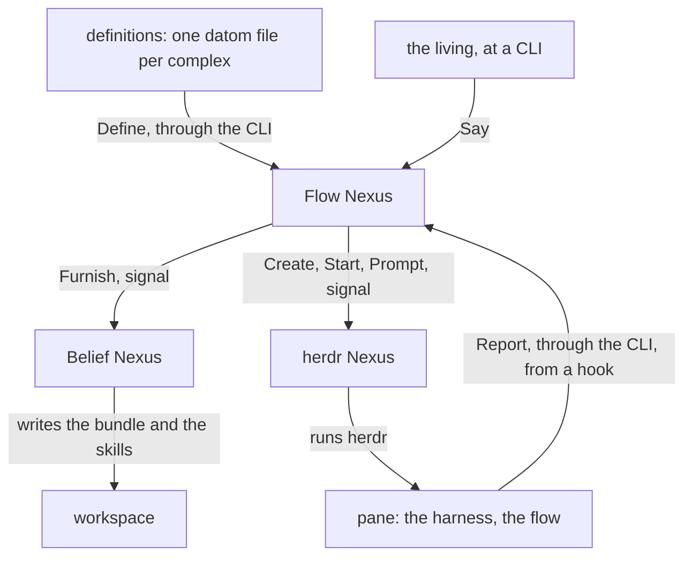

# The metaflow

Version 1. A metaflow is several complexes defined together, running as one self for one owner: the layer above the complex. It is a definition, as a complex is: it is made of nothing but complexes, and it has no directory, process or socket of its own. Three Nexuses run it, from the definitions given them, and the flows run from those.

## The layers

Each layer is defined in terms of the one below it. A flow is one run of a model in a harness. A permanent flow continues through a succession of runs, one entity under one address. A complex is several flows defined together: each flow's model, harness, workspace, beliefs and tools, and which flow speaks to which. A metaflow is several complexes defined together.



## One self

The complexes of a metaflow are one self because they speak to one another: a route may name another complex, and a message to a complex reaches its speaker. The living speaks to any complex with Say. What one complex says, does or leaves undone, the whole answers for.



## One owner

A metaflow runs for one owner: the login whose Nexuses run it. The definitions are his sources; the flows run with his credentials and files; it is not a sandbox.

## Where a metaflow lives

A metaflow has no file and no type of its own: it is the set of complexes the Flow Nexus holds in its Memory, each given by Define and read back by Describe, the set by Definitions; a harness is defined the same way, and a member names it. A change to one complex touches no other.

```ethos
Memory
[ flow:[ Complex ] ]
[ Definition.[ Complex Harness ] ]   ; the metaflow is every Complex held; a Harness is a definition its members name
```



## The Nexuses that run it

The Flow Nexus, the Belief Nexus and the herdr Nexus run a metaflow. Each is started in its place, a Nexus startup fact of vision:nexus-v1: the three that run one metaflow share one place name, and a CLI reaches them by it. Two place names are two sets of Nexuses, so the stable set keeps running while the next is tried; the metaflow is whatever complexes the Flow Nexus at that place holds.

```sh
# the CLI: the place's name, then one datom
flow-nexus main 'Launch.{ designer fable «Read the book» }'
herdr-nexus main 'Prompt.{ { main wQ:pT } «hello» }'
```

## The Nexuses are built and started by Nix

The repository metaflow holds the Nix that builds the three Nexuses, their translators and CLIs, and a shell that starts each of them with its place under the owner's login.

```sh
nix develop github:LiGoldragon/metaflow -- metaflow start next
```

## Everything in a metaflow is a definition

The Nexuses hold vocabulary; the owner writes definitions in datom. A definition is one file, one datom; the definition files are the owner's sources, kept wherever he keeps them and given by Define and replaced the same way; the running set is the Flow Nexus's Memory in its State directory. A change to one definition touches no other. The Rust knows no role, model name or topic.

A new place is told its metaflow by replaying the definition files, one Define per file, harnesses before the complexes that name them; nothing is migrated from the place before it, and the set of files is the whole of what a place needs to know.

```sh
# the owner's definitions, replayed into a fresh place
for f in definitions/*.datom; do flow-nexus next "Define.$(cat "$f")"; done
```

```datom
; definitions/designer.datom: one complex
{ designer
  [ { fable claude claude-fable-5-1 Medium
      Permanent
      Path.«/home/li/primary»
      { [ { Spirit core } { Vision nexus-v1 } ] Refuse }
      { [ Bash Edit ] [ Artifact ] }
      [ ClaudeMd ]
      [ Speaks.opus Speaks.Living ] }
    { opus claude claude-opus-4 Medium Ephemeral
      Temporary
      { [ { Spirit core } { Role worker } ] Notice }
      { [] [] }
      []
      [ Speaks.fable Speaks.Complex.implementer ] } ]
  fable }                            ; the speaker
```
