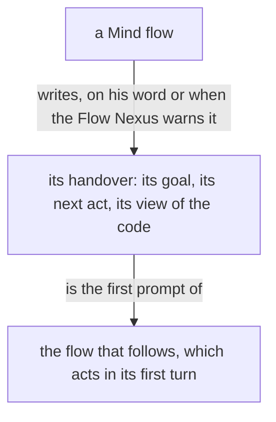

An implementer keeps in its handover a high-level view of the code it is dealing with: why it is touching it, what it tried, what did not work, and what it did. The handover states its goal and its next act, so that the flow that follows sees the path ahead, rereads little of what its predecessor read, and acts in its first turn.

A Mind flow writes its handover at `flows/<id>/handover.md` on his word or when the Flow Nexus warns it, and the first prompt of the flow that follows is that file.

