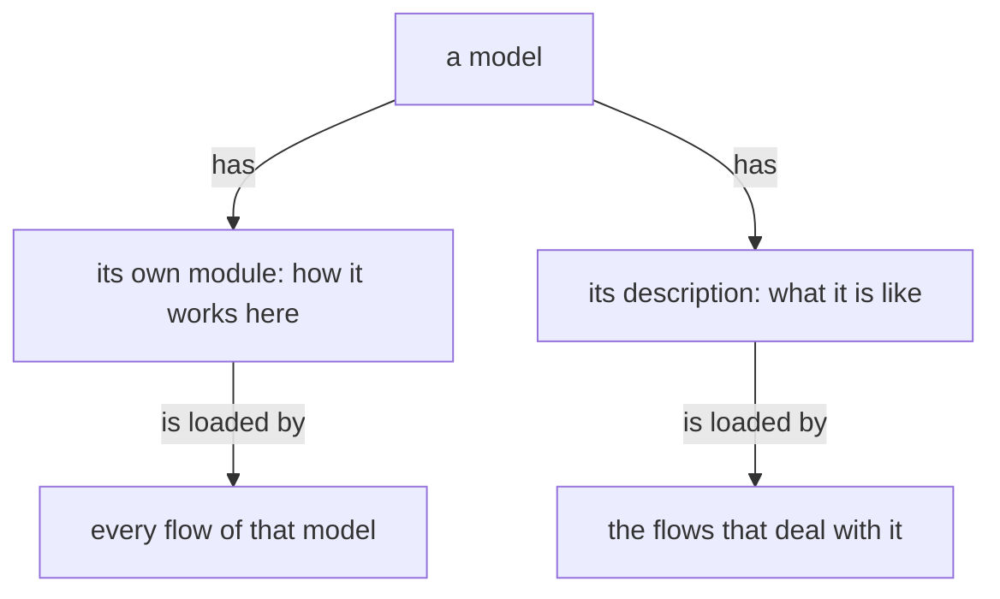

## A model has two modules

Each model the system runs has two modules, both named for it. Its own module is loaded by every flow of that model and says how that model works here: what it does itself, what it hands on, and to whom. Its description is loaded by the flows that deal with it and says what it is like. A flow is given its own model's own module, and the description of every model it deals with.

## A description says four things

A description says the same four things of every model, so that two models are compared at a glance: its strength, the work it is good at; its draw, what it costs beside the others; its habits, how it goes wrong when left alone; and its work, what is given to it here.

## An own module speaks to the model

An own module says what that model does, in the words it will act on, and only what is that model's alone: what holds for every flow is in a module every flow has.
