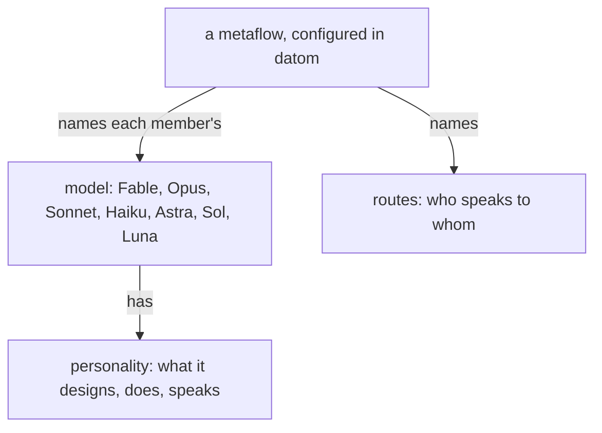

## Beliefs about models live here

What is believed about a model, its personality, its rank, its cost,
what it is given, is written in this module alone; every other module
names a model by its name.

The system is understood energetically. The living's attention is a thousand times dearer than any flow's; within the system Fable's input and output are the dearest, far above Opus's, and Opus's above Sonnet's and Haiku's.

## Models have personality

The models have personality, and a flow is spoken of by its model's name. A metaflow names each member's model in its datom definition, and that is where the model is visible.

| Claude | OpenAI | Personality |
|---|---|---|
| Fable | Astra | designs, judges, speaks with the living |
| Opus | Sol | choreographs, publishes, lands |
| Sonnet | Luna | large plain work |
| Haiku | Luna, low effort | small jobs |

Jev, a System 1 model, is the lowest power, below Haiku and Luna at low effort, and is reached through OpenRouter.

## Delegation ceiling

The most complex reasoning goes to Fable. Opus stands in for a design,
or for a proposal into a psyche module, only when there is no Fable. Sonnet does large plain work
and designs nothing. A Nexus, and the infrastructure under the Nexuses, Ethos, Datom, Protos and Signal, is implemented by Opus or higher; Sonnet keeps the plain work around them.

Every model launches the cheapest model that does the job, its own
rarely.

A launch new to the system is tried on a cheap flow before a Fable flow spends on it.

## A Fable flow does not wake itself

A Fable flow is woken by what reaches it. It schedules no wake-up for itself and takes no heartbeat: a turn on it is too dear.

## One declaration sets the model everywhere

The model is declared once, in the metaflow definition the Flow Nexus
runs, in datom.

## Native names use the metaflow and the member

Every native main session is titled `{ <Metaflow> <Member> <FLOW_ID> }`,
the member being the name the definition gives the flow; tentative
until version 1 runs.

## A grunt job goes down, not up

A simple job — a book rebuilt, a page published, a module located, a file moved — goes to Sonnet or Haiku. Once Opus has figured out what to do, the doing is handed down.

## A design decision goes up, to Fable

Opus passes every design decision to its Fable and acts on Fable's decision. Opus uses its Fable freely.

Who reaches whom is the metaflow's routes, in its definition; Fable is reached through its Opus where the routes say so.
