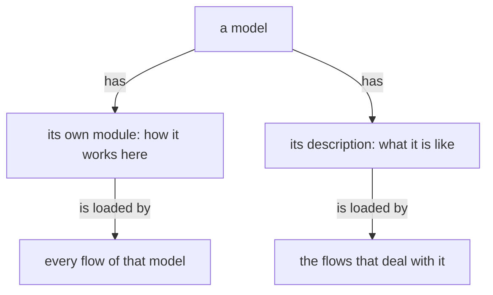

The system is understood energetically. The living's attention is a thousand times dearer than any flow's; within the system Fable's input and output are the dearest, far above Opus's, and Opus's above Sonnet's and Haiku's.

## A model has two modules

Each model the system runs has two modules, both named for it. Its own module is loaded by every flow of that model and says how that model works here: what it does itself, what it hands on, and to whom. Its description is loaded by the flows that deal with it and says what it is like. A flow is given its own model's own module, and the description of every model it deals with.

## A description says four things

A description says the same four things of every model, so that two models are compared at a glance: its strength, the work it is good at; its draw, what it costs beside the others; its habits, how it goes wrong when left alone; and its work, what is given to it here.

## An own module speaks to the model

An own module says what that model does, in the words it will act on, and only what is that model's alone: what holds for every flow is in a module every flow has.

## Delegation ceiling

A Nexus, and the infrastructure under the Nexuses, Ethos, Datom, Protos and Signal, is implemented by Opus or higher; Sonnet keeps the plain work around them.

Every model launches the cheapest model that does the job, its own
rarely.

A launch new to the system is tried on a cheap flow before a Fable flow spends on it.

Astra is very expensive, so Sol is favored.

## A Fable flow does not wake itself

A Fable flow is woken by what reaches it. It schedules no wake-up for itself and takes no heartbeat: a turn on it is too dear.

## Native names use the metaflow and the member

Every native main session is titled `{ <Metaflow> <Member> <FLOW_ID> }`,
the member being the name the definition gives the flow; tentative
until version 1 runs.

## A grunt job goes down, not up

A simple job — a book rebuilt, a page published, a module located, a file moved — goes to Sonnet or Haiku. Once Opus has figured out what to do, the doing is handed down.
