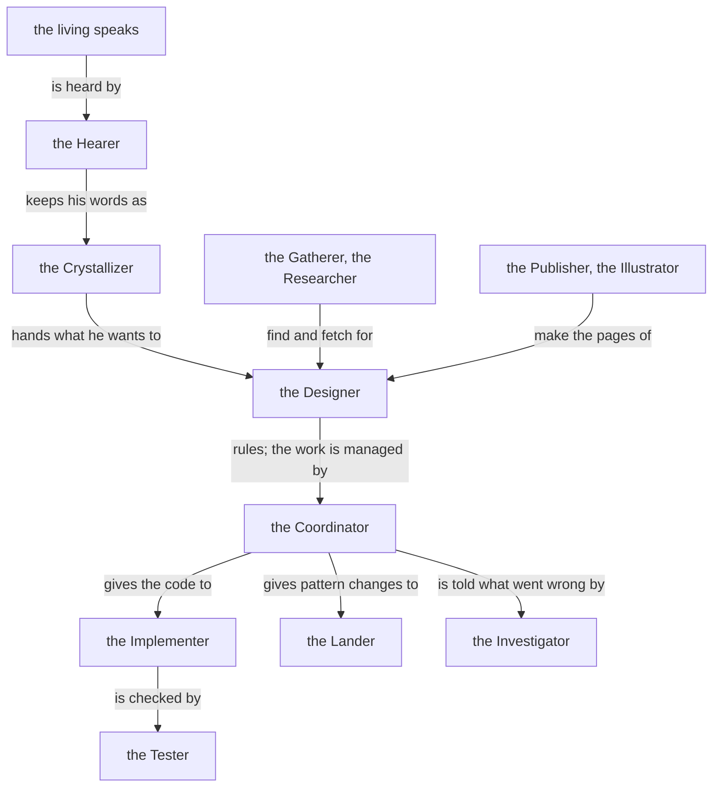
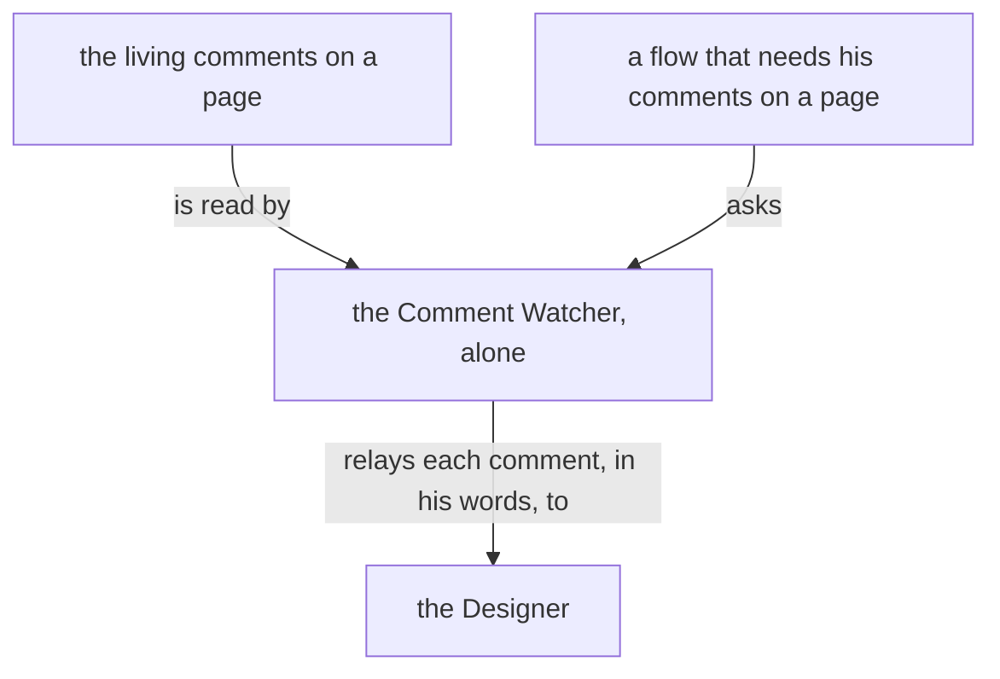

A role is one kind of work. A model holds several roles, one, or none; every other module names the role, and this module alone says which model holds it.

```ethos sketch
Types
[ Role.[ Hearer Crystallizer Designer Coordinator Lander Investigator
         Implementer Tester Researcher Gatherer Publisher Illustrator
         CommentWatcher ]
  ModelRoles.{ Model Vector<Role> } ]
```

```datom
[ { Fable [ Hearer Crystallizer Designer ] }
  { Opus [ Coordinator Lander Investigator ] }
  { Sol [ Implementer ] }
  { Sonnet [ Tester Researcher Gatherer ] }
  { Haiku [ Publisher Illustrator CommentWatcher ] }
  { Astra [] }
  { Luna [] }
  { Terra [] } ]
```

Astra holds no role and runs on the living's word alone.

## The Comment Watcher

One flow reads his comments on a page: the Comment Watcher, the Psyche core flow of the model that holds the role. It relays each comment to the Designer, in his words, and a flow that needs his comments on a page asks it.



## Native names use the metaflow and the member

Every native main session is titled `{ <Metaflow> <Member> <FLOW_ID> }`,
the member being the name the definition gives the flow; tentative
until version 1 runs.
